# Use API call responses in custom actions {#custom-action-enhancements}

>[!BEGINSHADEBOX]

**On this page:** Capture the JSON response returned by a custom action and use its fields to guide journey decisions, personalize messages, and handle errors.

>[!ENDSHADEBOX]

<!--
You can now leverage API call responses in custom actions and orchestrate your journeys based on these responses.

This capability was previously only available when using data sources. You can now use it with custom actions. 
-->

## Response payload requirements{#custom-action-enhancements-notes}

<!--
* Custom actions should only be used with private or internal endpoints, and used with an appropriate capping or throttling limit. See [this page](../configuration/external-systems.md). 
-->

* The complete response must be a JSON object. A bare array as the response is not supported.

* Arrays can be included inside an object. Scalar arrays are supported; heterogeneous arrays are not.

Supported:

```json
{
  "body": ["val1", "val2"],
  "points": 1290
}
```

Not supported (bare array):

```json
["val1", "val2"]
```

Not supported (heterogeneous array):

```json
{
  "values": [20, "aafw", false]
}
```

<!--
## Best practices{#custom-action-enhancements-best-practices}

A capping limit of 5000 calls/s is defined for all custom actions. This limit has been set based on customers usage, to protect external endpoints targeted by custom actions. You need to take this into account in your audience-based journeys by defining an appropriate reading rate (5000 profiles/s when custom actions are used). If needed, you can override this setting by defining a greater capping or throttling limit through our Capping/Throttling APIs. See [this page](../configuration/external-systems.md).

You should not target public endpoints with custom actions for various reasons:

* Without proper capping or throttling, there is a risk of sending too many calls to a public endpoint that may not support such volume.
* Profile data can be sent through custom actions, so targeting a public endpoint could lead to inadvertently sharing personal information externally.
* You have no control on the data being returned by public endpoints. If an endpoint changes its API or starts sending incorrect information, those will be made available in communications sent, with potential negative impacts.
-->

<!--
## Define the custom action {#define-custom-action}

When defining the custom action, two enhancements have been made available: the addition of the GET method and the new payload response field. The other options and parameters are unchanged. See [this page](../action/about-custom-action-configuration.md).

### Endpoint configuration {#endpoint-configuration}

The **URL configuration** section has been renamed **Endpoint configuration**.

In the **Method** drop-down, you can now select **GET**.

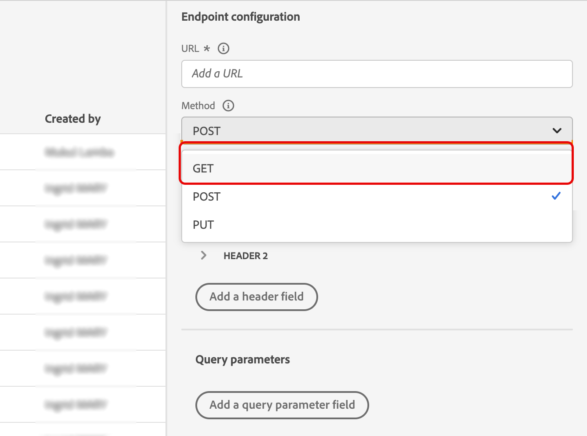{width="70%"}

### Payloads {#payloads-new}

The **Action parameters** section has been renamed **Payloads**. Two fields are available:

* The **Request** field: this field is only available for POST and PUT calling methods.
* The **Response** field: this is the new capability. This field as available for all calling methods.

>[!NOTE]
> 
>Both these fields are optional.

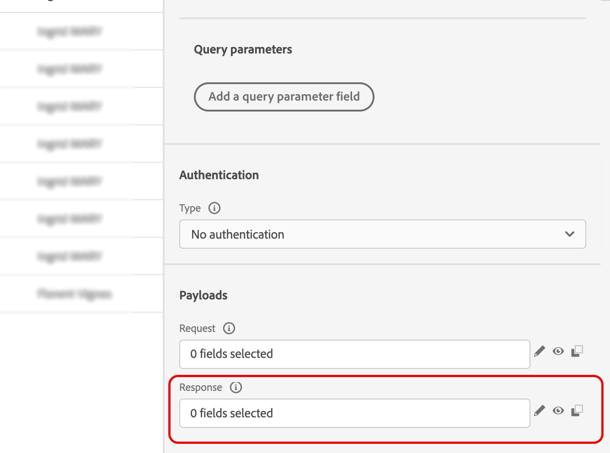{width="70%"}
-->

## Configure the custom action {#config-response}

To capture the response of a custom action, define a sample of the payload your endpoint returns.

1. Create or open a custom action. See [Configure a custom action](../action/about-custom-action-configuration.md).

1. Click inside the **Response** (success response) field. 

    {width="80%"}

1. Paste an example of the successful response your endpoint returns. Verify that the sample's field types match the actual response. In this example, the local endpoint sends the number of loyalty points and the status of a profile.

    ```json
    {
      "customerID": "xY12hye",
      "status": "gold",
      "points": 1290
    }
    ```

    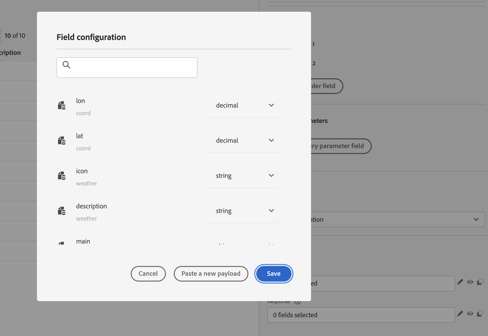{width="80%"}

    The sample defines the fields that Journey Optimizer retrieves each time the action is called.

1. (Optional) To capture a failure payload, select **Define a failure response payload** and provide an example that matches the payload your endpoint returns when the call fails. For example:

    ```json
    {
      "message": "customer not found"
    }
    ```

    When configured, the failure payload fields are available under the `errorResponse` node. The shape of the sample should match the real failure response.

1. Add any required request parameters. In this example, `customerID` is a query parameter.

    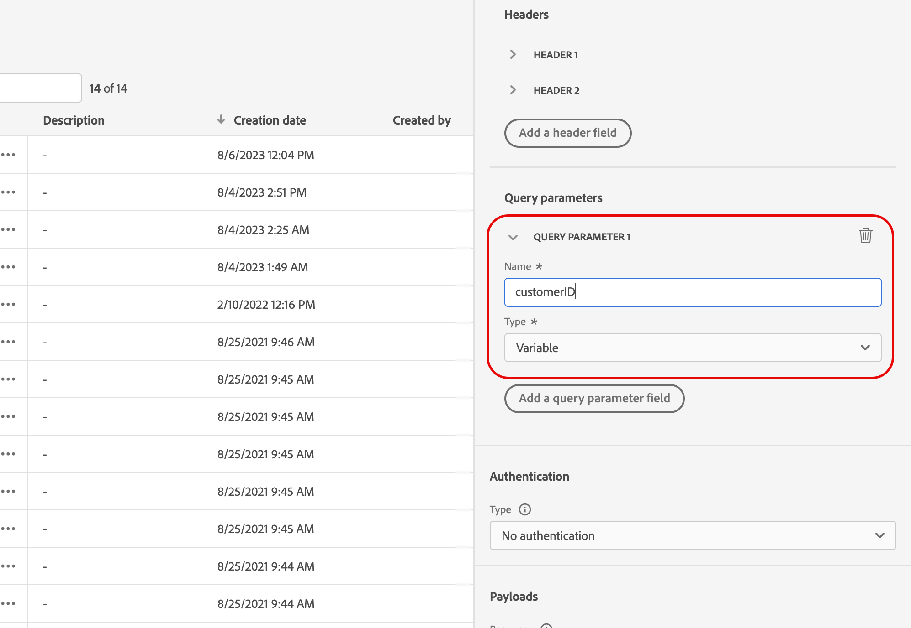{width="80%"}

1. Click **Save**.

## Use the response in a journey {#response-in-journey}

Add the custom action to a journey. You can then use the response fields in conditions, subsequent actions, and message personalization.

For example, you can add a condition to check the number of loyalty points. When the person enters the restaurant, your local endpoint sends a call with the profile's loyalty information. You can send a push if the profile is a gold customer. And if an error is detected in the call, send a custom action to notify your system administrator.

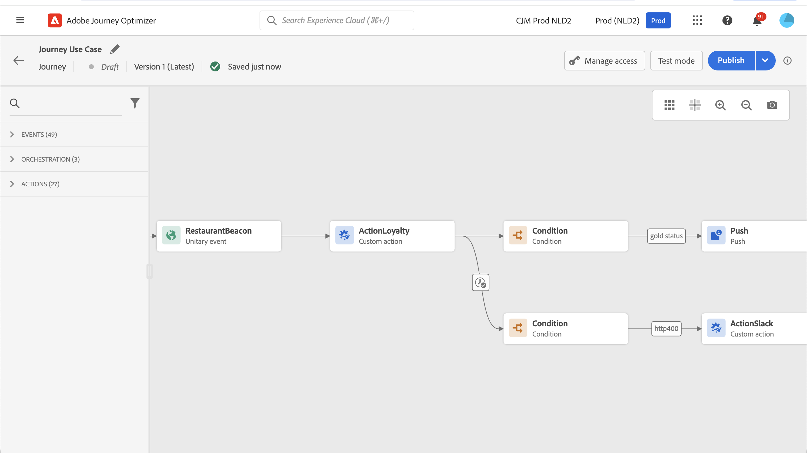

1. Add your event and the Loyalty custom action created earlier. 

1. In the Loyalty custom action, map the required input parameters, such as the customer ID query parameter with the profile ID. Select **Add an alternative path in case of a timeout or error** to handle those outcomes separately.

    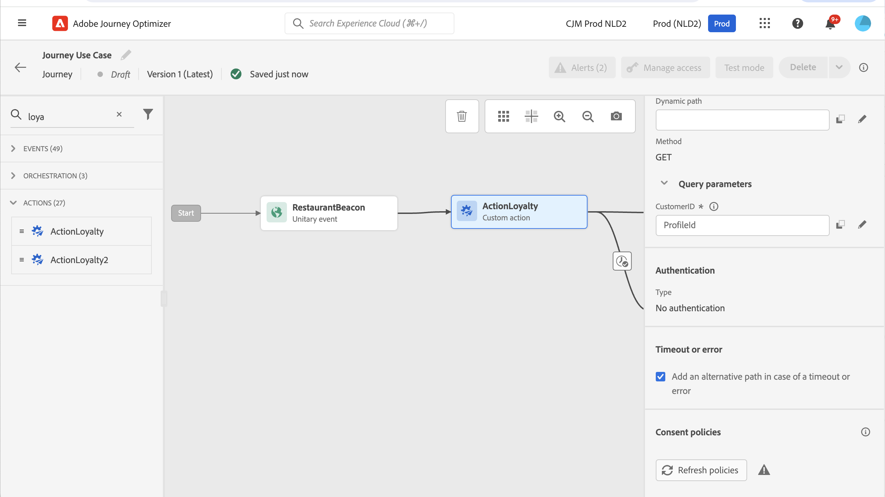

1. In the success path, add a condition and use the action response fields. In the advanced editor, the response fields are available under the **Context** node.

    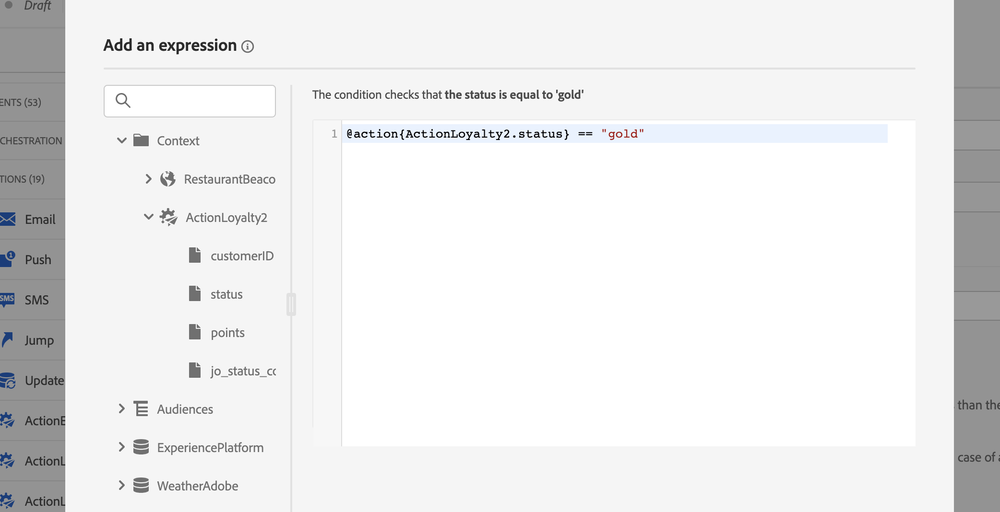

1. Add a push or another action, and personalize your message using the response fields. In this example, the content uses the number of loyalty points and the customer status. The response fields are available under **Contextual attributes** > **Journey Orchestration** > **Actions**.

    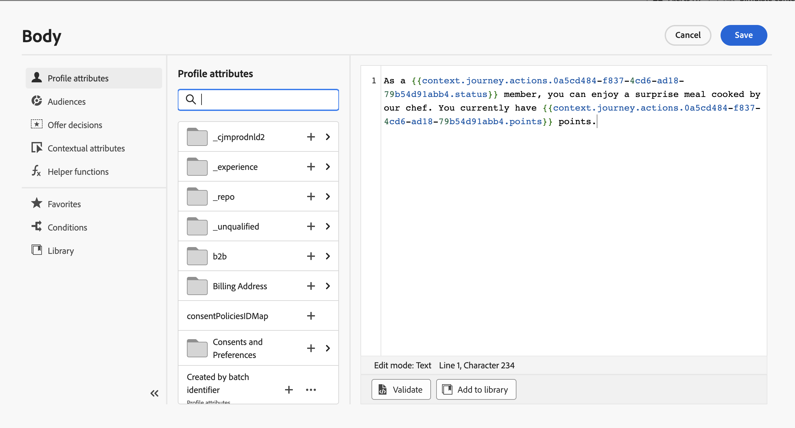

    >[!NOTE]
    >
    >Each profile entering the custom action triggers a call, even if the endpoint returns the same response for every profile.

1. In the timeout and error path, add a condition and use the built-in **jo_status_code** field to branch on the call outcome. In this example, the condition checks for the **http_400** error type. See [Error status](#error-status).

    ```
    @action{ActionLoyalty.jo_status_code} == "http_400"
    ```

    If you configured a failure payload, you can also branch on one of its fields. For the example above:

    ```
    @action{ActionLoyalty.errorResponse.message} == "customer not found"
    ```

    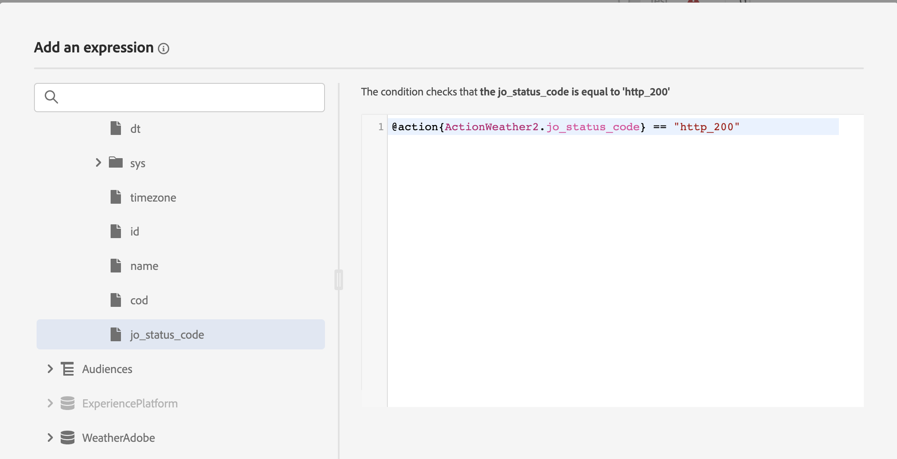

1. Add a custom action that notifies your organization.

    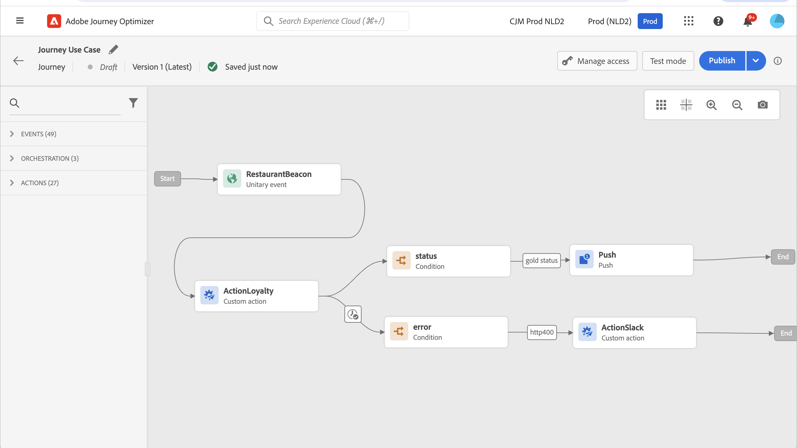

## Test mode logs {#test-mode-logs}

Use test mode to inspect the payload returned by the action in the **actionsHistory** section of the logs. For failed calls, the logs include the failure payload if one is configured. This is useful for debugging.

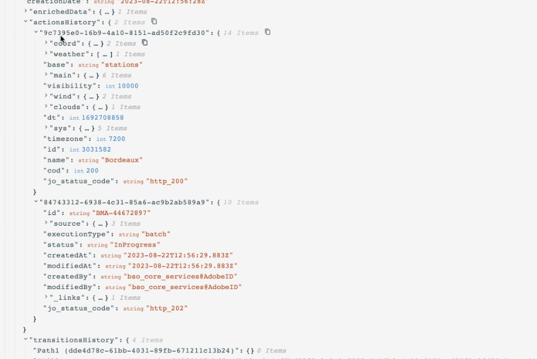

## Error status {#error-status}

The **jo_status_code** field is available even when no response payload is defined. Possible values include:

| Value | Meaning |
|---|---|
| `http_<code>` | HTTP status code returned by the API call, such as `http_200` or `http_400` |
| `timedout` | The call timed out |
| `capped` | The call was blocked by capping |
| `internalError` | An internal error occurred |

An action call is considered in error when the returned HTTP code is greater than 2xx or when another error occurs. In that case, the journey follows the configured timeout or error branch.

Only newly created custom actions include the **jo_status_code** field by default. To use it with an existing custom action, update and save the action. For example, you can update its description.

If no failure response payload is configured, the `errorResponse` node is not available.

## Expression syntax {#exp-syntax}

Reference a response field with:

```json
@action{<action name>.<field path>}
```

For example:

```json
@action{ActionLoyalty.status}
```

To provide a default value:

```json
@action{<action name>.<field path>, defaultValue: <expression>}
```

For example:

```json
@action{ActionLoyalty.points, defaultValue: 0}
@action{ActionLoyalty.points, defaultValue: @event{myEvent.newPoints}}
```

For collections, use `currentActionField` to refer to the current item:

```json
count(
  @action{MyAction.MyCollection.all(
    currentActionField.description == "abc"
  )}
)
```

See [Field references](../building-journeys/expression/field-references.md) and [Collection management functions](../building-journeys/expression/collection-management-functions.md).

### Personalize native-channel messages {#response-in-channels}

Use custom action response fields in supported native-channel personalization (email, push, mobile messages). For arrays and nested data, see [Iterate over contextual data with Handlebars](../personalization/iterate-contextual-data.md#custom-action-responses).

## Troubleshooting {#troubleshooting}

| Symptom | Check |
|---|---|
| Response fields are unavailable | Confirm that the **Response** sample is valid JSON and reflects the endpoint's response structure and field types. |
| The response cannot be used because it is an array | Return an object instead, placing the array inside a field. |
| Some array values are unavailable | Confirm that the array is not heterogeneous. |
| `jo_status_code` is missing on an existing action | Update and save the action. The field is included by default only on newly created actions. |
| `errorResponse` is unavailable | Configure and save a failure response payload. |
| The call follows the timeout or error branch | Inspect `jo_status_code` and, if configured, the failure payload in the test mode logs. |

## Additional resources

* [Configure a custom action](../action/about-custom-action-configuration.md)
* [Iterate over contextual data with Handlebars](../personalization/iterate-contextual-data.md#custom-action-responses)
* [Field references](../building-journeys/expression/field-references.md)
* [Collection management functions](../building-journeys/expression/collection-management-functions.md)

{{$include /help/_includes/do-not-localize/action/ai-augmented-action-response.md}}
