# Use custom metadata in campaigns and journeys {#custom-metadata}

>[!BEGINSHADEBOX]

**On this page:** Learn how to define custom metadata fields for your journeys, Action campaigns and Orchestrated campaigns, so you can track business information such as line of business, product or cost center, and use it for reporting and audience creation.

>[!ENDSHADEBOX]

>[!AVAILABILITY]
>
>This capability is available in Limited Availability. Contact your Adobe representative to gain access.

Custom metadata lets you create your own business fields and display them in the properties of your journeys, Action campaigns and Orchestrated campaigns. Use them to track information that goes beyond what [tags](../start/search-filter-categorize.md#tags) and descriptions can capture, such as line of business, promotional region, product line, cost center, or project ID.

The values you enter are recorded in the entity datasets. You can use them for downstream reporting, to export data, or to build audiences from the profiles who received a given journey or campaign.

## How custom metadata works {#how-it-works}

Custom metadata fields are defined in the [!DNL Adobe Experience Platform] [schemas](../data/get-started-schemas.md) based on the **AJO Entity Class**. Currently, [!DNL Journey Optimizer] automatically provisions a record-based schema for each of three entities — Action campaigns, journeys and Orchestrated campaigns:

* **AJO Campaign Custom Metadata Schema**
* **AJO Journey Custom Metadata Schema**
* **AJO Orchestrated Campaign Custom Metadata Schema**

## Define your custom metadata fields {#define-fields}

To define custom metadata fields, add them to a custom field group in the schema of the entity type (Action campaigns, journeys, or Orchestrated campaigns) where you want to use them.

You can use a different field group for each entity type, but reusing the same field group in the schemas of other entity types ensures that the same metadata fields are tracked across all your orchestration types.

>[!NOTE]
>
>You need the **[!DNL Manage schemas]** permission to edit the custom metadata schemas. [Learn more about permissions](ootb-permissions.md)

1. In [!DNL Adobe Experience Platform], browse to **[!UICONTROL Data Management]** > **[!UICONTROL Schemas]**. From the **[!UICONTROL Browse]** tab, open one of the custom metadata schemas, for example **AJO Campaign Custom Metadata Schema**.

    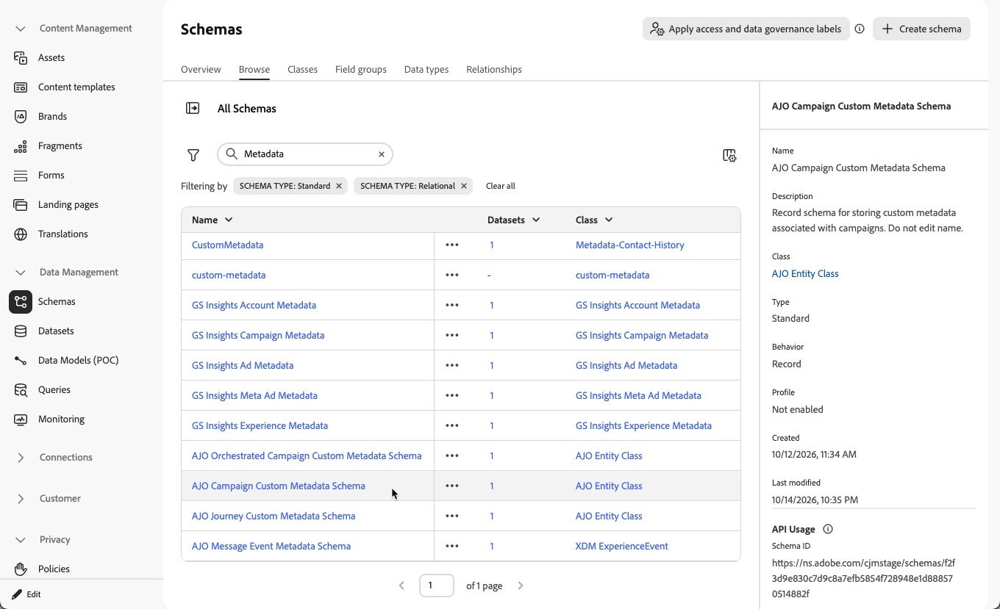

    >[!NOTE]
    >
    >Do not edit the name of these schemas.

1. In the schema's structure, from the **[!UICONTROL Field groups]** section, click **[!UICONTROL Add]**.

    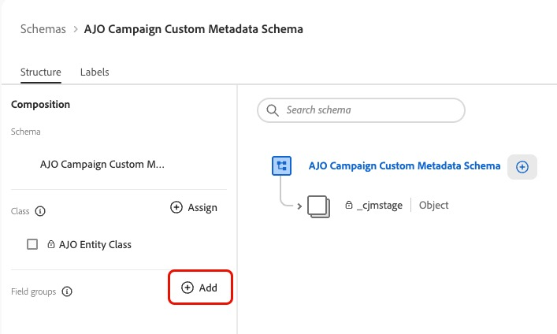{width="60%" zoomable="yes"}

    Select **[!UICONTROL Create new field group]**. Enter a display name, for example **AJO Custom Metadata**, and click **[!UICONTROL Add field group]**. [Learn how to add field groups and fields to a schema](https://experienceleague.adobe.com/en/docs/experience-platform/xdm/tutorials/create-schema-ui){target="_blank"}

    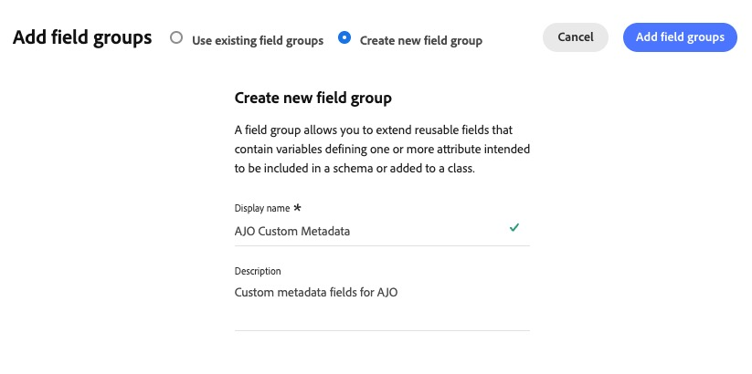{width="70%" zoomable="yes"}

1. Back in the schema's structure, select the field group you created in the **[!UICONTROL Field groups]** section. Then click the + icon next to the name of the schema to add a new field.

    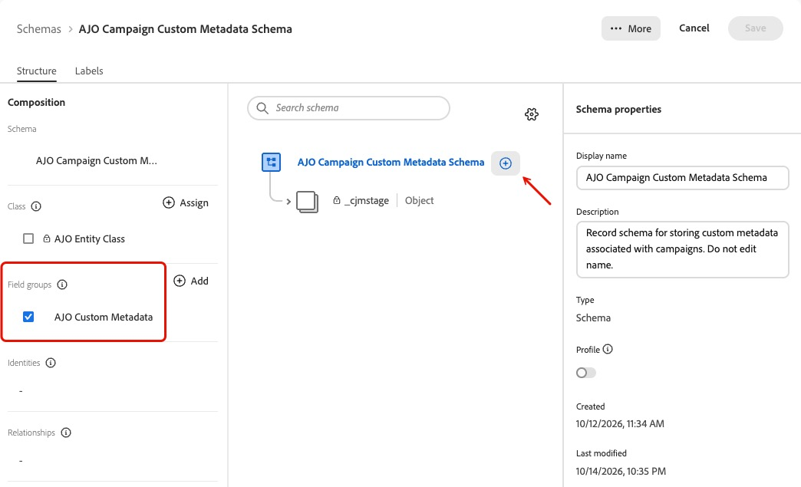{width="70%" zoomable="yes"}

    >[!NOTE]
    >
    >You can also select the field group at any time while defining the field from the **[!UICONTROL Field Group]** drop-down list.

    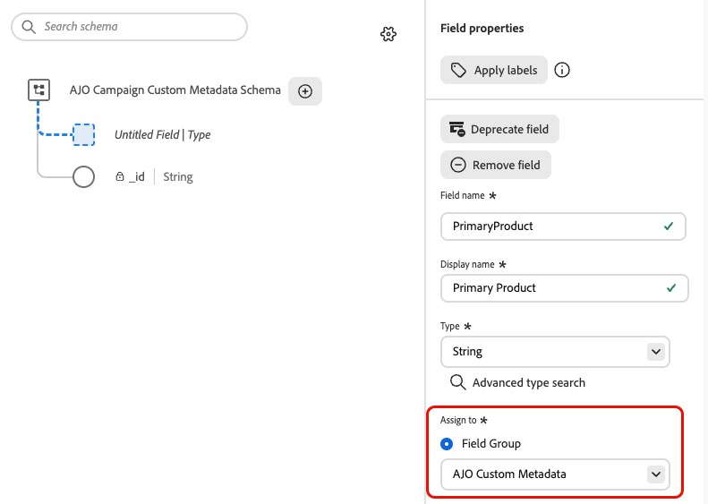{width="60%" zoomable="yes"}

1. For each field:

    * Define a name, a display name and, optionally, a description.
    * Set the field type to **[!UICONTROL String]**. Fields of any other type are not available for selection in the **[!UICONTROL Metadata]** configuration screen.
    * To provide a list of values, define the field as an enum and add each value with its display name.

    >[!IMPORTANT]
    >
    >Do not mark fields as required in the schema, as this can cause issues when data is inserted. Instead you can make fields required when you [select the fields to display](#select-fields) in the properties of your campaigns or journeys.

    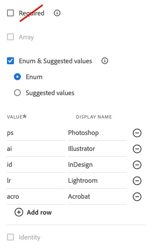{width="40%" zoomable="yes"}

1. Click **[!UICONTROL Apply]** to save the new field.

1. Repeat these steps to add more fields to your field group and click **[!UICONTROL Save]**.

1. To use the same fields for other entity types, add the same field group to their schemas.

    For example, if you have defined fields for campaigns using the **AJO Custom Metadata** field group in the **AJO Campaign Custom Metadata Schema**, you can reuse this field group in the **AJO Journey Custom Metadata Schema** and in the **AJO Orchestrated Campaign Custom Metadata Schema**.

    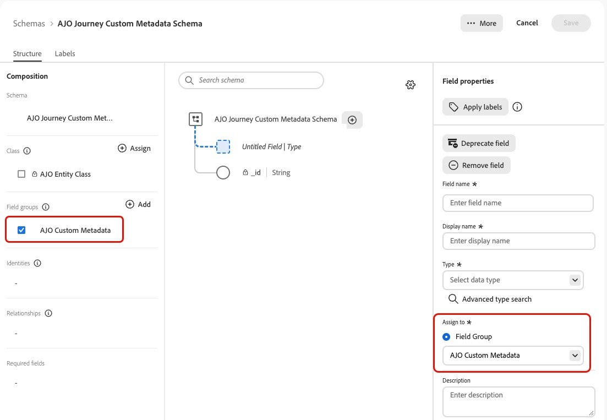{width="80%" zoomable="yes"}

    Select it in the **[!UICONTROL Field groups]** section or from the **[!UICONTROL Field Group]** drop-down list.

>[!NOTE]
>
>Field names must be unique in a sandbox. If a field with the same name already exists elsewhere in the sandbox, you might not be able to add it to your schema.

## Select the fields to display {#select-fields}

>[!CONTEXTUALHELP]
>id="ajo_custom_metadata_configuration"
>title="About custom metadata"
>abstract="Add up to 10 schema fields per entity type to capture custom metadata on your journeys, campaigns and Orchestrated campaigns."

Once your fields are defined in the schemas, use the **[!UICONTROL Metadata]** configuration screen to choose which fields appear in the properties of your journeys and campaigns, and in which order.

1. In the left navigation, browse to **[!UICONTROL Administration]** > **[!UICONTROL Configurations]**, then click **[!UICONTROL Manage]** in the **[!UICONTROL Metadata]** card.

    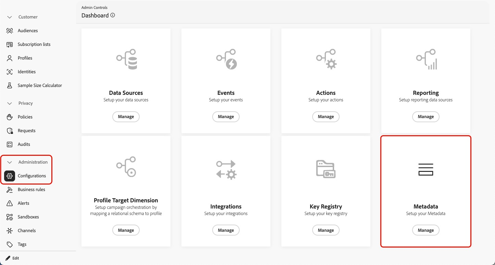

1. The **[!UICONTROL Metadata]** configuration screen contains one tab per entity type: **[!UICONTROL Journeys]**, **[!UICONTROL Campaigns]** and **[!UICONTROL Orchestrated Campaigns]**.

    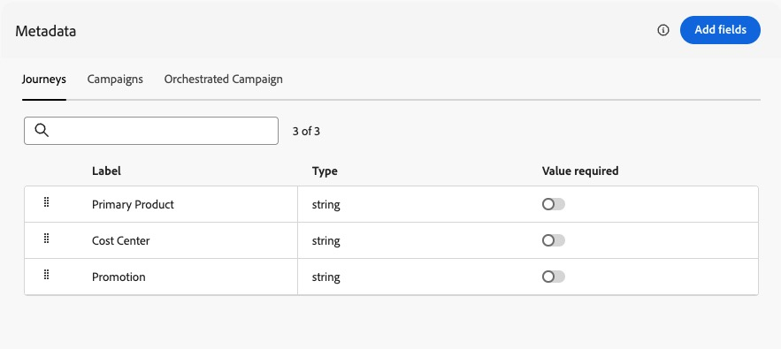{width="80%" zoomable="yes"}

1. For each tab, the list is synchronized with the corresponding schema. When you add or change fields or lists of values in the [custom metadata schema](#define-fields), the changes are reflected here.

    >[!NOTE]
    >
    >It can take a few minutes for schema changes to be displayed.

1. You can reorder the selected fields. The fields are displayed in this order in the properties of your journeys and campaigns, so place the most important ones first.

1. Optionally, you can mark fields as **required**. They are displayed with an asterisk in the campaign or journey properties. If a required field is not filled in, you cannot activate or publish the journey or campaign.

1. To add or remove fields, click the **[!UICONTROL Add fields]** button and check or uncheck the corresponding fields in the list to update the selection.

    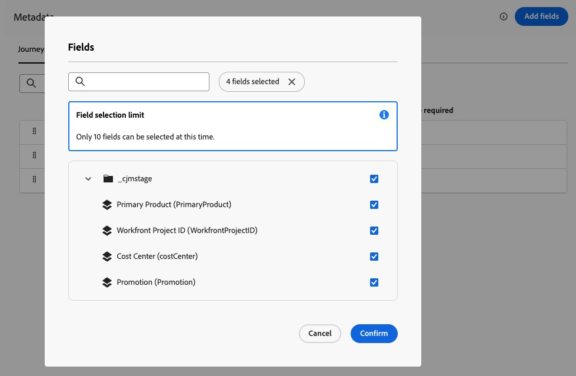{width="80%" zoomable="yes"}

    >[!CAUTION]
    >
    >You can select up to **10 fields** per entity type. If your schema contains more fields, select the 10 you want to display.

1. Confirm your selection.

The configuration is independent for each entity type: you can select different fields, in a different order, for journeys, Action campaigns and Orchestrated campaigns.

## Fill in metadata values {#fill-values}

Once you have [defined the fields](#define-fields) and [selected them in the Metadata configuration](#select-fields), they appear in the **[!UICONTROL Metadata fields]** section of the properties of each entity.

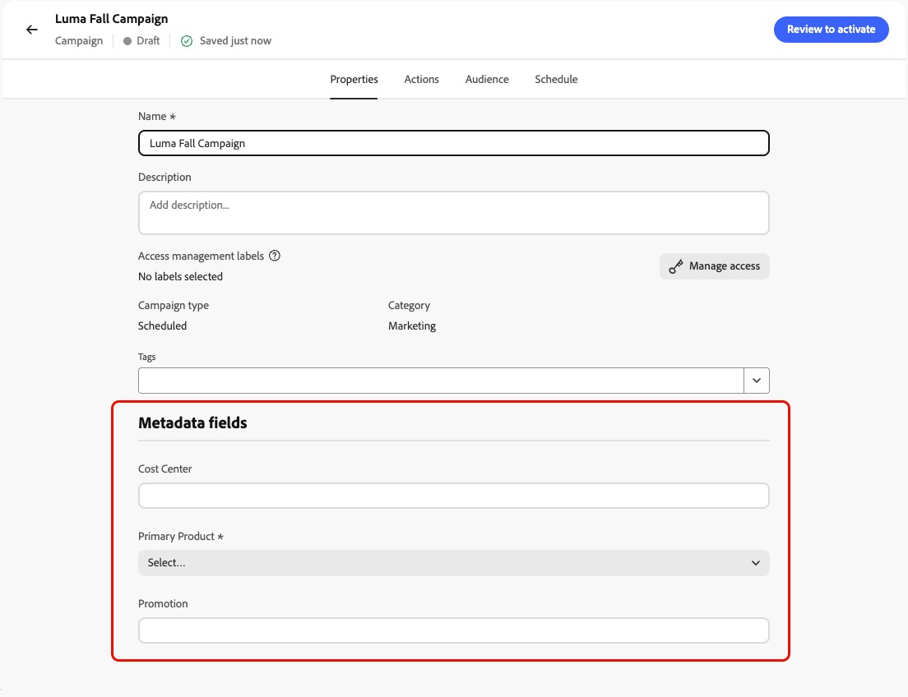{width="70%" zoomable="yes"}

Find where to fill in the fields for each entity type:

* [Action campaign properties](../campaigns/campaign-properties.md)
* [Journey properties](../building-journeys/journey-properties.md#custom-metadata)
* [Orchestrated campaign properties](../orchestrated/create-orchestrated-campaign.md#create)

The custom fields are displayed in the order you specified when [selecting the fields to display](#select-fields).

Enter or select a value for each field, then save your journey or campaign as usual.

>[!CAUTION]
>
>Fields marked with an asterisk are required. If a required field is not filled in, you cannot activate or publish the journey or campaign.

## Use custom metadata for reporting {#reporting}

When a journey, Action campaign or Orchestrated campaign is activated, its metadata values are sent to the corresponding dataset:

* **AJO Campaign Custom Metadata Dataset**
* **AJO Journey Custom Metadata Dataset**
* **AJO Orchestrated Campaign Custom Metadata Dataset**

Learn more about datasets in [this section](../data/get-started-datasets.md).

You can use these datasets to export the data for downstream reporting, or to build audiences based on the metadata of the journeys and campaigns that profiles received.

