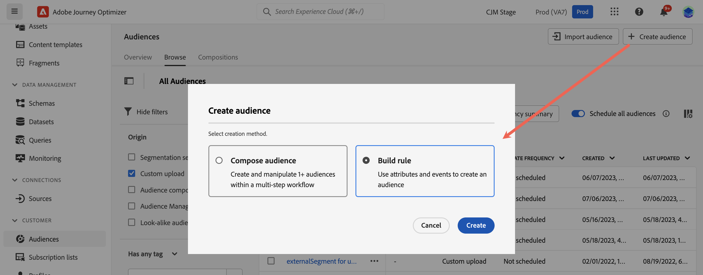
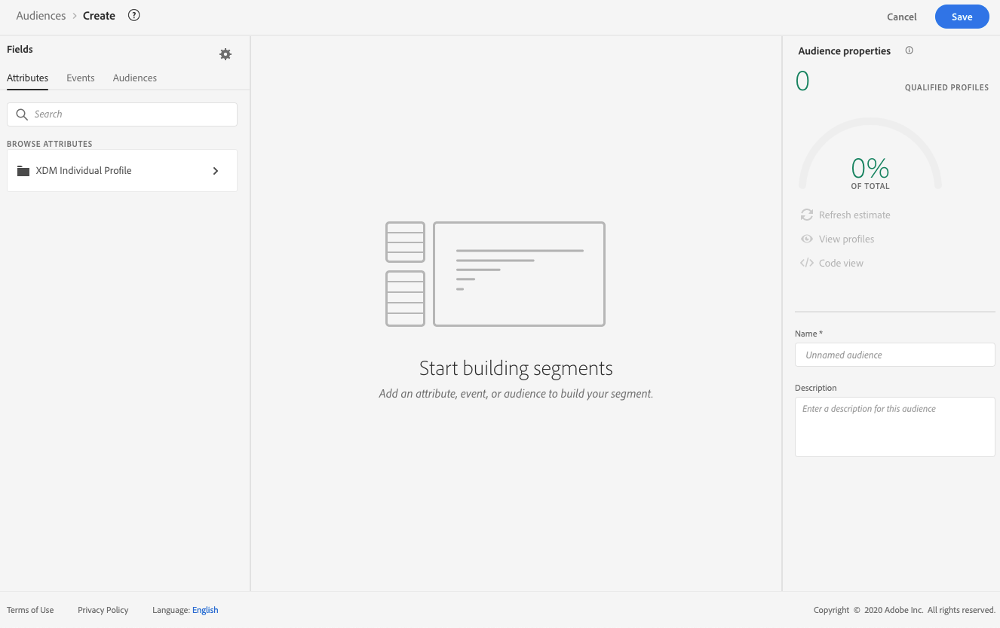
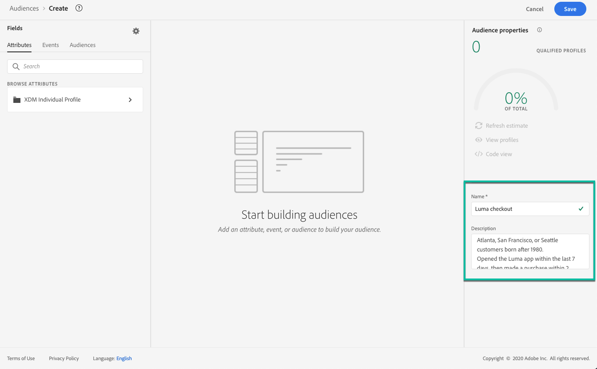
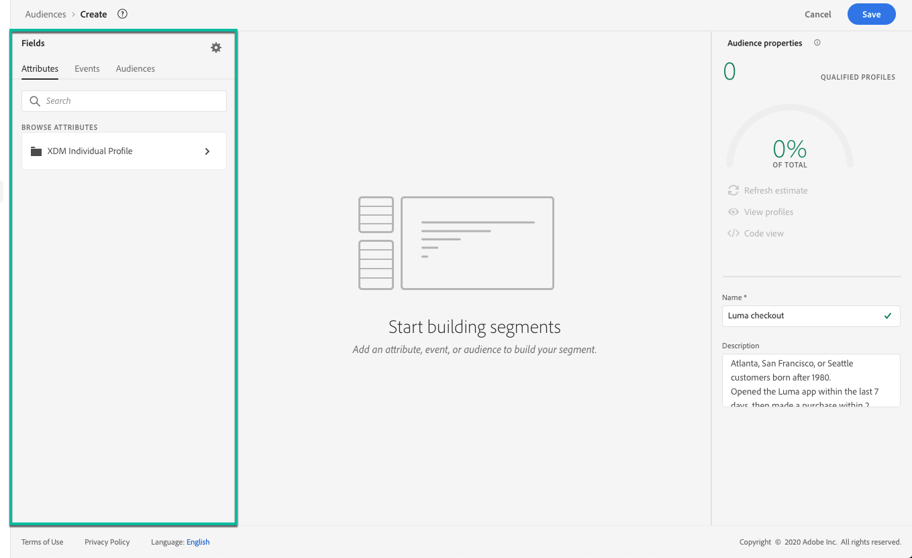
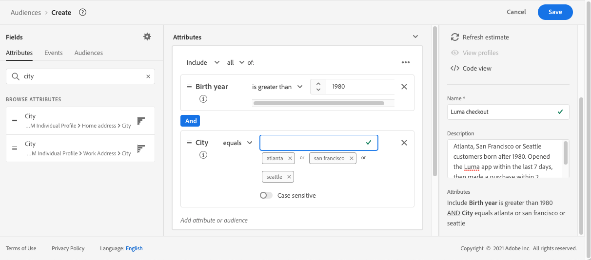
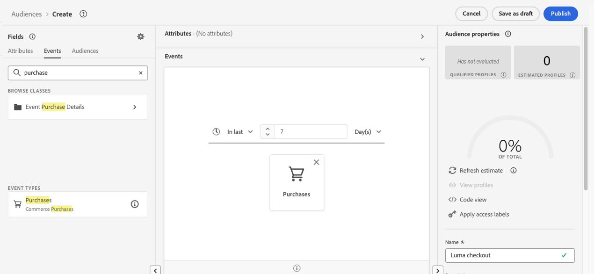
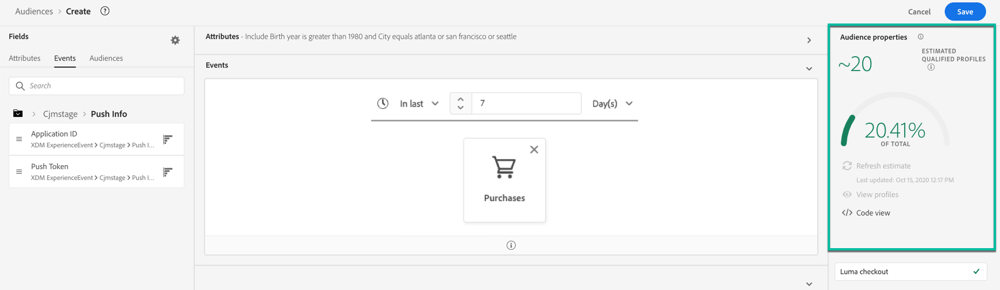
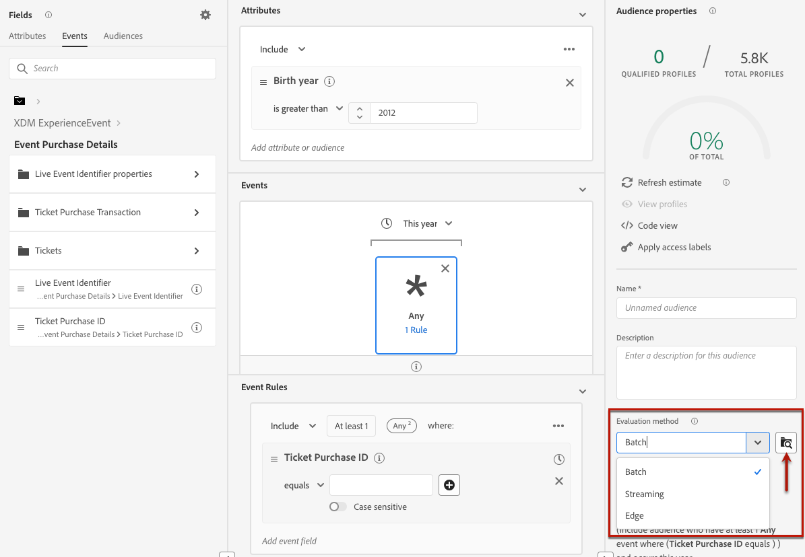
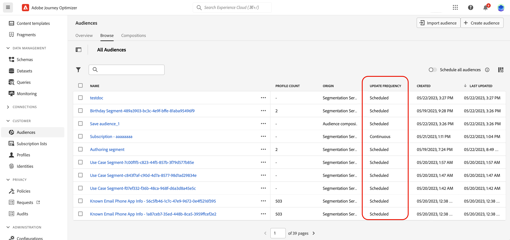

# Build segment definitions {#build-segments}

>[!BEGINSHADEBOX]

**On this page:** Learn how to build segment definitions from attributes and events to create audiences and choose the streaming, batch, or edge evaluation method for targeting in Adobe Journey Optimizer.

>[!ENDSHADEBOX]

>[!CONTEXTUALHELP]
>id="ajo_ao_create_rule"
>title="Create a rule"
>abstract="The Build rule creation method allows you to create a new audience definition using Adobe Experience Platform Segmentation Service."

## Create a segment definition {#create}

In this example, you build an audience to target all customers living in Atlanta, San Francisco, or Seattle and born after 1980. All these customers must have made a purchase within the last 7 days.

➡️ [Learn how to create audiences in this video](#video-segment)

1. From the **[!UICONTROL Audiences]** menu, click the **[!UICONTROL Create audience]** button and select **[!UICONTROL Build rule]**.
    
    

    The segment definition screen allows you to configure all the required fields to define your audience. Learn how to configure audiences in the [Segmentation Service documentation](https://experienceleague.adobe.com/en/docs/experience-platform/segmentation/methods/overview){target="_blank"}.

    

1. In the **[!UICONTROL Audience properties]** pane, provide a name and a description (optional) for the audience.

    

1. Drag and drop the desired fields from the left pane into the center workspace, then configure them according to your needs.

    The basic building blocks of segment definitions are **attributes** and **events**. In addition, the attributes and events contained in existing audiences can be used as components for new definitions. [Learn more in the Segmentation service documentation](https://experienceleague.adobe.com/en/docs/experience-platform/segmentation/ui/segment-builder#building-blocks){target="_blank"}

    >[!NOTE]
    >
    >Note that the fields available in the left pane vary depending on how the **XDM Individual Profile** and **XDM ExperienceEvent** schemas have been configured for your organization.  Learn more in the [Experience Data Model (XDM) documentation](https://experienceleague.adobe.com/docs/experience-platform/xdm/home.html){target="_blank"}.

    

    In this example, we need to rely on **Attributes** and **Events** fields to build the audience:

    * **Attributes**: profiles living in Atlanta, San Francisco or Seattle born after 1980.

        

        >[!NOTE]
        >
        >The `frequencyMap` attribute is not supported for use in segment definitions and cannot be used as part of audience segmentation criteria. For frequency based targeting consider using frequency capping rules under business rules.

    * **Events**: profiles who made a purchase within the last 7 days.

        

1. As you are adding and configuring new fields in the workspace, the **[!UICONTROL Audience Properties]** pane is automatically updated with information on the estimated profiles belonging to the audience.

    

1. Once the audience is ready, click **[!UICONTROL Save]**. It displays in the list of Adobe Experience Platform audiences. Note that a search bar is available to help you search a specific audience in the list. 

The audience is now ready for use in your journeys. For more information, refer to [this section](../audience/about-audiences.md).

## Audience evaluation methods {#evaluation-method-in-journey-optimizer}

In Adobe Journey Optimizer, audiences are generated from segment definitions using one of three evaluation methods below.

+++ Streaming segmentation

The profiles list for the audience is kept up-to-date in real-time as new data flows into the system.

Streaming segmentation is an ongoing data selection process that updates your audiences in response to user activity. Once a segment definition has been built and the resulting audience has been saved, the segment definition is applied against incoming data to Journey Optimizer. This means that individuals are added or removed from the audience as their profile data changes, ensuring that your target audience is always relevant. [Learn more in Adobe Experience Platform documentation](https://experienceleague.adobe.com/docs/experience-platform/segmentation/ui/streaming-segmentation.html){target="_blank"}.

>[!IMPORTANT]
>
>**Evaluation method and event-data capability are separate concepts.** A segment can be configured as streaming while a particular event type is processed in a batch manner. As of **November 1, 2024**, Journey Optimizer send and open events from tracking and feedback datasets are not supported for true streaming segmentation in any customer sandbox or organization. These events can still be used in batch segments, but when included in a streaming segment, they are evaluated in a batch manner and cannot provide deterministic same-day exclusion through streaming qualification. Click and other tracking events can be used in streaming segmentation when the segment definition meets [Adobe Experience Platform's streaming segmentation eligibility criteria](https://experienceleague.adobe.com/en/docs/experience-platform/segmentation/methods/streaming-segmentation#rulesets){target="_blank"}. Tracking collection itself is not stopped. Related exclusion, bounce, and delay events resulting from send events are also affected. For suppression use cases, use native frequency capping or other business rules where available. For a response to a supported message sent earlier in the same journey, use a [Reaction event](../building-journeys/reaction-events.md) rather than rebuilding the logic as an audience.

+++

+++ Batch segmentation

The profiles list for the audience is evaluated every 24 hours.

Batch segmentation processes all profile data at once through segment definitions, creating a snapshot of the audience that can be saved and exported for use. Unlike streaming segmentation, batch segmentation does not continuously update the audience list in real-time. New data that comes in after the batch process is not reflected in the audience until the next batch process. Attempts to force an immediate update do not override the daily cycle. For immediate incremental updates, consider using streaming or on-demand segmentation options.

For more details, refer to the [Adobe Experience Platform Segmentation Service documentation](https://experienceleague.adobe.com/docs/experience-platform/segmentation/home.html#batch){target="_blank"}

+++

+++ Edge segmentation

Edge segmentation is the ability to evaluate segments in Adobe Experience Platform instantaneously [on the edge](https://experienceleague.adobe.com/docs/experience-platform/edge/home.html){target="_blank"}, enabling same-page and next-page personalization use cases. Currently only select query types can be evaluated with edge segmentation. For more details, refer to the [Adobe Experience Platform Segmentation Service documentation](https://experienceleague.adobe.com/docs/experience-platform/segmentation/ui/edge-segmentation.html#query-types){target="_blank"}

+++

If you know the evaluation method you want to use, select it using the drop-down list. You can also click the browse icon folder icon with a magnifying glass to see a list of the available segment definition evaluation methods. For more details, refer to the [Adobe Experience Platform Segmentation Service documentation](https://experienceleague.adobe.com/docs/experience-platform/segmentation/ui/segment-builder.html#segment-properties){target="_blank"}.

<!--
The determination between batch segmentation and streaming segmentation is made by the system for each audience, based on the complexity and the cost of evaluating the segment definition rule. You can view the evaluation method for each audience in the **[!UICONTROL Evaluation method]** column of the audience list.
    

>[!NOTE]
>
>If the **[!UICONTROL Evaluation method]** column does not display, you  need to add it using configuration button on the top right of the list.
-->

After you have first defined an audience, profiles are added to the audience when they qualify. Backfilling the audience from prior data can take up to 24&nbsp;hours. After the audience has been backfilled, the audience is continuously kept up-to-date and is always ready for targeting.

## Flexible audience evaluation {#flexible}

Adobe Experience Platform Audience Portal allows you to run a segmentation job on demand for selected audiences, ensuring that you always have the most up-to-date audience data before targeting them in Journey Optimizer journeys and campaigns.

With flexible audience evaluation, you can:

1. Create a fresh new segment based on your latest data.
1. Evaluate the audience in real time to ensure accuracy. To do so, choose the audiences you want to have evaluated and select "Evaluate audiences", provided they meet specific criteria (e.g., people-based, Segmentation Service origin).
1. Use the evaluated audience in Adobe Journey Optimizer campaigns or journeys for precise targeting.

You can evaluate up to 20 audiences at a time, and ineligible audiences are automatically excluded. For more details, see the [Adobe Experience Platform Segmentation Service documentation](https://experienceleague.adobe.com/en/docs/experience-platform/segmentation/ui/audience-portal#flexible-audience-evaluation). 

On-demand Flexible Audience Evaluation is queued with other segmentation work and can take up to **four hours**. The audience is not immediately available when the request is submitted. After the segment job completes, the corresponding export job runs automatically. Monitor the evaluation status and verify the resulting audience state before depending on it in a journey or campaign.

### Batch evaluation and audience freshness {#batch-evaluation-and-audience-freshness}

Plan batch audience use as a sequence:

1. Source data is ingested.
1. Batch segmentation evaluates the segment definition.
1. An audience snapshot is created.
1. Profile snapshot or export data propagates to the consuming service.
1. The journey or campaign executes.

Batch audiences are snapshots, not continuously recalculated lists. Data received after evaluation is not reflected until a later evaluation, and a journey or scheduled campaign can use an older snapshot while evaluation or export propagation is still in progress. Do not treat a 45- to 60-minute buffer as a universal guarantee. For batch audiences, allow approximately two hours after segmentation completes for the audience to become ready for use. Actual timing varies by sandbox, audience size, ingestion volume, export processing, and system load. For Read Audience journeys configured with daily recurrence, use **[!UICONTROL Trigger after batch audience evaluation]** instead of relying on a fixed buffer. This option is available only for daily recurrence. Confirm the actual segmentation and export durations in each sandbox.

The [Schedules API](https://experienceleague.adobe.com/en/docs/experience-platform/segmentation/api/schedules){target="_blank"} exposes the batch segmentation schedule for a sandbox. Use the schedule configuration endpoints documented there to review or update the `batch_segmentation` schedule, then verify a subsequent evaluation and snapshot before relying on the new time for a production journey or campaign. Schedule changes are sandbox-specific.

## How-to video{#video-segment}

Understand how Journey Optimizer uses rules to generate audiences, and learn how to use attributes, events, and existing audiences to create an audience.

>[!VIDEO](https://video.tv.adobe.com/v/3425020?quality=12)

{{$include /help/_includes/do-not-localize/audience/ai-augmented-creating-a-segment-definition.md}}
