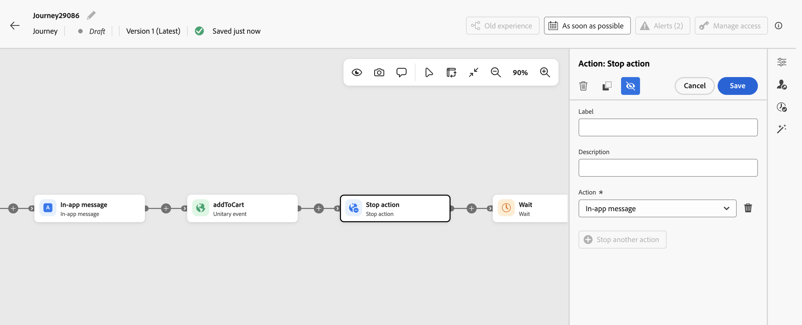

# Stop action {#inbound-disqualification}

>[!BEGINSHADEBOX]

**On this page:** Learn how to use the **[!UICONTROL Stop action]** activity to remove a profile from selected inbound activities without ending the journey.

>[!ENDSHADEBOX]

>[!CONTEXTUALHELP]
>id="ajo_journey_inbound_activity_deactivation"
>title="Stop action activity"
>abstract="Removes a profile from up to five selected upstream inbound activities (in-app, content card, web, or code-based experience) without ending the profile's journey."

Use the **[!UICONTROL Stop action]** activity to remove a profile from one or more selected upstream inbound activities (up to five): in-app, content card, web, or code-based experience. When a profile reaches this step, it stops qualifying for the selected experiences and continues progressing in the journey. Other inbound activities are not affected.

Unlike [stopping a journey](end-journey.md#stop-journey), which halts all profiles progressing through it, **[!UICONTROL Stop action]** applies only to the selected inbound activities for the profile that reaches this step.

## Where to place the activity {#placement}

The **[!UICONTROL Stop action]** activity must be downstream of the inbound activities it targets, on the same journey path. Other activities, such as **[!UICONTROL Wait]** or **[!UICONTROL Reaction]**, can be placed between the inbound activity and **[!UICONTROL Stop action]**.

When choosing where to place it:

* Avoid placing it immediately after an inbound activity, as this can prevent the profile from seeing the inbound experience.
* Placing it immediately before **[!UICONTROL End]** is redundant because inbound activities are already removed when the profile exits the journey.

## Guardrails {#guardrails}

When you configure the **[!UICONTROL Stop action]** activity, the selected inbound activities and the placement of the activity are checked. Some conditions generate errors, while others generate warnings.

The following configurations generate an error:

* No inbound activity, or more than five inbound activities.
* The same inbound activity more than once.
* An inbound activity that is not upstream of **[!UICONTROL Stop action]** on the same journey path.
* An inbound activity that has been deleted. It appears as **[!UICONTROL Unavailable activity]**.

The following configurations generate a warning:

* An inbound activity that was already stopped earlier in the journey.
* An inbound activity stopped immediately after it is activated, which can prevent the profile from seeing the experience.
* **[!UICONTROL Stop action]** placed immediately before **[!UICONTROL End]**, which is unnecessary because inbound activities are already removed when the profile exits the journey.

## Configure the activity {#configure}

1. Start designing your journey. Learn more in [Create your first journey](journey-gs.md).

1. Add an inbound activity to your journey.

1. At the point where you want to stop the experience, click the plus (+) icon downstream of the inbound activity on the same journey path and select **[!UICONTROL Stop action]** from the list. See [Where to place the activity](#placement).

1. Add a **[!UICONTROL Label]** to the activity and, in the **[!UICONTROL Action]** field, select the upstream inbound activity that you want to remove the profile from.

    

    >[!TIP]
    >
    >Give inbound activities distinct labels. The **[!UICONTROL Action]** dropdown shows only activity names, and two activities can have the same name.
    
1. To target additional inbound activities, click **[!UICONTROL Stop another action]** and select another activity. You can select up to five activities.

1. Click **[!UICONTROL Save]**.

1. Add the next activities to finish your journey.

Your **[!UICONTROL Stop action]** activity is now configured. When a profile reaches this step, it is removed from the selected inbound experiences and continues progressing in the journey.

If the profile re-enters the journey, the experience activates again when the profile reaches it.

## Use cases {#use-cases}

* **Stop an in-app reminder after registration.** Your journey shows an in-app experience encouraging a profile to register for an event. Once the journey detects that the profile has registered, use **[!UICONTROL Stop action]** to remove that profile from the upstream in-app activity. The profile no longer qualifies for the registration reminder but continues through the remaining journey steps, such as receiving an event preparation email.

* **Stop purchase promotions after conversion.** Your journey makes a promotional web or code-based experience available to a profile. After the journey detects a purchase, use **[!UICONTROL Stop action]** to remove the profile from the upstream promotional activities so they no longer qualify for those experiences. The profile can continue through post-purchase steps in the same journey, while any inbound activities not selected in **[!UICONTROL Stop action]** remain unaffected.

* **Replace a code-based experience.** Activate code-based experience A, add a **[!UICONTROL Wait]** activity, then use **[!UICONTROL Stop action]** to stop experience A before activating code-based experience B. This sequence replaces the first experience while the profile continues through the journey.

{{$include /help/_includes/do-not-localize/building-journeys/ai-augmented-stop-action.md}}
