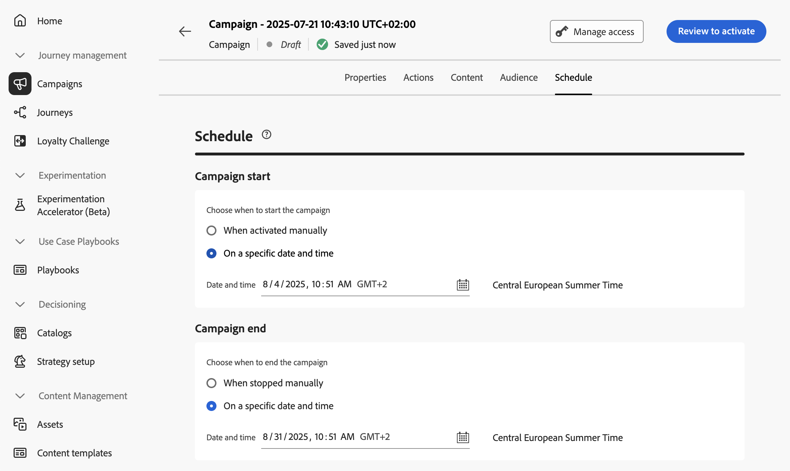

# Schedule the API triggered campaign {#api-schedule}

>[!BEGINSHADEBOX]

**On this page:** Set start and end dates in the Schedule tab so your API triggered campaign sends at the right time.

>[!ENDSHADEBOX]

Use the **[!UICONTROL Schedule]** tab to define the campaign schedule.

## Set start and end dates

By default, API triggered campaigns start once they are triggered, and end as soon as the message has been sent once. If you do not want to execute your campaign right after it is triggered, you can specify a date and time at which the message should be sent using the **[!UICONTROL Campaign start]** option.

The **[!UICONTROL Campaign end]** option allows you to specify when a campaign should stop being executed. Outside of the specified dates, the campaign will not be executed.

>[!NOTE]
>
>When scheduling campaigns in [!DNL Adobe Journey Optimizer], ensure your start date/time aligns with the desired first delivery.

## Set rate control

>[!IMPORTANT]
>
>The **[!UICONTROL Throttle delivery]** option is not supported for API triggered campaigns, in standard or High throughput mode. A **[!UICONTROL Delivery rate]** entered in the **[!UICONTROL Delivery settings]** section is not applied. To limit the sending rate, pace your API calls upstream.

## Next steps {#next}

Once your campaign configuration and content are ready, you can review and activate it. [Learn more](../campaigns/review-activate-api-triggered-campaign.md)

{{$include /help/_includes/do-not-localize/campaigns/ai-augmented-api-triggered-campaign-schedule.md}}
