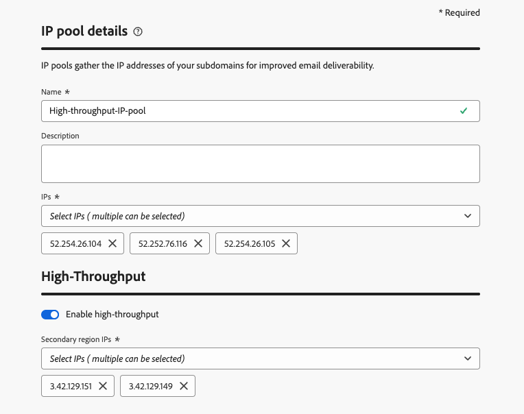
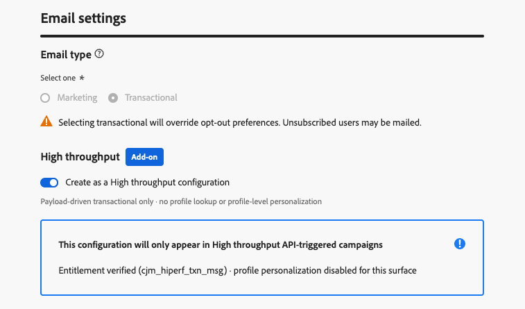

# Activate High throughput mode for API-triggered campaigns {#high-throughput}

>[!BEGINSHADEBOX]

**On this page:** Activate High throughput mode for API-triggered campaigns so you can send very large-scale, real-time transactional messages (email and push) at up to 5000 transactions per second without relying on profiles.

>[!ENDSHADEBOX]

High throughput mode is designed for organizations that need **very large-scale, real-time transactional messaging** (up to 5000 transactions per second). Unlike regular API-triggered campaigns, High throughput campaigns operate independently of Adobe Profiles and require a different configuration model.  

This page explains how High throughput campaigns differ from standard API-triggered campaigns, setup requirements, and when to choose each mode.  

## Guardrails & limitations {#guardrails}

* **Access** - Available across all regions except Switzerland for organizations licensed with the High throughput transactional messaging add-on.

* **Channels**: Email and push notifications.

* **Personalization in High throughput campaigns**:  

  * All personalization must be included in the API payload as **contextual data**. [Learn how to personalize content using contextual data](../campaigns/api-triggered-campaign-content.md#contextual) 
  * Profile-based personalization is **not** supported. If profile variables are used, validation errors will occur.  

* **Personalization in High throughput channel configurations** - High throughput email channel configurations do **not** support contextual or profile-based personalization.

* **Matching resources** - High throughput campaigns, channel configurations, and IP pools can only be used with each other. Standard and High throughput resources cannot be mixed.

* **API endpoint** - High throughput campaigns use a different endpoint than standard API-triggered campaigns. For details, see [Execute an API triggered campaign](../campaigns/trigger-campaigns.md#trigger).

* **Campaign exclusivity** - High throughput campaigns do not use Adobe Profiles. Messages are delivered whether or not a profile exists.

  Moreover, a campaign cannot be used for both profile-enabled and non-profile use cases. If you need both, create two separate campaigns, and ensure the calling system decides which one to trigger based on the context.

* **Datasets for feedback and tracking** -  Feedback and tracking data for High throughput campaigns are stored in dedicated datasets that are not enabled for profiles. As a result, these events are not stitched to profiles, even if a matching profile exists.

  The datasets used are: 

  * **AJO Message Feedback Event Dataset - Non Profile** — used for both email and push feedback.
  * **AJO Email Tracking Experience Event Dataset - Non Profile** — used for email tracking only. A dedicated non-profile tracking dataset for push is not yet available.

* **Throughput allocation** - The throughput provisioned under the High throughput add-on is exclusively reserved for High throughput campaigns. There is no sharing of throughput between standard and High throughput API-triggered campaigns.

* **Unsupported features**:

  * [Message Export](../configuration/message-export.md) and [dynamic subdomains](../email/surface-personalization.md#dynamic-subdomains) are not supported for High throughput.

  * **Personalized PDF attachments** - Not supported when High throughput traffic is routed through the secondary region. [Learn more about personalized PDF attachments](../email/pdf-attachments.md#personalized-attachments)

* **Push notifications**:

  * **Web push** — High throughput web push campaigns run on shared infrastructure and do not benefit from the dedicated capacity reserved for High throughput mobile push.
  * **Payload size** — The maximum payload size is 5 KB.
  * **Denylist behavior** — When a message hits a denylist, delivery feedback is retained but no profile-update feedback is produced. This means denylist responses do not trigger profile updates or token invalidation in Adobe Experience Platform.

## Choosing between standard vs. High throughput campaigns

Use this table to decide which API-triggered campaign type fits your use case:  

| Feature / Requirement | Standard API-triggered campaign | High throughput campaign |
| ------------------------ | --------------------------------- | --------------------------- |
| **Availability** | Included in base offering | Requires High throughput transactional messaging add-on. |
| **Throughput** | Up to 500 transactions per second | Up to 5000 transactions per second |
| **Channels** | Email, Mobile message, Push | Email, Push |
| **Personalization** | Profile + contextual in the API payload | Contextual in the API payload only |
| **Profile & stitching** | Exists or gets created with events stitched to profile | No profile |
| **Message volume** | Standard entitlement & message packs | Separate tiered message volumes |
| **Infrastructure** | Standard | Enhanced |
| **Uptime** | 99,9% | 99,99% |
| **Health check API** | Yes | Yes |

In other words:

* Choose **Standard API-triggered** campaigns if:  
  * You don't have High throughput contracted.  
  * Your throughput needs are <500 TPS.  
  * You require personalization based on Adobe Profiles.  
  * You want campaign data stitched to profiles for future targeting.
  * You want to use another channel than Email or Push.

* Choose **High throughput** campaigns if:  
  * You need throughput >500 TPS.  
  * You don't require profile stitching.  
  * You can pass all personalization in the API payload.  
  * You want to use the Email or Push channel.

## Prerequisite {#prerequisite}

After purchasing the **High throughput transactional messaging** add-on, contact Adobe Customer Care or your Adobe representative so that the required backend activation <!--and one-time setup -->can be completed.

>[!NOTE]
>
>You only need to do this once, not for each channel configuration.

## Set up High throughput API-triggered email campaigns {#setup-guidelines}

To use High throughput email campaigns, follow the steps below.

>[!IMPORTANT]
>
>The IP pool and channel configurations designated for High throughput transactional messages must be used exclusively for that purpose, and not be used with standard transactional messaging using API-triggered campaigns or journeys.

The flow described above applies to the email channel only.

>[!NOTE]
>
>Push channel setup remains a manual on-demand process. [Learn more](#setup-push)

### Create a dedicated IP pool {#create-ip-pool}

High throughput requires a dedicated IP pool because it is built to maintain high availability and performance across two regions.

When you purchase the High throughput add-on, sending IPs are provisioned in a secondary region, in addition to the IPs allocated to you in your primary region.

* **Failover** - If the primary region becomes unavailable, all High throughput traffic automatically switches to the secondary region, so your transactional messages keep being delivered.
* **IP warm-up** - To make sure the secondary region IPs are ready when needed, part of your High throughput traffic is routed through the secondary region on an ongoing basis. This keeps these IPs warm. Sending from IPs with no sending history could cause internet service providers (ISPs) to reject your emails.

Create the IP pool as follows.

>[!NOTE]
>
>This IP pool is exclusively for High throughput traffic. You cannot use it in channel configurations that are not designated for High throughput API-triggered campaigns.

1. Create an IP pool. [Learn how](../configuration/ip-pools.md)

1. Select the **[!UICONTROL Enable high-throughput]** option. 

1. Select one or more secondary region IPs for the dedicated IP pool. This ensures high availability for your High throughput traffic.

    

The dedicated IP pool is now ready for use with High throughput channel configurations.

### Create a High throughput email channel configuration {#configuration-guidelines}

1. Create an **email** channel configuration. [Learn how](../configuration/channel-surfaces.md)

1. Select the **[!UICONTROL Transactional]** email type in the **[!UICONTROL Email settings]**.

1. Enable the **[!UICONTROL Create as a High throughput configuration]** toggle.

    

1. In the **[!UICONTROL IP pool details]** section, select the High throughput IP pool you created. Only High throughput IP pools are listed.

1. Sumbmit the channel configuration.

Your High throughput email channel configuration is now ready for use in a High throughput API-triggered campaign.

>[!CAUTION]
>
>The type of an IP pool or channel configuration cannot be changed after creation. A standard resource cannot be converted to High throughput, and a High throughput resource cannot be converted back to standard.

When you create a High throughput API-triggered campaign, only High throughput channel configurations are available for selection.

## Set up High throughput push campaigns {#setup-push}

For push, setup remains a manual on-demand process.

You must create a new push channel configuration and contact Adobe Customer Care to request the activated push channel configuration to be mapped to the High throughput capability.

Provide the channel configuration details along with your organization ID.

>[!NOTE]
>
>The High throughput IP pool and channel configuration flow described above applies to the email channel only.
