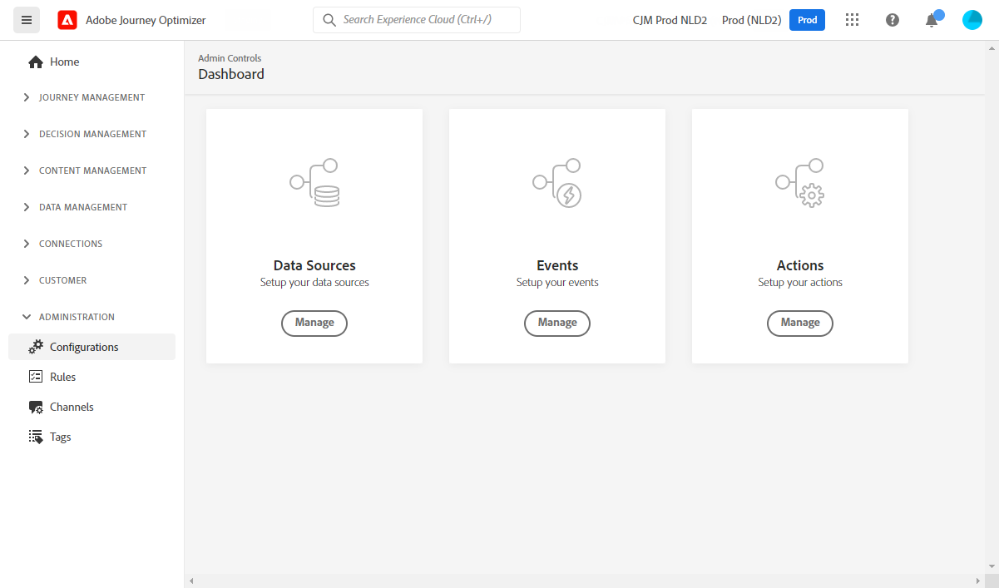
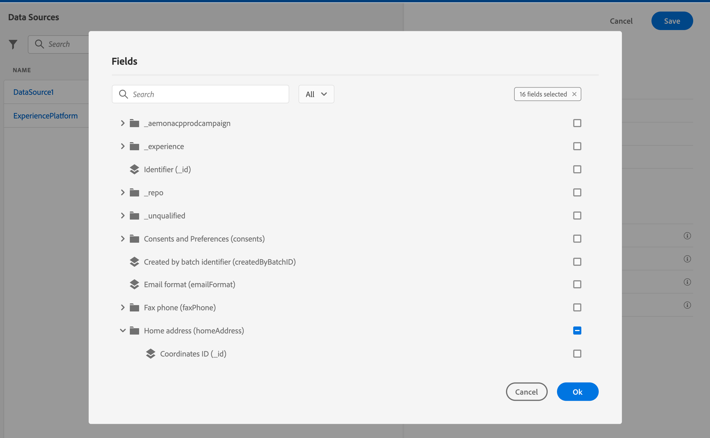

# Configure journeys: Data Sources, Events, and Actions {#configure-journeys}

>[!BEGINSHADEBOX]

**On this page:** Learn how to configure the data sources, events, and actions required to trigger journeys, enrich them with external data, and send messages in Adobe Journey Optimizer.

>[!ENDSHADEBOX]

>[!CONTEXTUALHELP]
>id="ajo_journey_configuration_dashboard"
>title="About journey configuration"
>abstract="To send messages with journeys, it is necessary to configure Data Sources, Events, and Actions. Data Sources enable you to establish a connection to a system to retrieve additional information that is used in your journeys, such as in conditions. Events allow for the triggering of your journeys when an event is received. Custom Actions facilitate the connection to a third-party system to send your messages. If you are using Journey Optimizer's built-in messaging capabilities, configuring an action is not required."

To send messages and orchestrate experiences with journeys, you must configure **Data Sources**, **Events**, and (when using external systems) **Actions**.

Think of this page as the **starting point** for journey configuration:

* **Data Sources** – where journeys can look up additional data.
* **Events** – what triggers journeys or moves a person to the next step.
* **Actions** – how journeys send messages or call external systems.

If you are new to [!DNL Adobe Journey Optimizer], start with the [quick start guide](../start/quick-start.md) or the [journey configuration overview](get-started-configuration.md).

You can also configure connections to external systems via custom Data Sources and custom actions. This allows you, for example, to enrich your journeys with data coming from an external reservation system, or send messages using a third-party system. Learn how to [integrate Journey Optimizer with external systems](external-systems.md).

## Before you build journeys: configuration checklist {#checklist}

Use this checklist to make sure the most important configuration pieces are in place before you design journeys.

| Step | What you do | Who typically does it | Where in the UI | Learn more |
| ---- | ----------- | --------------------- | --------------- | ---------- |
| 1 | Prepare schemas, datasets, and identities in Adobe Experience Platform | Data Engineer | **Adobe Experience Platform** > Schemas, Datasets, Identities | — |
| 2 | Expose profile fields and history via the Experience Platform data source | Data Admin / Data Engineer | **Journey Optimizer** > Configurations > **Data sources** | [Get started with data sources](../datasource/about-data-sources.md) |
| 3 | Configure events that trigger journeys (unitary or business events; audience qualification events are selected on the journey canvas) | Data Admin / Developer | **Journey Optimizer** > Configurations > **Events** | [Get started with events](../event/about-events.md) |
| 4 | Configure actions, if you must call third-party systems (custom actions) | Technical user | **Journey Optimizer** > Configurations > **Actions** | [Get started with custom actions](../action/action.md) |
| 5 | Create test profiles to test journeys and messages safely | Data Engineer / Practitioner | **Adobe Experience Platform** > Schemas, Datasets, Profiles | [Create test profiles](../audience/creating-test-profiles.md) |
| 6 | Build and publish your first journey | Journey Practitioner | **Journey Optimizer** > Journeys | [Create your first journey](../building-journeys/journey-gs.md) |

## Data Sources {#data-sources}

**Data Sources** allow your journeys to **look up additional data at run time**. They can use the built-in **Adobe Experience Platform data source** to read Real-time Customer Profile attributes and behavioral history, or **external data sources** to call external APIs and use their responses in the journey. For new external lookups, use [custom actions](#actions) instead of external data sources, as described in the [guardrails](../start/guardrails.md#data-sources-g).

You typically use Data Sources to:

* Build **conditions** in journeys (for example, "if loyaltyTier = gold and weather = rainy").
* Personalize **message content** and **custom action payloads** with dynamic values.
* Define **custom waits** or **time zone** logic based on retrieved data.

+++Where to configure

1. In Journey Optimizer, go to [!UICONTROL Configurations] in the left navigation.
1. Under [!UICONTROL Data sources], select [!UICONTROL Manage].

+++

When planning your data, choose the pattern that best fits your use case:

| Pattern | When to use |
| --- | --- |
| **Custom actions only** | One-off API calls; no need to store data in the Adobe Experience Platform Data Lake |
| **Non-profile dataset** | Persist contextual events for lookup without contributing to Real-time Customer Profile |
| **Profile-enabled dataset** | Data needed for segmentation, personalization across channels, and identity stitching |

Learn more: [Get started with data sources](../datasource/about-data-sources.md) | [Configure data sources](../datasource/configure-data-sources.md)

## Events {#events}

**Events** tell [!DNL Journey Optimizer] **when** to start a journey or advance a person through a path.

Events are based on **Experience Events** ingested into Adobe Experience Platform through sources such as the Adobe Experience Platform Web SDK, Adobe Mobile SDK, Streaming Ingestion APIs, and Adobe Analytics source connectors.

### Event types

Journeys support three event types. You configure the first two in the **Events** configuration:

* **Unitary events**
  Linked to a single profile. They describe an individual's behavior or a fact related to that person (for example, "placed an order," "installed the mobile app," "reached 10,000 loyalty points"). Journeys can start or branch when a unitary event occurs.

* **Business events**
  Not tied to a single profile (for example, "flight canceled," "product back in stock," "weather alert"). A business event can be used with an audience so that multiple profiles who care about that event can react when it happens.

* **Audience qualification events**
  Triggered when a profile enters or exits an audience. You select them on the journey canvas, not in the **Events** configuration.

Business events cannot be combined with unitary events or audience qualification activities in the same journey. See [Journey guardrails - Events](../start/guardrails.md#events-g).

In the event configuration, you define:

* Which **schema** and fields are used.
* How to identify the **profile** (identity namespace and field).
* The **Event ID condition** that filters which incoming events should trigger journeys.
* Optional timeouts, for example when listening for subsequent events later in the journey.

+++Where to configure

1. In Journey Optimizer, go to [!UICONTROL Configurations].
1. Under [!UICONTROL Events], select [!UICONTROL Manage], then [!UICONTROL Create event].

+++

Learn more: [Get started with events](../event/about-events.md) | [Create a unitary event](../event/about-creating.md) | [Work with Adobe Analytics data](../event/about-analytics.md) | [Experience event lookup in journeys](../building-journeys/exp-event-lookup.md)

## Actions {#actions}

**Actions** define **how** a journey sends a message or calls another system.

[!DNL Journey Optimizer] supports two main categories:

### Action activity (built-in channels)

[!DNL Journey Optimizer] provides a single **Action activity** that covers all native channels: Email, SMS, Push notifications, In-app and Web, Content cards, and Code-based experiences.

Rather than separate channel-specific nodes, you drag and drop one **Action** activity onto the journey canvas and select the channel and content from there. You do **not** need to configure an Action object in the Configuration menu for built-in channels.

>[!NOTE]
>
>Legacy channel-specific activities (Email, Push, SMS, etc.) are deprecated as of March 2026. Existing journeys using them continue to work without migration. New journeys should use the **Action activity**.

Learn more: [Action activity](../building-journeys/journey-action.md)

### Custom actions

Use **custom actions** when you want a journey to call an **external HTTP service** via a REST API with a JSON payload. Typical use cases:

* Sending messages through a **third-party provider** (for example, external messaging platforms or internal gateways).
* Writing to **internal systems** (for example, CRM, ticketing, Order Management).
* Posting **webhooks** to other applications.

A custom action configuration includes:

* Target URL and HTTP method.
* Authentication (for example, API key, OAuth).
* Headers and payload structure.
* Optional throttling and capping settings.

+++Where to configure

1. In Journey Optimizer, go to [!UICONTROL Configurations].
1. Under [!UICONTROL Actions], select [!UICONTROL Manage], then [!UICONTROL Create action].

A **technical user** must configure custom actions. Once created, they are available as **Action activities** in the journey canvas.

+++

Learn more: [Get started with custom actions](../action/action.md) | [Use custom actions](../building-journeys/using-custom-actions.md) | [Pass collections dynamically with custom actions](../building-journeys/collections.md) | [Limit throughput with External Data Sources and Custom Actions](../building-journeys/limit-throughput.md)

## Example – Put it all together: order confirmation journey {#example}

The following simple use case shows how Data Sources, Events, and Actions work together.

>[!NOTE]
>
>**Goal:** Send an order confirmation email when a customer completes a purchase.

### 1. Event – Purchase completed

* Configure a **unitary event** based on your purchase Experience Event schema (for example, `commerce.order.orderID`).
* Set the **profile identifier** (for example, email).
* Define an **Event ID condition** that matches "order placed" events.

### 2. Data Source – Profile and order details

* In the **Experience Platform data source**, enable profile fields such as:
  * `person.name.firstName`
  * `commerce.order.orderID`
  * `commerce.order.priceTotal`
* These fields are available in conditions and personalization.

### 3. Action – Action activity (Email)

* Drag and drop an **Action** activity onto the journey canvas.
* Select **Email** as the channel and configure the message content.
* Personalize the message with data from the event and data source (for example, first name, order ID, total amount).

With these three pieces configured, you can design a journey that starts when the **purchase event** arrives, optionally checks additional **conditions** using Data Sources, and sends a **personalized email** using the Action activity.

## Frequently Asked Questions {#faq}

+++Do I always need to configure a Data Source?

No. If your journey only uses **fields present in the event payload**, and you do not need additional profile attributes or external lookups, you can rely on the event alone.

Configure Data Sources when you want to use additional **profile attributes or history** from Real-time Customer Profile or call **external APIs** during the journey.

+++

+++Do I need to configure an Action for built-in channels?

No. For built-in channels (Email, SMS, Push, In-app, Web, Content cards, Code-based experiences), you only need to configure the **channel** itself (for example, channel surfaces, subdomains, IPs) and add an **Action activity** to your journey canvas to select the channel from there.

You configure an **Action** object in the Configuration menu only for **custom actions** that call third-party systems. Learn more: [Action activity](../building-journeys/journey-action.md)

+++

+++Where do events come from?

Events are Experience Events ingested into Adobe Experience Platform through Streaming Ingestion APIs, the Adobe Experience Platform Web SDK, Adobe Mobile SDK, and Adobe Analytics and other source connectors.

In the **Events** configuration, you define **how [!DNL Journey Optimizer] interprets those events** (schema, identity, and conditions) so that they can trigger journeys.

Learn more about sources: [Get started with source connectors](../start/get-started-sources.md)

+++

+++What is the difference between a unitary event and a business event?

A **unitary event** is tied to a single profile — it represents something a specific person did (for example, placed an order or opened an email). It triggers a journey for that individual profile.

A **business event** is not tied to a single profile — it represents something that happened in your business context (for example, a flight was canceled or a product came back in stock). Business events are used to re-engage multiple profiles at once, typically combined with an audience to determine who should enter the journey.

Learn more: [Get started with events](../event/about-events.md)

+++

+++Can I use the same custom action in multiple journeys?

Yes. Once a custom action is configured and saved in the Configuration menu, it becomes available as an **Action activity** in the journey canvas for all journeys in that sandbox. You do not need to reconfigure it for each journey.

If you update the custom action configuration (for example, the endpoint URL or authentication), the change applies to all journeys using it. Test any updates carefully before publishing.

Learn more: [Get started with custom actions](../action/action.md)

+++

+++How many Data Sources, Events, and Actions can I configure?

[!DNL Journey Optimizer] applies guardrails to events, data sources, and custom actions. For example, a single XDM schema can be referenced by a maximum of 100 events across active journeys at one time.

For current values, see [Journey guardrails and limitations](../start/guardrails.md).

+++

+++Who is responsible for configuring Data Sources, Events, and Actions?

These objects are typically configured by **technical users** — Data Admins, Data Engineers, or Developers — before journey practitioners start building journeys. See the [configuration checklist](#checklist) at the top of this page for a role-by-role breakdown.

+++

## Browse through Adobe Experience Platform fields {#friendly-names-display}

When defining [event payload](../event/about-creating.md#define-the-payload-fields), [field group payload](../datasource/configure-data-sources.md#define-field-groups) and selecting fields in the [expression editor](../building-journeys/expression/expressionadvanced.md), the display name is shown alongside the technical field name to make it easier to identify the right field.

This information is retrieved from the schema definition in the Experience Data Model. When setting up schemas, you can provide descriptors (using the `xdm:alternateDisplayInfo` property) to replace generic technical names with user-friendly labels — particularly useful when working with reporting variables or generic field identifiers. This is especially useful when journey authors are not familiar with the underlying data model, as clear labels reduce configuration errors and speed up journey building. You can configure these friendly name descriptors via the Schema Registry. For more information, see the [Schema Registry developer guide](https://experienceleague.adobe.com/en/docs/experience-platform/xdm/api/getting-started){target="_blank"}.

The display logic works as follows:

| Condition | Field appears as |
| --- | --- |
| Friendly name defined | `<friendly-name>(<name>)` |
| Only display name available | `<display-name>(<name>)` |
| Neither defined | `<name>` |

>[!NOTE]
>
>Friendly names are not retrieved when you select fields from a union of schemas.

## Next steps {#next-steps}

Once you understand how Data Sources, Events, and Actions work together, you can:

* Configure and manage your **data sources**: [Get started with data sources](../datasource/about-data-sources.md)
* Configure and manage **events** for your journeys: [Get started with events](../event/about-events.md)
* Configure **custom actions** for third-party integrations: [Get started with custom actions](../action/action.md)
* Build and publish your first journey: [Create your first journey](../building-journeys/journey-gs.md)

For role-specific guidance:

* [Get started as a Data Engineer](../start/path/data-engineer.md)
* [Get started as a Marketer](../start/path/marketer.md)

**Learn through use cases:** See end-to-end examples that combine Events, Data Sources, and Actions in real journeys: [Send multi-channel messages](../building-journeys/journeys-uc.md) | [Browse all use cases](../building-journeys/jo-use-cases.md)
