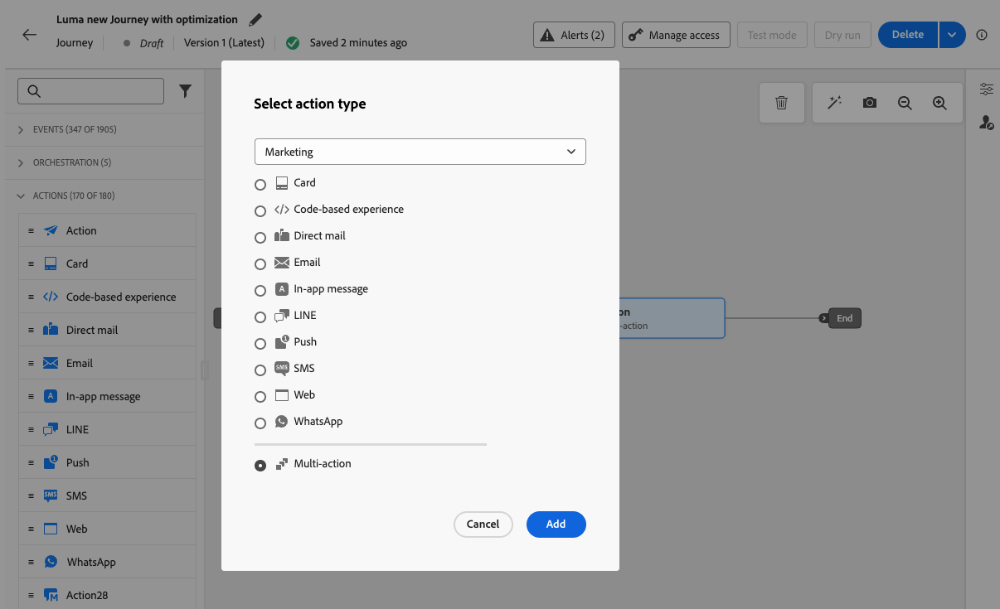
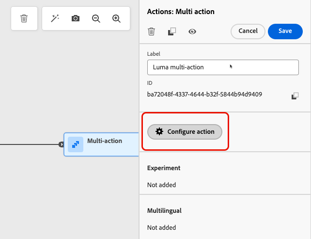
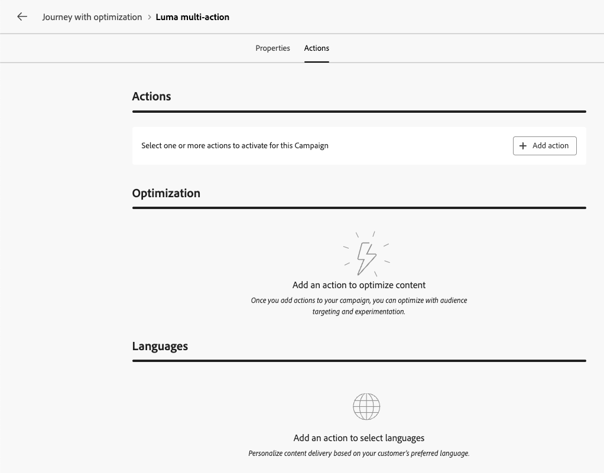
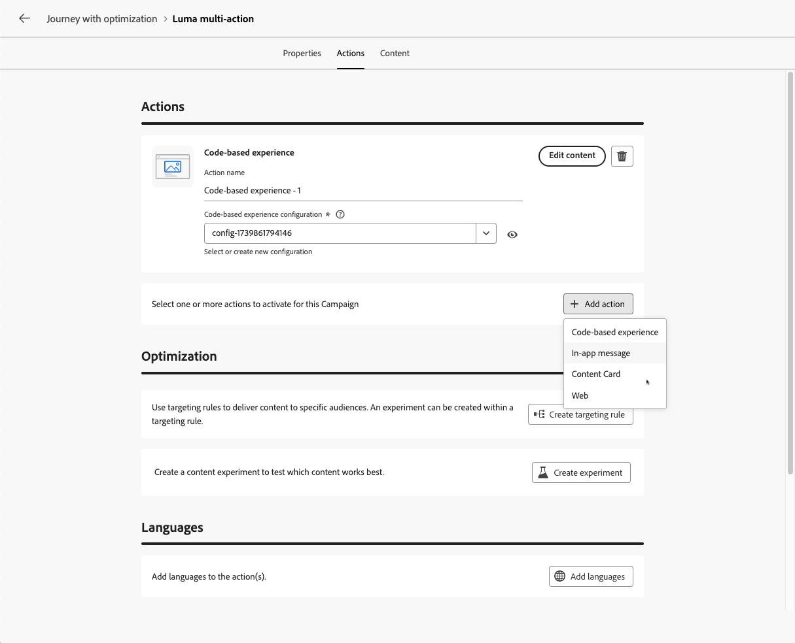

# Add multiple inbound actions {#multi-action}

>[!BEGINSHADEBOX]

**On this page:** Learn how to define several inbound actions inside a single journey action or action campaign, to deliver multiple experiences to different locations at the same time.

>[!ENDSHADEBOX]

To simplify your orchestration, you can define several inbound actions inside a single journey action or a single campaign, each action containing a specific content.

This capability enables you to deliver various Code-based experiences, In-app messages, Content Cards, or Web actions to different locations at the same time, without the need to create multiple journey actions or campaigns. It makes the deployment easier and allows for smoother reporting, with all the data consolidated into one single journey or campaign.

For example, you can send a code-based experience to multiple endpoints with slightly different contents. To do this, create multiple code-based actions within the same journey action or campaign, each with a different endpoint configuration.

>[!NOTE]
>
>This capability is only available for inbound channels.
>
>For outbound channels (Email, Push, Mobile message), use [channel optimization](../building-journeys/channel-optimization.md) to add multiple channels and automatically select the best channel per customer.

You can add up to 10 inbound actions in a journey action or in a campaign.

## Open the actions configuration {#open-actions}

>[!CONTEXTUALHELP]
>id="ajo_multi_action_journey"
>title="Add multiple inbound actions"
>abstract="A single journey can include several inbound actions. This capability enables you to deliver multiple Code-based experiences, In-app messages, Content Cards or Web actions to different locations at the same time, each action containing a specific content."

>[!CONTEXTUALHELP]
>id="ajo_multi_action"
>title="Add multiple inbound actions"
>abstract="You can select several inbound actions inside a single campaign. This capability enables you to deliver multiple Code-based experiences, In-app messages, Content Cards or Web actions to different locations at the same time, each action containing a specific content."

The first steps depend on whether you work in a journey or in a campaign. 

>[!BEGINTABS]

>[!TAB Journeys]

1. Start your journey with an [Event](../building-journeys/general-events.md) or a [Read Audience](../building-journeys/read-audience.md) activity.

1. From the **[!UICONTROL Actions]** section of the palette, drag and drop an **[!UICONTROL Action]** activity into the canvas.

1. Select **[!UICONTROL Multi action]** as the action type.

   

1. Add a label if needed and select **[!UICONTROL Configure action]**.

   {width="60%"}

1. You are directed to the **[!UICONTROL Actions]** tab of the journey action configuration screen.

   {width="70%"}

>[!TAB Action campaigns]

1. Create an [action campaign](../campaigns/create-campaign.md) and define its [properties](../campaigns/campaign-properties.md).

1. Open the **[!UICONTROL Actions]** tab of your campaign.

>[!ENDTABS]

## Add the inbound actions {#add-actions}

The following steps are the same in journeys and in action campaigns.

1. Select an inbound action (**Code-based experience**, **In-app message**, **Content Card** or **Web**) from the **[!UICONTROL Actions]** section.

1. Select the channel configuration and define a specific content for that action.

1. Use the **[!UICONTROL Add action]** button to select another inbound action from the drop-down list.

    {width="80%"}

1. Proceed similarly to add more actions. You can add up to 10 inbound actions in a journey action group or in a campaign.

Once the journey is [live](../building-journeys/publish-journey.md) or the campaign is [live](../campaigns/review-activate-campaign.md), all actions are activated simultaneously.

## See also {#see-also}

* [Use the Action activity](../building-journeys/journey-action.md) in a journey
* [Configure the campaign action](../campaigns/campaign-action.md)

{{$include /help/_includes/do-not-localize/delivery/ai-augmented-multiple-inbound-actions.md}}