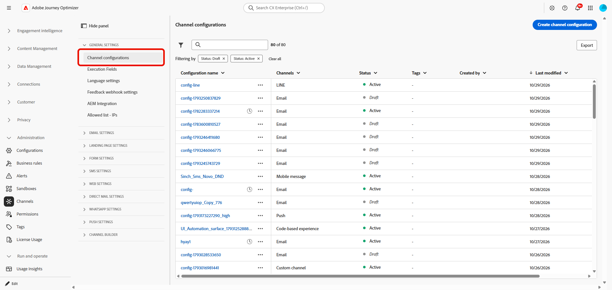
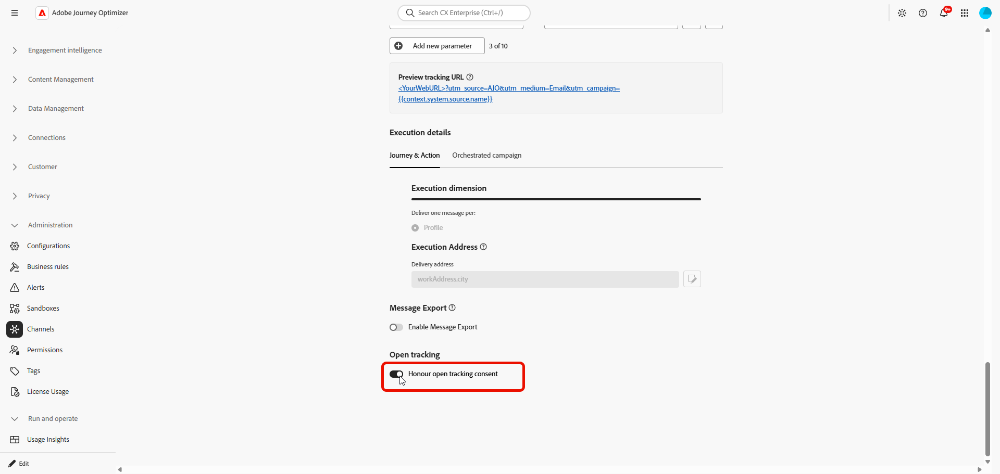

# Honor email open tracking consent {#open-tracking-consent}

>[!BEGINSHADEBOX]

**On this page:** Learn how to stop open tracking for individual recipients who opted out, while keeping it active for everyone else. You record the preference on the customer profile, then turn on **[!UICONTROL Honour open tracking consent]** in your email channel configurations.

>[!ENDSHADEBOX]

Previously, email open tracking could only be enabled or disabled for an entire campaign, and the same setting applied to all recipients. [!DNL Journey Optimizer] now supports recipient-level control through email open tracking consent. Open tracking can remain enabled for a campaign while being disabled for recipients who have explicitly opted out. The opt-out is determined from the preferences recorded at the email channel level or at the level of an individual email address, and it does not affect the recipient's eligibility to receive the email.

To configure email open tracking consent, complete the following steps:

1. [Populate and maintain tracking preferences](#populate-preferences) on customer profiles in [!DNL Adobe Experience Platform] through your existing consent data ingestion process.
1. [Enable **Honour open tracking consent**](#enable-option) in the email channel configurations that must apply those preferences.

To learn more about CNIL expectations for tracking pixels, see [CNIL guidance on email tracking pixels](../privacy/cnil-pixel-tracking.md).

## Understand open tracking consent {#understand-consent}

### Consent fields {#consent-fields}

>[!NOTE]
>
>Tracking preferences and marketing preferences are two independent sets of fields. A marketing opt-in does not populate a tracking preference, and it does not count as one.

Preferences live in the **Consents and Preferences** field group of the **XDM Individual Profile** class, under the `consents` object. Adobe defines and maintains the field, including `tracking.email.open`, so you do not need to create custom fields. 

[Learn more about the Consents and Preferences field group](https://experienceleague.adobe.com/en/docs/experience-platform/xdm/field-groups/profile/consents){target="_blank"}

You can store the preference at two levels, which mirror the structure of existing marketing consent:

| Preference | Channel level (whole profile) | Identity level (one email address) |
|---|---|---|
| Permission to receive marketing email (existing) | `consents.marketing.email.val` | `consents.idSpecific[namespace][emailAddress].marketing.email.val` |
| Permission to track email opens (new) | `consents.tracking.email.open.val` | `consents.idSpecific[namespace][emailAddress].tracking.email.open.val` |

* **Channel-level** preferences cover every email address on the profile. For example, setting `consents.tracking.email.open.val` to `"n"` opts the customer out of open tracking for all of their addresses.
* **Identity-level** preferences sit in the `idSpecific` map. The first key is an identity namespace known to Experience Platform Identity Service. The second key is the identity value, such as an email address. [!DNL Journey Optimizer] uses the namespace and address selected for the delivery.

You do not need to fill in both levels. Choose the one that matches how your organization collects the preference.

Each `open` object contains the following properties:

| Property | Required | Description |
|---|---|---|
| `val` | Yes, when the object is present | `"n"` records an explicit opt-out and `"y"` records an explicit opt-in. Values must be lowercase. |
| `time` | No | The date and time, in ISO 8601 format, when the preference was collected or changed. |
| `reason` | No | The reason for the opt-out. |

### How preferences are applied {#how-applied}

For a supported delivery with the [**[!UICONTROL Honour open tracking consent]** option enabled](#enable-option), [!DNL Journey Optimizer] checks the channel-level preference and the preference of the identity selected for delivery. An explicit lowercase `"n"` at either level prevents open tracking.

| Channel-level value | Selected identity value | Open tracking |
|---|---|---|
| `"n"` | Any value, or absent | Suppressed |
| `"y"` or absent | `"n"` | Suppressed |
| `"y"` | `"y"` or absent | Not suppressed by this consent check |
| Absent | `"y"` or absent | Not suppressed by this consent check |

Keep the following in mind:

* Only an explicit `"n"` disables open tracking. A `"y"`, a missing value, or any other value, such as `"dn"`, `"p"`, or `"u"`, leaves the existing open tracking behavior of the message unchanged. Map the choices you collect to valid schema values deliberately.
* A missing value is not a recorded opt-in. If your policy allows tracking only after affirmative permission, review the additional controls you need with your privacy team.
* An identity-level `"y"` never overrides a channel-level `"n"`. When a person changes their choice, update the correct level and make sure no other opt-out remains in effect.

## Before you begin {#before-you-begin}

### Limitations {#limitations}

* The feature controls **email open tracking** only. It does not affect click tracking, unsubscribe preferences, third-party tracking, or other remote images in an email.
* Marketing consent and eligibility rules remain separate. Allowing tracking does not make an ineligible message eligible, and denying tracking does not unsubscribe a recipient or exclude them from delivery.
* The preference is evaluated when a message is prepared for a supported delivery. A subsequent change to the preference does not modify emails that were already delivered, and it does not delete tracking data that was previously collected.
* High-throughput transactional messaging is excluded.
* The option relies on the preferences you populate on profiles. It does not collect or backfill those choices.
* Turning the option off restores the previous open tracking behavior. It is not a way to enforce an opt-out.

For data model definitions, see [Consents and Preferences](https://experienceleague.adobe.com/en/docs/experience-platform/xdm/field-groups/profile/consents){target="_blank"}. Review your collection experience and operating policy with your privacy and legal teams.

### Who does what {#responsibilities}

| Adobe provides | Your organization configures and maintains |
|---|---|
| Standard email open tracking field definitions in the XDM consent model | Source-to-XDM mappings and profile values for the tracking preferences |
| The **[!UICONTROL Honour open tracking consent]** option in email channel configurations | Enablement on the configurations used by your journeys and campaigns |
| Open tracking enforcement for supported, enabled delivery types | Accurate channel-level or identity-level preferences, including existing opt-outs and later changes |
| Guidance on scope, and help validating behavior | Profile identities, ingestion, merge policy configuration, and end-to-end testing |

Your organization is also responsible for the consent collection experience, privacy notices, the choice of lawful basis, and data retention. Enabling the option does not collect consent, and it does not create a preference center control for you.

## Populate customer preferences {#populate-preferences}

Start by deciding whether each preference you collect applies to all of a person's email addresses or to one specific address. Then update your existing source-to-XDM mappings so they write to the matching tracking field.

The examples below show how to record an opt-out at each level. 

They are partial profile data, not complete ingestion payloads. When building your own payload, keep the following in mind:

* Include the required schema fields, the profile identifier, and the envelope expected by your ingestion method.
* The `idSpecific` entries only define the scope of a preference. They do not replace the identity fields that identify the profile.
* Follow the update behavior of your connector, and preserve existing marketing preferences, other consent fields, and other identity entries.

+++ Example to opt out at the channel level

This fragment turns off open tracking for every email identity on the profile:

```json
{
  "consents": {
    "tracking": {
      "email": {
        "open": {
          "val": "n",
          "time": "2026-10-28T10:00:00Z",
          "reason": "Customer declined email open tracking"
        }
      }
    }
  }
}
```

+++

+++ Example to opt out for one email address

This fragment applies only when the delivery uses the given namespace and address:

```json
{
  "consents": {
    "idSpecific": {
      "Email": {
        "alex@example.com": {
          "tracking": {
            "email": {
              "open": {
                "val": "n",
                "time": "2026-10-28T10:00:00Z"
              }
            }
          }
        }
      }
    }
  }
}
```

`Email` and `alex@example.com` are placeholders. Use the real namespace code and address of the identity used for delivery. When a profile holds several addresses, such as a personal one and a work one, a preference set for one address does not carry over to the other. Check your [execution address settings](../configuration/primary-email-addresses.md) to make sure the address that receives the message is the one whose preference you update.
+++

 
### Choose an ingestion method {#ingestion-methods}

Write the values to your existing Profile-enabled consent dataset, using one of the supported ingestion paths:

| Goal | Documentation |
|---|---|
| Import existing choices from a CRM, a consent system, or a CSV file | [Map a CSV file to an existing XDM schema](https://experienceleague.adobe.com/en/docs/experience-platform/ingestion/tutorials/map-csv/existing-schema){target="_blank"} |
| Upload XDM-compatible JSON or Parquet records in the UI | [Ingest data into Adobe Experience Platform](https://experienceleague.adobe.com/en/docs/experience-platform/ingestion/home){target="_blank"} |
| Keep profiles updated through a streaming connection | [Stream record data using Streaming Ingestion APIs](https://experienceleague.adobe.com/en/docs/experience-platform/ingestion/streaming/record){target="_blank"} |
| Understand the overall consent workflow | [Consent processing in Adobe Experience Platform](https://experienceleague.adobe.com/en/docs/experience-platform/privacy/consent/consent-processing){target="_blank"} |

For the first import, include every open tracking opt-out you have already recorded. After that, update profiles whenever a customer changes their choice.

### Verify the merged profile {#verify-profile}

>[!NOTE]
>
>For **Orchestrated campaigns**, the consent values must also be present in the profile data used for campaign execution, sometimes called the thin profile. Updating the source profile is not enough if the values never reach that execution profile.

Confirm both that ingestion succeeded and that the resulting profile is correct:

1. Check that the records were ingested without mapping or validation errors.
1. In Adobe Experience Platform, from the **[!UICONTROL Profiles]** menu, look up test profiles by a known identity namespace and value, and inspect their attributes.
1. Confirm that the values appear at the new tracking paths, under the exact identity keys you expect.
1. Review the applicable merge policy. Another dataset must not override the intended preference. Be aware that the `time` property by itself does not guarantee that a value wins a merge conflict.
1. Confirm that later changes reach the profile before a delivery relies on them. An upload or API acknowledgement alone does not prove that the new value is available for sending.

Learn more in the [Profile UI guide](https://experienceleague.adobe.com/en/docs/experience-platform/profile/ui/user-guide){target="_blank"} and the [merge policies overview](https://experienceleague.adobe.com/en/docs/experience-platform/profile/merge-policies/overview){target="_blank"} pages.

## Enable the option in email channel configurations {#enable-option}

>[!AVAILABILITY]
>
>You need the **[!UICONTROL Manage messages presets]** permission to edit channel configurations. Learn more on [permissions](../administration/ootb-permissions.md).

>[!CONTEXTUALHELP]
>id="ajo_admin_open_tracking_consent"
>title="Honour open tracking consent"
>abstract="When enabled, open tracking is turned off for recipients who recorded an explicit opt-out at the channel level or for the email address selected for delivery. Delivery of the email is not affected."

Once the profile data is validated, turn on the option in each email channel configuration that should apply it.

Before enabling the option, note that:

* **[!UICONTROL Honour open tracking consent]** option is off by default.
* It is not available for high-throughput transactional email configurations.
* While the option is off, the tracking preferences have no effect on existing open tracking behavior.
* Turning the option on never enables open tracking for a message that already has it disabled.

1. In [!DNL Journey Optimizer], access **[!UICONTROL Channels]** > **[!UICONTROL General settings]** > **[!UICONTROL Channel configurations]**.

    {zoomable="yes"}

1. Open the email channel configuration to update or create a new one if needed.

1. From the **[!UICONTROL Open tracking]** section, enable **[!UICONTROL Honour open tracking consent]**.

    {zoomable="yes"}

1. Save or submit the configuration.

1. Confirm that your journeys and campaigns use this configuration. Repeat these steps for each relevant configuration and sandbox.

    >[!TIP]
    >
    >For the safest rollout, enable the option first, then create and publish a new campaign that uses the updated configuration. Validate the behavior with controlled test profiles before sending to production audiences.

## Validate before going live {#validate}

After you [verify the merged profile data](#verify-profile), use controlled test profiles to validate the send behavior for each case:

* a channel-level opt-out
* an identity-specific opt-out
* conflicting channel-level and identity-level choices
* recipients who allow tracking or have no preference

For profiles with several email addresses, verify the address that is actually selected for delivery. Check that eligible messages are still delivered, and that recipients who opted out have no active [!DNL Journey Optimizer] open tracking in the test messages.

Before enabling production configurations, make sure that:

* existing opt-outs have been imported,
* ongoing updates work,
* merged profiles contain the expected values, and
* the channel configuration has **[!UICONTROL Honour open tracking consent]** turned on, with a newly created campaign used for the first test.

