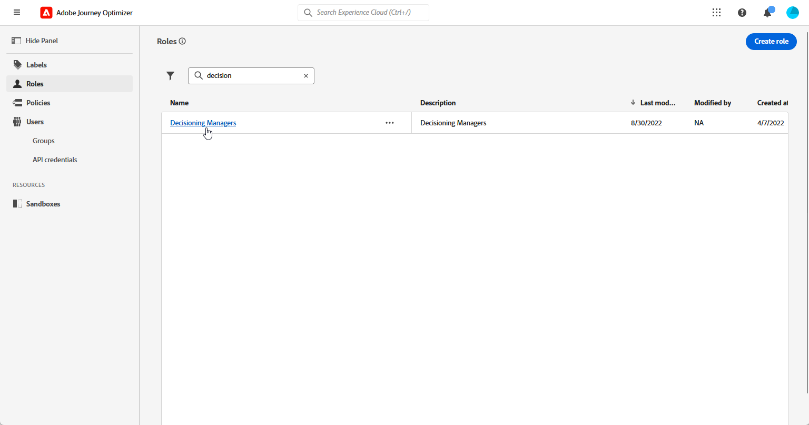
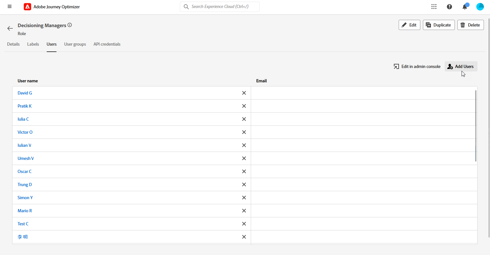
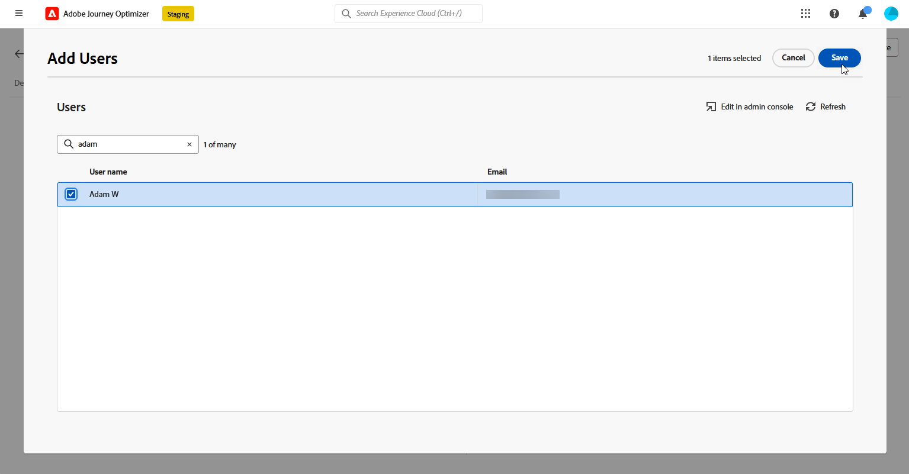
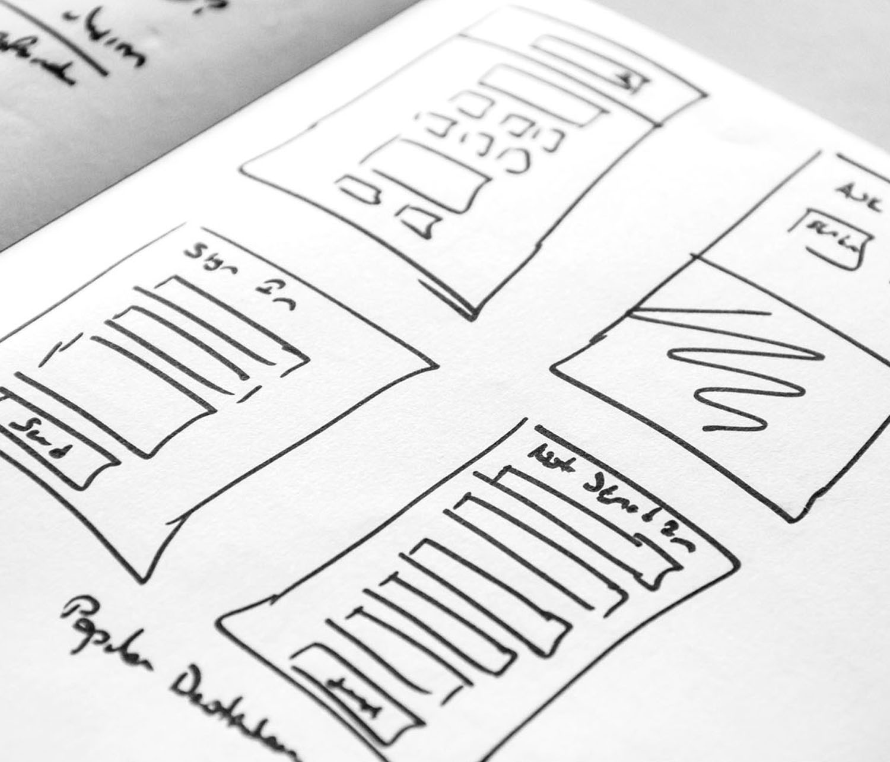

# Get started with Decisioning {#get-started-experience-decisioning}

>[!BEGINSHADEBOX]

**On this page:** Understand what Decisioning is and follow the key setup steps so you can deliver the most relevant decision items to each individual across your channels.

>[!ENDSHADEBOX]

>[!CONTEXTUALHELP]
>id="ajo_email_enable_experience_decisioning"
>title="What is decisioning?"
>abstract="Decisioning is a new tooling besides Decision management to pick the best items from decision engine and deliver to each individual. It requires additional setup in order to use it."

Create your items. Define who qualifies and how items are ranked. Let the decision engine pick the best ones for each profile.

## What is Decisioning {#about}

Decisioning simplifies personalization by offering a centralized catalog of marketing offers known as 'decision items' and a sophisticated decision engine. This engine leverages rules and ranking criteria to select and present the most relevant decision items to each individual.

These decision items are seamlessly integrated into messages and experiences across [!DNL Adobe Journey Optimizer] channels: [code-based experience](../code-based/get-started-code-based.md), [web](../web/get-started-web.md), email, mobile messages, push notifications, [custom channels](../custom-channel/get-started-custom-channel.md), and [direct mail](batch-decisioning-direct-mail.md) for batch decisioning and personalized direct mail exports. Experience Decisioning support for direct mail is a new capability; previously, the Decisioning engine was not available for direct mail extraction files.

>[!IMPORTANT]
>
>Decision policies are available to all customers for the [Code-based Experience](../code-based/get-started-code-based.md), [Web](../web/get-started-web.md), [Email](../email/get-started-email.md), [Push notification](../push/get-started-push.md), [Mobile message](../mobile/get-started-mobile.md), [Custom channels](../custom-channel/get-started-custom-channel.md), and [Direct mail](../direct-mail/get-started-direct-mail.md) channels.

➡️ [Discover this feature in video](#video)

➡️ An end-to-end use case showing how to create decisions and use them in content experiments with the code-based experience channel is presented in [this section](experience-decisioning-uc.md).

### Decisioning process {#process}

The chart below shows the five phases of setting up Decisioning, from defining your components to inserting a decision policy in your content. Check the prerequisites below, then follow the key steps to work through these phases.

{zoomable="yes"}

➡️ Feeling lost already? Go to [How Decisioning works](how-decisioning-works.md) to see how the pieces fit together.

### Prerequisites {#prerequisites}

Decisioning is only available to users with access to a Decisioning related **[!UICONTROL role]** such as Decision managers. If you cannot access Decisioning, your permissions must be extended.

+++Learn how to assign the Decision managers role

1. To assign a role to a user in the [!DNL Permissions] product, navigate to the **[!UICONTROL Roles]** tab and select Decision managers.

    

1. From the **[!UICONTROL Users]** tab, click **[!UICONTROL Add user]**.

    

1. Type in your user's name or email address or select the user from the list and click **[!UICONTROL Save]**.

    If the user was not previously created, refer to the [Add users documentation](https://experienceleague.adobe.com/en/docs/experience-platform/access-control/ui/users).

    

Your user should then receive an email redirecting to your instance.

+++

## Decisioning key steps {#steps}

The main steps to work with Decisioning are as follows:

1. **Configure custom attributes**: Tailor the item catalog to your specific requirements by setting up custom attributes into the catalog's schema.
    
    ➡️ [Learn how to configure the item catalog](catalogs.md)

1. **Create decision items** to show to your targeted audience.

    ➡️ [Learn how to create decision items](items.md) in the user interface (and in the [API documentation](api-reference/decisions-items/create.md))

1. **Organize with collections**: Use collections to categorize decision items based on attribute-based rules. Incorporate collections into your selection strategies to determine which collection of decision items should be considered.

    ➡️ [Learn how to manage item collections](collections.md) in the user interface (and in the [API documentation](api-reference/items-collections/create.md))

1. **Create decision rules**: Decision rules are used in decision items and/or selection strategies to determine to whom a decision item can be shown.

    ➡️ [Learn how to create decision rules](rules.md)

1. **Implement ranking methods**: Create ranking methods and apply them within selection strategies to determine the priority order for selecting decision items.
    
    ➡️ [Learn how to create ranking methods](ranking/ranking.md)

1. **Create selection strategies**: Build selection strategies that leverage collections, decision rules, and ranking methods to identify the decision items suitable for displaying to profiles.

    ➡️ [Learn how to create selection strategies](selection-strategies.md) in the user interface (and in the [API documentation](api-reference/selection-strategies/create.md))

1. **Create a decision policy and embed it into your journey or campaign** (code-based experience, web, email, mobile message, push, custom channels, or direct mail): Decision policies combine multiple selection strategies to determine the eligible decision items to display to the intended audience. 
    
    ➡️ [Learn how to work with decision policies](create-decision.md)

<!--
In summary, the key steps above come down to five main phases:

![Diagram of the Decisioning process in five phases: define components (decision item schema, decision rules, ranking formulas or AI models, and channel configuration); create decision items and group them in collections; configure a selection strategy with a collection, eligibility, and ranking; add a decision policy to a campaign or journey, with the number of items, selection strategies or decision items, and optional fallback items; and insert the decision policy in the content, using the decision item attributes.](assets/decisioning-process-phases.png){zoomable="yes"}
-->

>[!NOTE]
>
>Profiles that receive a decision through a journey or campaign count toward your organization's **Engageable Profiles** license metric, along with profiles engaged through other Journey Optimizer capabilities. [Monitor your Engageable Profiles count](../audience/license-usage.md)

## Go further with Decisioning {#go-further}

When you are ready, explore these topics.

<table style="table-layout:fixed"><tr style="border: 0;">
<td>

<a href="decisioning-guardrails.md">Guardrails and limitations</a>

</td>
<td>

<a href="decisioning-faq.md">Frequently asked questions</a>

</td>
<td>

<a href="placements.md">Email placements</a>

</td>
</tr></table>

<table style="table-layout:fixed"><tr style="border: 0;">
<td>

<a href="cja-reporting.md">Reporting</a>

</td>
<td>

<a href="decisioning-troubleshooting.md">Troubleshooting</a>

</td>
<td>

<a href="api-reference/getting-started.md">API reference</a>

</td>
</tr></table>

## Additional resources {#additional-resources}

* [Coworker for Decisioning](experience-decisioning-coworker-skills.md) - Ask Coworker why an offer was or wasn't shown to a profile or segment (Decisioning Explainer), or create, explain, simulate, and optimize rules and ranking formulas conversationally (Decisioning Rule Workflow).
* [Create decision policies](create-decision-policy.md) - Learn how to build decision policies combining strategies and constraints.
* [Use Adobe Experience Platform data](../../rp_landing_pages/aep-data-landing-page.md) - Use context data and Adobe Experience Platform datasets to enrich decision rules and ranking formulas.
* [Migrate from Decision management](migrate-to-decisioning.md) - Understand the benefits of migrating to Decisioning and use migration tooling APIs.
* [Decisioning tutorials](https://experienceleague.adobe.com/en/docs/journey-optimizer-learn/tutorials/decision-capabilities/decisioning/introduction-to-decisioning){target="_blank"} - Explore step-by-step video tutorials on decisioning features and best practices.

## How-to video {#video}

Learn about Decisioning capabilities in Adobe Journey Optimizer.

>[!VIDEO](https://video.tv.adobe.com/v/3451101?quality=12)

{{$include /help/_includes/do-not-localize/experience-decisioning/ai-augmented-gs-experience-decisioning.md}}
