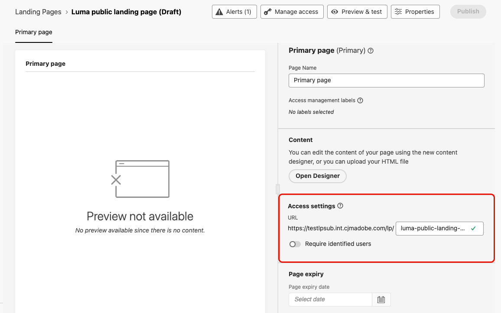
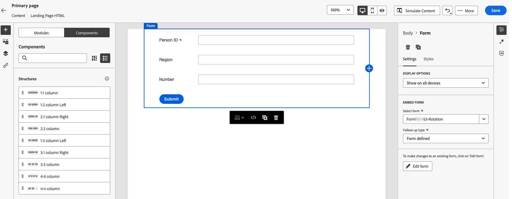
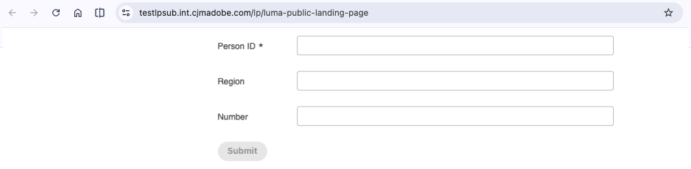

# Create public landing pages {#lp-anonymous}

>[!BEGINSHADEBOX]

**On this page:** Learn how to create public landing pages that anyone can open from a shared URL, and use them to capture data from anonymous visitors in non-profile enabled datasets.

>[!ENDSHADEBOX]

>[!AVAILABILITY]
>
>Public landing pages are available in Limited Availability. Contact your Adobe representative to request access.

Landing pages are usually displayed to a visitor who clicks a personalized link, for example from an email, so that the visitor's profile can be identified when the page loads. With public landing pages, you can also publish a landing page on a **public URL** that anyone can open. Visitors can then fill in a form on the page and submit data.

You can share the public URL anywhere, such as in emails, SMS messages, or on your website, and use it for external marketing campaigns.

## Key characteristics {#lp-anonymous-characteristics}

|  | Landing pages for known profiles | Public landing pages |
| --- | --- | --- |
| **Access** | Visitors typically open the page from a personalized link. | Anyone with the URL can open the page. |
| **Form data** | Written to a profile-enabled or non-profile-enabled dataset, for known profiles. | Written to a **non-profile enabled** dataset only. |
| **Profile creation** | Not applicable. Submissions enrich existing profiles. | Submissions do not create or enrich profiles. |
| **Subdomain** | Subdomain delegated to Adobe. | Subdomain [migrated to Cloudflare](lp-subdomains.md#lp-migrate-cloudflare). |

<!-- TBC (PM): confirm the form-data row of the known-profiles column against lp-forms.md before publishing. -->

>[!NOTE]
>
>Data submitted through a public landing page is stored in a dataset, not in a profile. It is up to you to decide how to use this data outside of [!DNL Journey Optimizer].

## Before you start {#lp-anonymous-prerequisites}

Before creating a public landing page, make sure that:

* The subdomain you want to use for your landing pages has been [migrated to Cloudflare](lp-subdomains.md#lp-migrate-cloudflare). This applies when you reuse a landing page subdomain that you already configured.
* A [landing page preset](lp-presets.md#lp-create-preset) exists for that subdomain.
* A [form preset](lp-forms.md#create-form-preset) linked to a **non-profile enabled** dataset exists, and a [form](lp-forms.md#create-form) has been created and published from that preset.

<!-- TBC (PM/engineering): PM feedback: the form must include all the mandatory fields of the dataset, otherwise publishing the form fails. PM to confirm with engineering before documenting. -->

<!-- TBC (engineering): what happens for a new subdomain (not an existing one)? Is the Cloudflare migration still required? PRD lists custom domain hosting as a non-goal for v1. -->

## Create a public landing page {#lp-anonymous-create}

A public landing page is created like any other landing page, with a few specific settings: the page must be accessible to anonymous visitors, and the form it contains must store data in a non-profile enabled dataset. To create one, follow the steps below.

1. Browse to **[!UICONTROL Content Management]** > **[!UICONTROL Landing pages]** from the left menu, then click **[!UICONTROL Create landing page]**.

1. Add a title and, optionally, a description.

1. Select a preset. [Learn how to create landing page presets](lp-presets.md#lp-create-preset)

1. Select **[!UICONTROL Data Capture]** as the type of landing page. 

    >[!NOTE]
    >
    >Only [Data Capture landing pages](get-started-lp.md#data-capture-lp) let you embed a specific form.

1. Click **[!UICONTROL Create]**. The primary page and its properties display.

1. In the **[!UICONTROL Access settings]** section, define the landing page URL. The first part of the URL is the subdomain defined in your preset. Enter the unique end of the URL in the field next to it.

    

1. Make sure the **[!UICONTROL Require identified users]** option is disabled. When this option is enabled, only identified profiles can access the page. When it is disabled, the page is accessible to anonymous visitors.

1. Click **[!UICONTROL Open Designer]** to design the content of your page. [Learn more about the landing page designer](design-lp.md)

1. Drag and drop a **[!UICONTROL Structure]** component into your content, then a **[!UICONTROL Form]** component into that structure.

1. In the **[!UICONTROL Embed form]** section, select a published form that is linked to a non-profile enabled dataset.

    

1. In the **[!UICONTROL Follow up type]** section, define what happens when visitors submit the form. [Learn more](lp-forms.md#leverage-form-in-lp)

1. Optionally, define a page expiry date, and the action that happens when the page expires. [Learn more](create-lp.md#configure-primary-page)

    <!-- TBC (engineering): the PRD describes expired pages as publicly reachable with limited functionality (error page, submit button disabled). Confirm the behavior for anonymous pages before documenting. -->

1. Click **[!UICONTROL Save]**, then use **[!UICONTROL Preview & test]** to test your page. [Learn how](create-lp.md#test-landing-page)

1. Click **[!UICONTROL Publish]**. Publishing can take some time. You are notified when the landing page is published.

## Share the landing page {#lp-anonymous-share}

Once the landing page is published, anyone can access it from its URL. To check that it is public, copy and paste the URL into a browser window.

Add the URL wherever you need it, such as in an email, an SMS message, or on your website. To track clicks from a message, [add tracking parameters](../email/message-tracking.md#insert-links) to the URL.

<!-- TBC (PM): confirm that UTM/tracking parameters can be appended for public landing pages (PRD section 7.3) and whether any anonymous visit tracking is available. -->

When visitors submit the form, the data is sent to the dataset defined in the form preset. Allow up to 15 minutes for the data to be processed and available for use.

## Guardrails and limitations {#lp-anonymous-limitations}

* Form data can only be stored in **non-profile enabled** datasets. Public landing pages cannot create or enrich profiles.
* Reporting is not supported for public landing pages.
* [Managing allowed IPs](../configuration/waf-ip-allowlist.md) is not supported for subdomains used for public landing pages.
* As for other landing pages, public landing pages cannot be [copied to another sandbox](../configuration/copy-objects-to-sandbox.md) using Sandbox tooling.
* Because anonymous visitors are not identified, do not use personalization based on profile data in the content of a public landing page.

    <!-- TBC (engineering): the architecture draft states that pages containing personalization attributes are classified as personalized and are never cached by the CDN. Confirm what happens if profile attributes are used in an anonymous page. -->

<!-- TBC (engineering): confirm whether the PRD limits apply (20 form fields maximum, 100K hits per day, 10 MB download size), and whether the existing form guardrails (CAPTCHA, consent, restricted PII fields) apply to anonymous pages. -->

## Related topics {#lp-anonymous-related}

* [Get started with landing pages](get-started-lp.md)
* [Create and publish landing pages](create-lp.md)
* [Use forms in your landing pages](lp-forms.md)
* [Configure landing page subdomains](lp-subdomains.md)

{{$include /help/_includes/do-not-localize/landing-pages/ai-augmented-lp-anonymous.md}}
