# Start and monitor your Orchestrated campaigns {#start-monitor}

>[!BEGINSHADEBOX]

**On this page:** Learn how to test, publish, and monitor Orchestrated campaigns in Adobe Journey Optimizer, including the campaign lifecycle, execution logs, and activity status indicators.

>[!ENDSHADEBOX]

>[!CONTEXTUALHELP]
>id="ajo_campaign_publication"
>title="Publish Orchestrated campaign"
>abstract="To start your campaign, you must publish it. Ensure all errors are cleared before publication."

Once you have created your orchestrated campaign and designed the tasks to perform in the canvas, you can publish it and monitor how it is being executed. You can also execute the campaign in test mode to check its execution and the result of the different activities.

## Campaign lifecycle at a glance {#lifecycle}

Orchestrated campaigns move through a defined set of states. The key stages in the publication workflow are:

| Status | What it means |
|---|---|
| **Draft** | The campaign is being built and tested — not yet active. |
| **Live** | The campaign has been published and is executing. |
| **Completed** | Campaign execution has finished. |

>[!NOTE]
>
>For all statuses (including Scheduled, Stopped, Archived) and available actions at each stage, see [Understanding campaign statuses](../campaigns/manage-campaigns.md#statuses).

## Test your campaign before publishing {#test}

[!DNL Journey Optimizer] allows you to test Orchestrated campaigns before going live. When a campaign is created, it enters the **Draft** state by default. Two complementary tests are available:

| Test | Purpose | Action |
|---|---|---|
| **[Campaign flow test](#test-flow)** | Validate the sequence and configuration of activities in the campaign workflow. | Click **[!UICONTROL Start]** in the canvas action bar. |
| **[Channel activity test](#run-test-channel)** | Simulate an individual channel activity without sending the message, and review its target population and exclusions. | Select the channel activity and click **[!UICONTROL Run test]**. |

### Test the campaign flow {#test-flow}

Use the campaign flow test to execute the workflow manually and validate how its activities are orchestrated.

>[!IMPORTANT]
>
>All activities in the canvas are executed except **[!UICONTROL Save audience]** activities and channel activities. Test each channel activity separately with **[!UICONTROL Run test]**. There is no functional impact on your data or audience.

To test an Orchestrated campaign, open the campaign and select **[!UICONTROL Start]**. Activities are executed sequentially until the workflow reaches a channel activity, where it pauses so that you can run a dry run with **[!UICONTROL Run test]**. If there is no channel activity, execution continues to the end of the canvas.

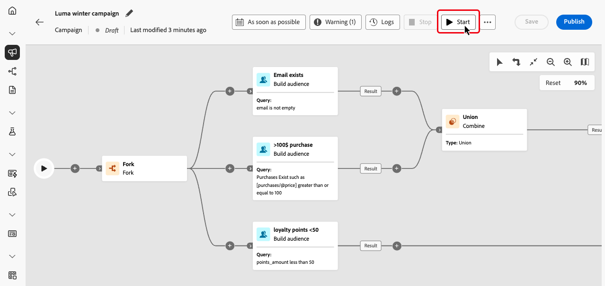{zoomable="yes"}

For **triggered orchestrated campaigns**, the system waits for an API call to start the campaign. You need to send the signal to continue the test. [Learn how to test signal-triggered campaigns](trigger-orchestrated-campaign.md#complete-and-test).

During the test, you can control the campaign execution using the action bar in the canvas. From there, you can:

* **Stop** the execution at any time.
* **Start** the execution again.
* **Restart** the execution to reset and re-run the workflow in a single action. This is particularly useful when you want to quickly retest the campaign flow after making modifications.
* **Resume** the execution if it was previously paused.

The **[!UICONTROL Alerts]** / **[!UICONTROL Warning]** icon in the canvas toolbar notifies you of issues, including warnings that may appear proactively before execution and errors that occur during or after execution.

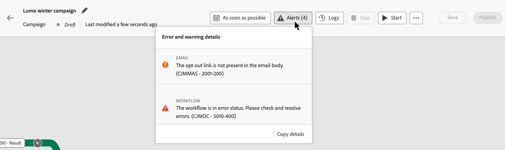{zoomable="yes"}

You can also quickly identify failed activities using the [visual status indicators](#activities) displayed directly on each activity. For detailed troubleshooting, open the [campaign's logs](#logs-tasks), which provide in-depth information about the error and its context.

The campaign flow test has important execution constraints you should be aware of:

* **Workflow pauses at channel activities** - The workflow pauses when it reaches a channel activity, such as Email, SMS, or Push. You can execute that activity separately with **[!UICONTROL Run test]**, but the workflow does not continue to subsequent activities after the channel activity is executed. This means that downstream activities, such as another channel, a condition, or an orchestration activity, cannot be reached during the campaign flow test.

* **Impact on testing strategy** - The logic that follows a message activity, such as conditional branching or multi-channel workflows, cannot be validated in the campaign flow test. To test it, you must publish the campaign and monitor live execution.

* **Expected difference from live execution** - In live execution, the workflow continues through all activities in sequence without pausing at channel activities. During test, these pauses allow you to verify message content and execution at each step, but come at the cost of incomplete workflow validation.

### Test a channel activity {#run-test-channel}

When the campaign flow test reaches a channel activity, use **[!UICONTROL Run test]** to execute that activity without sending the message. This simulates the send so that you can validate the target population and identify exclusions before publishing the campaign.

To test the channel activity and review its results:

1. Select the channel activity in the canvas, then click **[!UICONTROL Run test]**.

    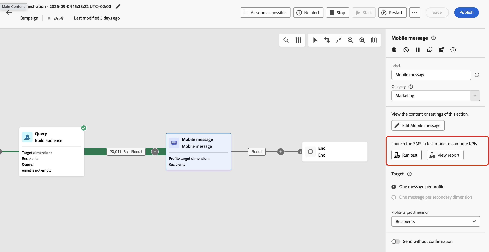

    >[!NOTE]
    >
    >The **[!UICONTROL Run test]** button can be available even when message content is invalid. Check the **[!UICONTROL Alerts]** / **[!UICONTROL Warning]** icon in the canvas toolbar for content-related errors, such as missing content for one of the message versions. Fix the reported content issues, then run the test again.

1. After the test has executed successfully, select the **[!UICONTROL View report]** button to open its live report.

    The test report uses the same campaign statistics as live reporting, but no message is sent during the test. [Learn more on the Campaign live report](../reports/campaign-live-report.md#campaign-live). 

>[!IMPORTANT]
>
>The channel activity dry run does not validate message rendering. A successful test does not guarantee that the message will render successfully when sent: profiles can be excluded at send time due to rendering errors, even when message content is valid and the target population is correctly qualified. This is separate from the invalid-content errors reported in the canvas toolbar.

You can also preview and test the content of your messages using simulation with AEP test profiles and proof sending. Start the campaign in test mode and let the workflow reach the channel activity to access its test profiles; publication is not required. [Learn how to work with channel activities and simulate content](activities/channels.md#simulate-content-test-profiles).

## Publish the campaign {#publish}

Before publishing the campaign, confirm the following:
* The campaign ran successfully in test mode with no errors in the [logs](#logs-tasks).
* Message content has been previewed using **[!UICONTROL Simulate Content]**.
* The [schedule is configured](create-orchestrated-campaign.md#schedule) if this is a scheduled campaign.
* You have reviewed the [sending confirmation](#confirm-sending) behavior — for non-recurring campaigns, no messages are sent until you explicitly approve the send after publishing.

Once your campaign is tested and ready, click **[!UICONTROL Publish]** to make it live.

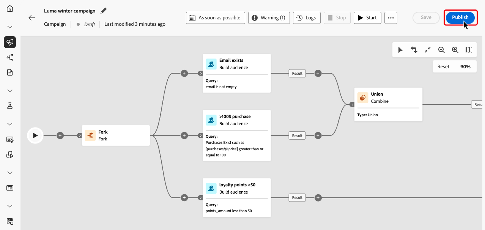{zoomable="yes"}

>[!NOTE]
>
>If the **[!UICONTROL Publish]** button is disabled (greyed out), access the logs from the action bar and check the error messages. All errors must be fixed before being able to publish a campaign.

The visual flow restarts, and real profiles begin flowing through the journey in real-time.

If the publish action fails (e.g., due to missing message content), you are alerted and must fix the issue before retrying. On successful publishing, the campaign begins executing (immediately or on schedule), moves from **Draft** to **Live** status, and becomes "Read only".

>[!IMPORTANT]
>
>For non-recurring campaigns, message delivery is paused after publishing until you explicitly confirm the send from the channel activity's properties pane. The campaign will show as **Live** but no messages are sent until confirmed. [Learn more](#confirm-sending)

### Publication-time execution sequence {#publication-sequence}

When you click **[!UICONTROL Publish]**, the following sequence occurs internally:

1. **Scheduler activation** — If the campaign has a [schedule configured](create-orchestrated-campaign.md#schedule), the scheduler kicks in and triggers execution at the defined time.
1. **Save Audience activities run first** — Any [Save audience](activities/save-audience.md) activities in the workflow execute before message activities. The audience shell is created within the [Audience Portal](../audience/about-audiences.md#browse), and qualified profiles begin ingesting.
1. **Message execution begins** — [Channel activities](activities/channels.md) start processing for the first message activity in the workflow.
1. **Profile snapshot lookup** — Profile data is resolved against a snapshot taken at publication time, not the real-time profile. This ensures consistency across the entire execution.
1. **Consent evaluation** — For matching profiles, consent is honored directly from the profile record. Consent is not re-evaluated at send time. [Learn more about consent management](../action/consent.md)
1. **On-the-fly profile creation** — Profiles that do not match an existing record are created on the fly during execution.
1. **Delivery log creation** — Delivery events are recorded in the [`ajo_message_feedback_event`](../data/datasets-query-examples.md#message-feedback-event-dataset) dataset, which is the primary source for delivery logs and post-send validation.

To validate results after execution, use Journey Optimizer reporting capabilities. [Learn more on Orchestrated campaigns reporting](reporting-campaigns.md)

## Revert a campaign back to draft {#back-to-draft}

The **[!UICONTROL Back to draft]** feature allows you to unpublish and revert an orchestrated campaign to draft status in specific situations. This is designed as a recovery mechanism to fix issues before any messages are sent, while maintaining the integrity of the campaign lifecycle.

This option is available in two scenarios:

* **Scheduled campaigns awaiting execution**: when a campaign is scheduled to execute at a specific time and that time has not yet been reached, you can use back to draft to review and modify the campaign before it starts executing. However, if the campaign is recurring (such as a daily scheduled campaign) and at least one execution has already occurred, the option is no longer available. In that case, you should [duplicate the campaign](../campaigns/manage-campaigns.md#duplicate-a-campaign) instead.

* **Live campaigns with execution errors**: when a campaign has encountered an error during execution and is paused, and no campaign executions have been completed yet, you can use back to draft to fix the error and republish the campaign.

To switch a campaign back to draft status, open the orchestrated campaign and click the **[!UICONTROL Back to draft]** button in the campaign canvas toolbar.

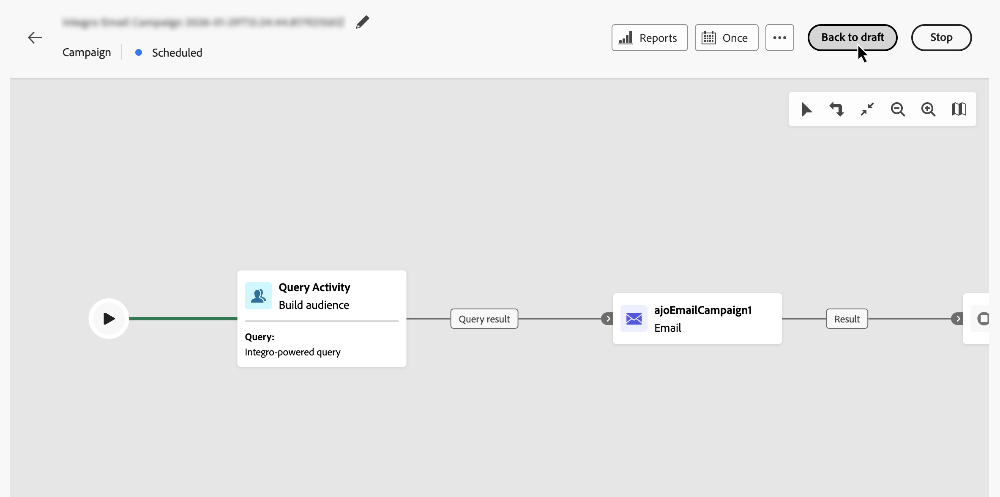

The campaign is unpublished and the workflow is stopped. The campaign returns to **Draft** status. You can now fix the identified issues, then [test the campaign](#test) and [publish it](#publish) again when ready.

## Confirm message sending {#confirm-sending}

By default, for non-recurring orchestrated campaigns, message delivery is paused until you explicitly approve the send. After publishing the campaign, confirm the send request from the channel activity's properties pane. Until it is confirmed, the channel activity stays pending and no message is sent.

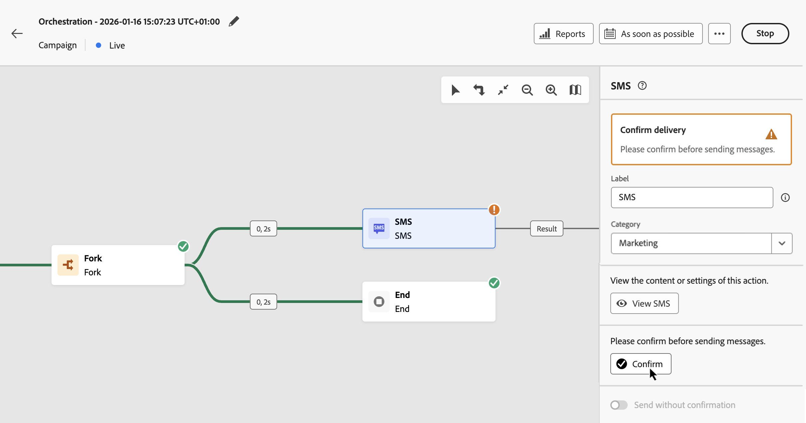

Before publishing, you can disable sending confirmation from the channel activity properties pane. For details, see [Confirm message sending](activities/channels.md#confirm-message-sending).

## Monitor campaign execution {#monitor}

### Visual flow monitoring {#flow}

While running (in test or live mode), the visual flow shows how profiles move through the journey in real-time. The number of profiles transitioning between tasks is displayed.

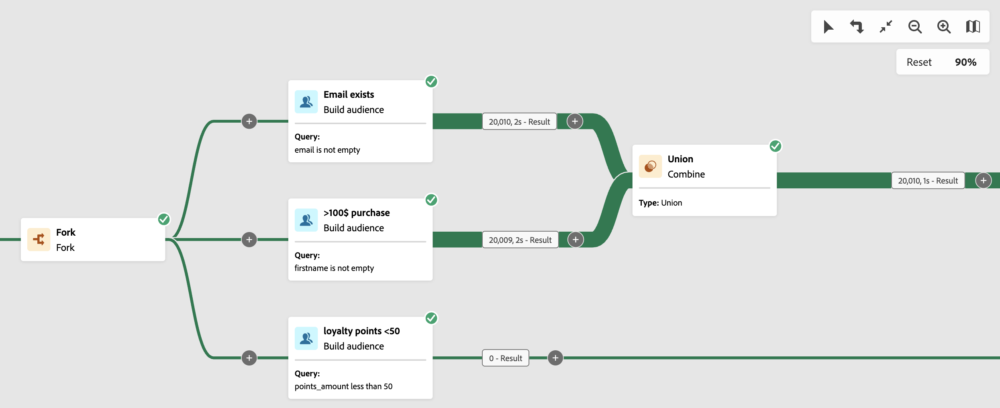{zoomable="yes"}

Data transported from one activity to another through transitions is stored in a temporary work table. This data can be displayed for each transition. To inspect data passed between activities:

1. Select a transition.
1. In the properties pane, click **[!UICONTROL Preview schema]** to view the work table schema. Select **[!UICONTROL Preview results]** to see the transported data.

    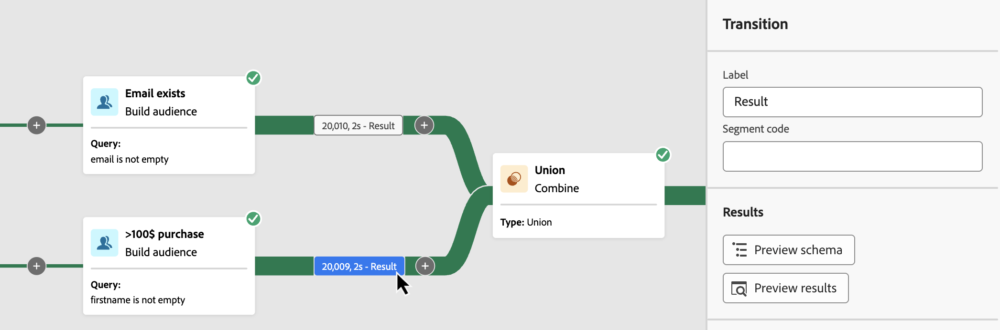{zoomable="yes"}

You can now inspect the data passed between activities to validate your campaign flow and confirm that each activity is processing the expected profiles.

### Activity execution indicators {#activities}

Visual status indicators help you understand how each activity is performing:

|Visual indicator | Description |
|-----|------------|
|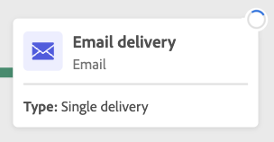{zoomable="yes"}{width="70%"}| The activity is currently being executed. |
|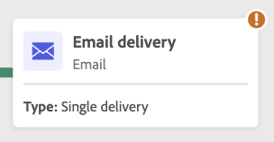{zoomable="yes"}{width="70%"}| The activity requires your attention. This may involve confirming the sending of a delivery or taking a necessary action. |
|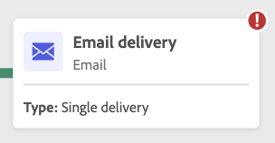{zoomable="yes"}{width="70%"}|The activity has encountered an error. To resolve the issue, open the Orchestrated campaign logs for more information.|
|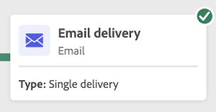{zoomable="yes"}{width="70%"}|The activity has been successfully executed. |

### Logs and tasks {#logs-tasks}

>[!CONTEXTUALHELP]
>id="ajo_campaign_logs"
>title="Logs and tasks"
>abstract="The **Logs and tasks** screen provides a history of the Orchestrated campaign execution, recording all user actions and encountered errors."

Monitoring logs and tasks is a key step to analyze your Orchestrated campaigns and make sure they are running properly. Logs and tasks are accessible from the **[!UICONTROL Logs]** button which is available in both test and live mode in the canvas toolbar.

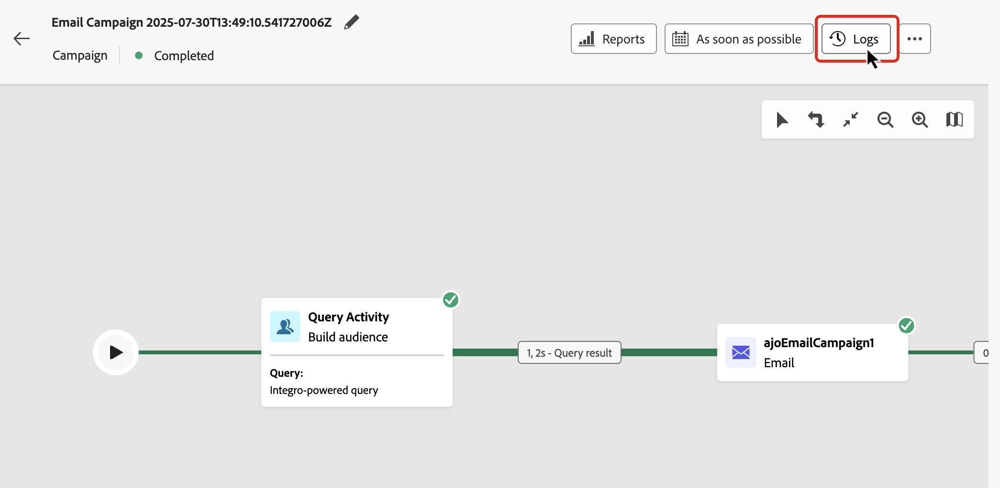{zoomable="yes"}

The **[!UICONTROL Logs and tasks]** screen provides a complete history of your campaign execution, recording all user actions and encountered errors.

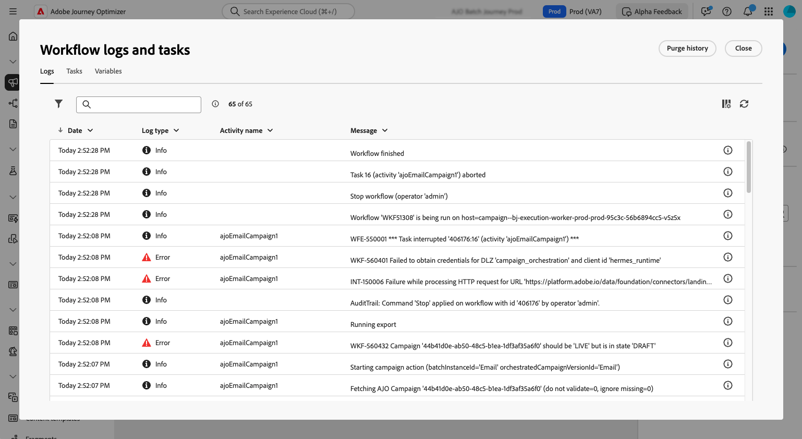{zoomable="yes"}

Two types of information are available:

* The **[!UICONTROL Log]** tab contains the chronological history of all operations and errors.
* The **[!UICONTROL Tasks]** tab details the step-by-step execution sequence of activities.

In both tabs, you can choose the displayed columns and their order, apply filters, and use the search field to quickly find the desired information.

### Set up alerts {#alerting}

System alerts provide proactive notifications about issues in your Orchestrated campaigns, so you can investigate and take corrective action without continuously checking the monitoring view. You can view and manage available alerts from **[!UICONTROL Administration]** > **[!UICONTROL Alerts]**.

For information about available alerts and how to subscribe, see [Access and subscribe to system alerts](../reports/alerts.md).

You can also create your own alert by adding an **[!UICONTROL Alert]** activity to the campaign canvas. The alert fires when campaign execution reaches the activity. [Learn how to configure the Alert activity](activities/alert.md).

If an Orchestrated campaign returns an error code, see [Orchestrated campaign errors](orchestrated-campaign-errors.md).

## Next steps {#next}

After starting the Orchestrated campaign canvas, you can use Journey Optimizer reporting capabilities to get insights such as understanding audience behavior, and measuring the performance of each step in your customer journey. [Learn more on Orchestrated campaigns reporting](../orchestrated/reporting-campaigns.md)

Have questions about Orchestrated campaigns? Check the [Orchestrated campaigns FAQ](orchestrated-campaigns-faq.md) for answers to the most common questions from practitioners.

{{$include /help/_includes/do-not-localize/orchestrated/ai-augmented-start-monitor-campaigns.md}}
