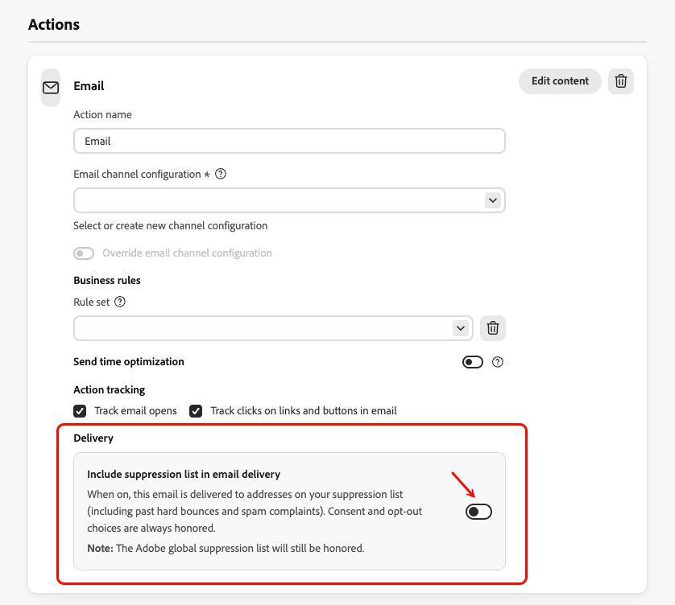
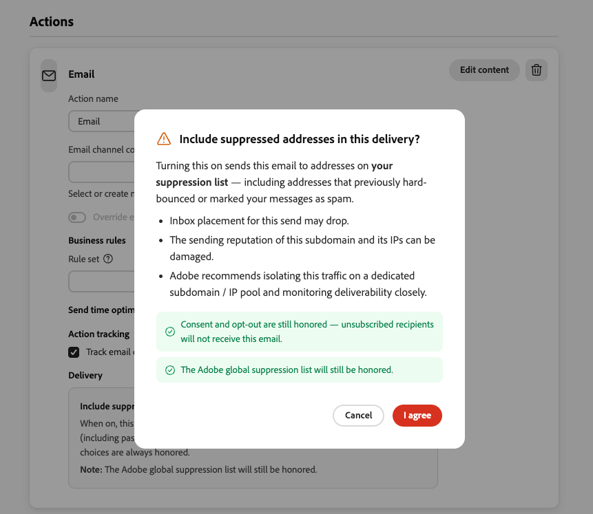

# Suppression list {#suppression-list}

>[!BEGINSHADEBOX]

**On this page:** Learn how the suppression list excludes specific email addresses and domains from your deliveries to protect your sending reputation and delivery rates.

>[!ENDSHADEBOX]

A suppression list consists of addresses and domains that you want to exclude from your deliveries, because sending to these contacts could hurt your sending reputation and delivery rates.

The [!DNL Journey Optimizer] suppression list is managed at your own environment level, i.e. for a given sandbox.

It gathers email addresses and domains that are suppressed across all mailings in a single client environment, meaning specific to an organization ID associated with a sandbox ID.

>[!NOTE]
>
>Adobe keeps an updated list of known bad addresses which have been proven to be detrimental to engagement and mailing reputation, and ensures emails are not delivered to them. This list is managed in a global suppression list which is common across all Adobe customers.
>
>The addresses and domain names contained in the global suppression list are hidden. Only the number of excluded recipients is indicated in the delivery reports.

In addition, you can leverage Journey Optimizer **Suppression REST API** to control your outgoing messages using suppression and allow lists. [Learn how to work with the Suppression REST API](https://developer.adobe.com/journey-optimizer-apis/references/suppression){target="_blank"}

## Why a suppression list? {#why-suppression-list}

To control the email messages that are received by their inbox owners and ensure they only receive those they want, Internet service providers (ISPs) and commercial spam filters have their proprietary algorithms to track the overall reputation of email senders based on the IP addresses and sending domain(s) they use.

If you do not take their feedback (such as spam complaints, bounces, etc.) into account, they will rate your reputation down. The suppression list helps you with honoring the ISPs' feedback.

The recipients whose email addresses are suppressed are automatically excluded from message delivery. This will speed up deliveries, as the error rate has a significant effect on delivery speed.

## What's on the suppression list? {#what-s-on-suppression-list}

Addresses are added to the suppression list as follows:

* All **hard bounces** and **spam complaints** automatically send the corresponding addresses to the suppression list after a single occurrence. Learn more about spam complaints in [this section](#spam-complaints).

* **Soft bounces** do not immediately send an address to the suppression list, but they increment an error counter. Several [retries](../configuration/retries.md) are then performed, and when the error counter reaches the threshold, the address is added to the suppression list.

* You can also [**manually** add an address or a domain](../configuration/manage-suppression-list.md#add-addresses-and-domains) to the suppression list.

Learn more about hard bounces and soft bounces in [this section](#delivery-failures).

>[!NOTE]
>
>Unsubscribed users' addresses cannot be sent to the suppression list as they are not receiving emails from [!DNL Journey Optimizer]. Their choice is handled at the Experience Platform level. Learn more about [opting-out](../privacy/opt-out.md).

For each address, the basic reason for being suppressed and the suppression category (soft, hard, etc.) are displayed in the suppression list. Learn more about accessing and managing the suppression list in [this section](../configuration/manage-suppression-list.md).

>[!NOTE]
>
>The profiles with **[!UICONTROL Suppressed]** status are excluded during the message sending process. Therefore, while the **Journey reports** will show these profiles as having moved through the journey ([Read Audience](../building-journeys/read-audience.md) and [message activities](../building-journeys/journey-action.md)), the **Email reports** will not include them in the **[!UICONTROL Sent]** metrics as they are filtered out prior to email sending.
>
>Learn more about the [Live Report](../reports/live-report.md) and [Customer Journey Analytics report](../reports/report-gs-cja.md). To find out the reason for all exclusion cases, you can use the [Adobe Experience Platform Query Service](https://experienceleague.adobe.com/docs/experience-platform/query/api/getting-started.html){target="_blank"}.

### Delivery failures {#delivery-failures}

There are two types of errors when a delivery fails:

* **Hard bounce**. A hard bounce indicates an invalid email address (i.e. an email address that does not exist). This involves a bounce message from the receiving email server that explicitly states that the address is invalid.
* **Soft bounce**. This is a temporary email bounce that occurred for a valid email address.

A **hard bounce** automatically adds the email address to the suppression list.

A **soft bounce** <!--or an **ignored** error--> that occurs too many times also sends the email address to the suppression list after several retries. [Learn more about retries](../configuration/retries.md)

If you continue sending to these addresses, it may affect your delivery rates, because it tells ISPs that you may not be following email address list maintenance best practices, and therefore may not be a trustworthy sender.

### Spam complaints {#spam-complaints}

The suppression list collects email addresses that mark your message as spam. For example, if someone writes to a customer service requesting to never receive mail again from you, the email address of that person will be suppressed across your instance and you won't be able to deliver to that address anymore.

Sending to recipients after they submit a spam complaint may have a huge impact on your sending reputation, because it informs ISPs that you may send unwanted emails and may not listen to your recipients.

This could lead to your IP address or sending domain being blocked, which can be avoided with these addresses being on the suppression list.

Some ISPs offer a feedback loop (FBL) that allows the email sender to be automatically notified when the user who receives an email chooses to mark it as spam. [Learn more](deliverability.md#feedback-loops)

>[!NOTE]
>
>Not all email providers share user-level spam complaint (feedback loop) data. In particular, **Gmail** does not, unlike Yahoo Mail or Microsoft Outlook. Gmail recipients who mark a message as spam are therefore **not** automatically added to the suppression list. To monitor Gmail deliverability, use open and click rate trends and [Google Postmaster Tools](https://postmaster.google.com/){target="_blank"}.

### Suppression categories and failure reasons {#suppression-categories-and-reasons}

When a message fails to be delivered to an email address, [!DNL Journey Optimizer] determines why the delivery failed and associates it with a **[!UICONTROL Suppression category]**. The suppression categories are as follows:

* **Hard**: [hard bounces](#delivery-failures) and [spam complaints](#spam-complaints). The email address is immediately sent to the suppression list.
* **Soft**: [soft bounces](#delivery-failures). The email address is sent to the suppression list once the error counter reaches the retry threshold. [Learn more about retries](../configuration/retries.md)
* **Manual**: email addresses and domains that were [manually added](../configuration/manage-suppression-list.md#add-addresses-and-domains) to the suppression list.

Possible reasons for a delivery failure are:

| Reason | Description | Category |
| --- | --- | --- |
| **[!UICONTROL Invalid Recipient]** | The recipient's address is invalid or does not exist. | Hard |
| **[!UICONTROL Soft Bounce]** | The message soft bounced for a reason other than the soft errors listed in this table, such as when sending over the allowed rate recommended by an ISP. | Soft |
| **[!UICONTROL DNS Failure]** | The message bounced due to a DNS failure. | Soft |
| **[!UICONTROL Mailbox Full]** | The message bounced due to the mailbox of the recipient being full and unable to accept more messages. | Soft |
| **[!UICONTROL Relaying Denied]** | The message was blocked by the receiver because relaying is not allowed. | Soft |
| **[!UICONTROL Challenge-Response]** | The message is a challenge-response probe. | Soft |
| **[!UICONTROL Spam Complaint]** | The message was blocked because marked as a spam by the recipient. | Hard |

## Include suppressed addresses in an email delivery {#include-suppressed-addresses}

>[!CONTEXTUALHELP]
>id="ajo_email_include_suppression_list"
>title="Include suppression list in email delivery"
>abstract="When on, this email is also delivered to the addresses on your suppression list, including past hard bounces and spam complaints. Use this option only when you have a compliance requirement, as it can damage your deliverability. The Adobe global suppression list, consent, and opt-out choices are still honored."

>[!AVAILABILITY]
>
>This capability is available in Limited Availability. Contact your Adobe representative to gain access.

By default, [!DNL Journey Optimizer] excludes from every email delivery the addresses that are on your suppression list and on the Adobe global suppression list.

If you have a compliance requirement, for example when a communication must be demonstrably attempted to an address that previously bounced, you can include the addresses on your suppression list in a specific email delivery. This option is set at the email action level, in a campaign or in a journey.

>[!CAUTION]
>
>Sending to suppressed addresses is not a recommended email practice. Use this option only when you have a compliance requirement.
>
>Inbox placement for the send may drop, and the sending reputation of the subdomain and its IPs can be damaged. Adobe recommends isolating this traffic on a dedicated subdomain or IP pool and monitoring deliverability closely.

To include suppressed addresses in an email delivery, follow these steps:

1. From the settings of the email action in your campaign or journey, go to the **[!UICONTROL Delivery]** section.

1. Turn on the **[!UICONTROL Include suppression list in email delivery]** option.

    {width="80%"}

1. In the confirmation dialog, review the impacts and select **[!UICONTROL I agree]**. If you select **[!UICONTROL Cancel]**, the option remains turned off.

    {width="80%"}

When this option is on, the following rules apply to that email action only:

* The email is delivered to all the addresses on your suppression list, whatever their suppression category (hard bounces, spam complaints, soft bounces, or manual entries).
* The Adobe global suppression list is still honored: addresses on that list remain excluded.
* Consent and opt-out choices are always honored: unsubscribed recipients do not receive the email.

You can turn off the option at any time. No confirmation is required.

>[!NOTE]
>
>This option is different from the **[!UICONTROL Send to suppressed email addresses]** option of the email channel configuration, which applies to transactional messages and to addresses suppressed due to spam complaint only. [Learn more](../email/email-settings.md#send-to-suppressed-email-addresses)
