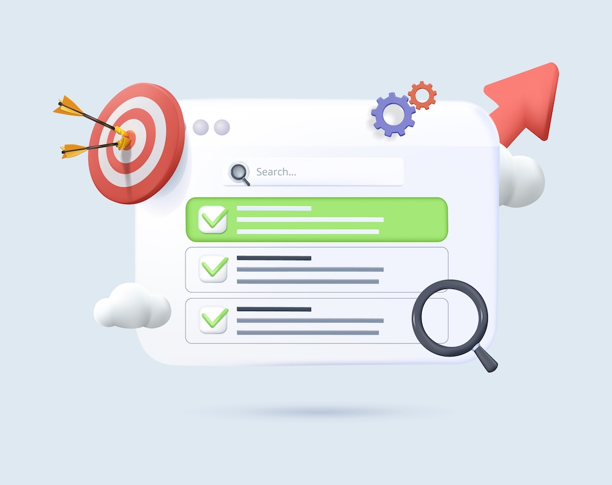

# Documentation highlights {#documentation-highlights}

>[!BEGINSHADEBOX]

**On this page:** The most useful [!DNL Journey Optimizer] documentation updates of October and November 2026: a Decisioning path from first concept to troubleshooting, new pages worth a bookmark, changes and limits to know about, and quick answers. Every item links straight to the section where it lives.

>[!ENDSHADEBOX]

Short on time? Start with [In the spotlight](#spotlight) and [Good to know](#good-to-know).

>[!NOTE]
>
>This page highlights documentation changes only, and picks the ones that are worth your time.
>
>* For new product features, see the [Release notes](release-notes.md).
>* For a month-by-month list of every documentation change, see the [Documentation updates](documentation-updates.md).

## In the spotlight: Decisioning, end to end {#spotlight}

Feeling lost among the Decisioning terms? November brought a map, a troubleshooting guide, and a bigger FAQ. Start with the first page below, or jump straight to the one you need.

{width="90%" align="center" zoomable="yes"}

| Page | What you get | Status |
| --- | --- | --- |
| [How Decisioning works](../experience-decisioning/how-decisioning-works.md) | The map: how decision items, collections, rules, ranking methods, selection strategies, and decision policies fit together, and what happens each time a profile needs content. | **New page** · Nov 2026 |
| [Get started with Decisioning](../experience-decisioning/gs-experience-decisioning.md#prerequisites) | The process chart now comes before the steps, a new **Prerequisites** section lists the permissions you need, and **Go further with Decisioning** replaces the Decisioning landing page. | **Reorganized** · Nov 2026 |
| [Create AI models](../experience-decisioning/ranking/create-ai-models.md#use-ai-model) | The prerequisites for profile and context features, how to use an AI model in a selection strategy and a decision policy, and how to pass context values in the decision request. | **Expanded** · Nov 2026 |
| [Troubleshoot Decisioning](../experience-decisioning/decisioning-troubleshooting.md#troubleshooting) | How eligibility, capping, ranking, and fallback items decide what a profile receives, and a checklist to find out why an item was or was not shown. | **New page** · Nov 2026 |
| [Decisioning frequently asked questions](../experience-decisioning/decisioning-faq.md) | Answers on getting started, key concepts, Decision management versus Decisioning, eligibility, capping rules, strategy order, ranking formulas, and troubleshooting. | **Expanded** · Nov 2026 |
| [Get started with decision management](../offers/get-started/starting-offer-decisioning.md) | Decision management pages now start with a banner that identifies them as the legacy capability and links to the Decisioning equivalent. To see how the objects map, read [Coming from Decision management?](../experience-decisioning/how-decisioning-works.md#compare) | **Updated** · Nov 2026 |

## New and notable {#new}

New pages and sections that are worth a bookmark.

<table style="table-layout:fixed"><tr style="border: 0;">
<td>

<a href="../../rp_landing_pages/troubleshooting-overview-landing-page.md">Fix errors faster</a>

A new troubleshooting overview and 14 error pages give the cause and the fix for each error code, grouped by family. <em>New section · Oct 2026</em>

</td>
<td>

<a href="../configuration/archiving-overview.md">Keep a copy of what you send</a>

Compare BCC email and Message Export to retain sent messages, and see why mirror pages and the Entity Dataset are not archiving options. <em>New section · Oct 2026</em>

</td>
<td>

<a href="../campaigns/api-triggered-high-throughput.md#configure-high-throughput">Set up High throughput yourself</a>

Once your add-on is activated, set up High throughput in the UI: a dedicated IP pool and channel configuration for email, or a channel configuration for push. <em>New section · Oct 2026</em>

</td>
</tr></table>

<table style="table-layout:fixed"><tr style="border: 0;">
<td>

<a href="../conflict-prioritization/quiet-hours.md#best-practices">Get quiet hours right</a>

Best practices for choosing a time zone mode, queuing or discarding messages, and pairing quiet hours with frequency capping. <em>New section · Nov 2026</em>

</td>
<td>

<a href="../reports/suppression-list.md#suppression-categories-and-reasons">Know why an address is suppressed</a>

Suppression categories and failure reasons now sit with hard bounces, soft bounces, and spam complaints. <em>Reorganized · Nov 2026</em>

</td>
<td>

<a href="../orchestrated/start-monitor-campaigns.md#test">Test orchestrated campaigns safely</a>

Run the campaign flow test, then test each channel activity to review its target population and exclusions without sending the message. <em>New section · Nov 2026</em>

</td>
</tr></table>

Also new:

* [Choose a consent level for opt-outs](../email/consent-level.md): decide whether an opt-out applies to every email address of a profile or only to the address that received the message. *New page · Oct 2026*
* [Configure OAuth 2.0 authentication](../custom-channel/custom-channel-oauth2.md): set up the token request, credential paths, and token extraction for custom channels. *New page · Oct 2026*

## Good to know {#good-to-know}

Changes, limits, and pitfalls that can surprise you. Each row links to the section that explains it.

### Changes and actions to take {#changes-actions}

| Topic | What to know | Go to the section |
| --- | --- | --- |
| **Time-to-live rollout delayed** *Oct 2026* | The time-to-live (TTL) guardrail already applies to new sandboxes and new organizations. Adobe has delayed the rollout to existing customer sandboxes, originally planned for October 1, 2026, and notifies impacted customers before it enforces the TTL. | [Datasets Time-to-live (TTL) guardrails](../data/datasets-ttl.md) |
| **Supplemental IDs and external audiences** *Nov 2026* | When you create an external audience through the API and it has several rows for the same profile, set `expressActivation: true` at creation. The flag defaults to `false` and cannot be changed afterwards. Without it, only one row per profile is admitted and the other rows, with their supplemental IDs, are not activated. Federated Audience Composition sets it for you. | [Supplemental identifiers with external audiences](../building-journeys/supplemental-identifier.md#external-audiences) |
| **Open tracking consent and existing messages** *Nov 2026* | After you turn on **[!UICONTROL Honor open tracking consent]**, republish your transactional messages once, and republish read audience journeys to apply the setting to future runs. Scheduled marketing campaigns and event-based journeys need no action. | [Apply the option to existing messages](../email/open-tracking-consent.md#existing-messages) |

### Limits and pitfalls {#pitfalls}

| Topic | What to know | Go to the section |
| --- | --- | --- |
| **Special characters in personalized URLs** *Oct 2026* | Use three curly braces (`{{{ ... }}}`) for the dynamic part of a personalized URL, so that escaping does not alter special characters such as `/` and `+`. Otherwise the URL can break, redirect to the wrong place, or cause tracking issues. Raw output is inserted as is, so use it only with values you know are URL-safe. | [Use triple curly braces in personalized URLs](../email/url-personalization.md#use-braces) |
| **Frequency capping and identity namespaces** *Nov 2026* | Channel capping works for all identity namespaces selected while you author a campaign or journey. Profile counters are tracked separately for each namespace, so capping on one namespace does not affect another. | [Frequency capping by channel and communication type](../conflict-prioritization/channel-capping.md) |
| **Quiet hours and time zones** *Nov 2026* | When you use the recipient's local time zone, make sure profiles include a time zone value: quiet hours are not enforced for profiles that do not. | [Choose a time zone mode](../conflict-prioritization/quiet-hours.md#choose-time-zone) |
| **Decisioning changes take time to apply** *Nov 2026* | Changes to a decision policy and to the objects it uses, such as adding an item to a collection or changing a rule, can take up to 15 minutes to propagate across all data regions, and up to 30 minutes for Canada. After you approve an item or create a capping rule, it can also take up to 15 minutes before events count toward the cap. Allow for this delay when you test a change. | [When do changes take effect?](../experience-decisioning/decisioning-troubleshooting.md#timing) |

## Numbers to remember {#numbers}

Limits and timings documented or clarified in October and November.

| 10 | 60 and 120 | 6 hours | 7 days |
| --- | --- | --- | --- |
| Lookups allowed per inbound message request. Exceeding the limit can fail the entire request with an HTTP 422 error. | Fragments you can add: 60 unique fragments per variant, and up to 120 distinct fragments across all variants of a multilingual message. | How long the Throttling API queues events when its limit is reached. Events still queued after that are dropped and reported with a `timedout` status. | How long Message Export records are kept from ingestion. Export them within that window to retain them longer. |
| [Inbound channel guardrails](../start/guardrails.md#inbound-guardrails) | [Use a fragment](../email/use-visual-fragments.md#use-fragment) | [Throttling FAQ](../configuration/external-systems.md#faq) | [Choose an archiving option](../configuration/archiving-overview.md#archiving-options) |

## Watch and learn {#watch}

Short how-to videos show Coworker and Decisioning at work. Start with this one: Coworker turns a plain-language description into a fully drafted journey.

>[!VIDEO](https://video.tv.adobe.com/v/3496867?quality=12)

More how-to videos:

* [Turn a flowchart image into a ready-to-edit journey, or build a cross-channel journey from a prompt](../building-journeys/journeys-coworker-skills.md#journey-create-videos)
* [Compare two versions of a journey](../building-journeys/journeys-coworker-skills.md#journey-tools-videos)
* [Simulate a journey with generated test profiles and events](../building-journeys/journeys-coworker-skills.md#journey-simulation-videos)
* [Create, manage, and optimize loyalty challenges](../loyalty-challenges/loyalty-coworker-skills.md#loyalty-challenge-management-videos)
* [Personalize a web page with Decisioning in the web visual editor](../experience-decisioning/use-decision-policy.md#video)

## Quick answers {#faq}

Short answers drawn from the pages above. Each one links to the full explanation.

+++ Where did the Decisioning landing page go?

The **Go further with Decisioning** section of [Get started with Decisioning](../experience-decisioning/gs-experience-decisioning.md#go-further) replaces it. It links to guardrails, the FAQ, email placements, reporting, troubleshooting, and the API reference.

+++

+++ Why was a decision item not shown to a profile?

Go through the checklist in order: dates and status, collection, eligibility, capping, order and number of items, fallback items, and recent changes (a change can take up to 15 minutes to apply, and 30 minutes for Canada). If you have access to Coworker and Decisioning, you can also ask the [Decisioning Explainer](../experience-decisioning/experience-decisioning-coworker-skills.md#decisioning-explainer). [Open the checklist](../experience-decisioning/decisioning-troubleshooting.md#troubleshooting)

+++

+++ What is the difference between an audience and a decision rule for eligibility?

An audience is a list of profiles that Adobe Experience Platform computes from profile attributes and experience events. It is not recomputed when a decision is made, so it might not be up to date. A decision rule is a condition that runs against the individual profile every time a decision is made, so each profile gets the latest result. Rules can use profile attributes, audiences, and context data. [Learn more](../experience-decisioning/decisioning-troubleshooting.md#audiences-rules)

+++

+++ Can I send an email to addresses that are on my suppression list?

Only when you have a compliance requirement. You can include the addresses on your suppression list in a specific email delivery, at the email action level in a campaign or a journey. This option is in Limited Availability. Inbox placement can drop and the sending reputation of the subdomain and its IPs can be damaged, so Adobe recommends isolating this traffic on a dedicated subdomain or IP pool. The Adobe global suppression list, consent, and opt-out choices are still honored. [Learn more](../reports/suppression-list.md#include-suppressed-addresses)

+++

+++ If a profile has several email addresses, does an opt-out apply to all of them?

It depends on the consent level. With **[!UICONTROL Channel]**, the opt-out is recorded for the email channel on the whole profile and applies to every email address of that profile. With **[!UICONTROL Identity]**, it is recorded only for the address that received the message. **[!UICONTROL Identity]** is the default level if nothing else is configured. [Learn more](../email/consent-level.md#channel-vs-identity)

+++

+++ What does an error code such as AJOJAS-2030-400 mean?

An error code has a prefix that identifies the service, an error number, and an HTTP status. In `AJOJAS-2030-400`, AJOJAS is the prefix of journey validation errors, 2030 is the error number, and 400 is the status. A status of 200 is a warning: it does not block saving or publishing. [Read an error code](../../rp_landing_pages/troubleshooting-overview-landing-page.md#read-error-code)

+++

## Keep exploring {#keep-exploring}

* [Documentation updates: November 2026](documentation-updates.md#november-2026) and [October 2026](documentation-updates.md#october-2026): every change, with a link to each section.
* [Release notes](release-notes.md): new features and improvements.
