# Release notes v2 (review draft) {#release-notes-v2}

This hidden page is a review copy of the September, October, and November 2026 release notes. Each feature and improvement carries a **Why it matters** accordion for PM, PMM, and Eng lead review. It is not part of the published release notes.

<!-- All Why it matters accordions on this page are drafts until PM, PMM, and the Eng lead confirm them. -->

## November '26 release notes {#nov-26-release-notes}

### Journeys {#nov-26-journeys}

<table>
<thead>
<tr>
<th><strong>AI recommendation cards for journey alerts</strong> </th>
</tr>
</thead>
<tbody>
<tr>
<td>

Spend less time investigating journey issues and get a head start on resolving them. When a <strong>Journey Custom Action failure</strong> or <strong>Journey Anomaly Detected</strong> alert fires, an <strong>AI Recommendations</strong> card on the Journey Optimizer home page highlights the issue. Select the card to review analysis and recommended next steps already prepared in Coworker, without having to request an investigation first. Continue the conversation to explore the findings and decide how to address the issue.

This capability is only available for a set of organizations (Limited Availability). To gain access, contact your Adobe representative.

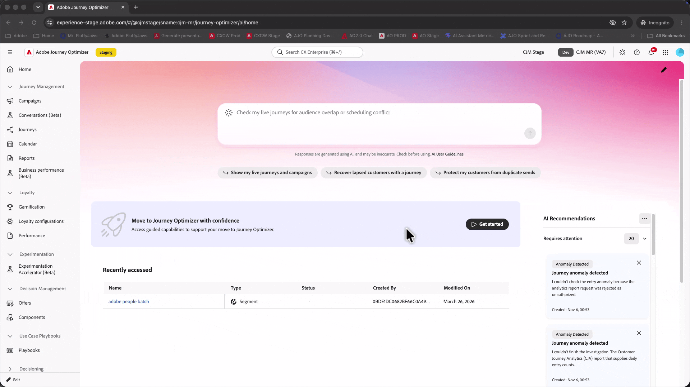

For more information, refer to the <a href="../start/user-interface.md#cx-enterprise-coworker">detailed documentation</a>.

Availability date: November 16, 2026

+++ Why it matters

**Why it helps:** Get a head start on journey issues, because the analysis and recommended next steps are already prepared in Coworker when an alert fires.

**How it works:** On the Journey Optimizer home page, the AI Recommendations panel shows a card when a Journey Custom Action failure or Journey Anomaly Detected alert fires. Select the card to open Coworker with the analysis and recommended next steps already prepared, without requesting an investigation first. AI monitoring is disabled by default: select Enable in the AI Recommendations panel.

**What you can do now:**

* Spot a custom action failure or a journey anomaly from a card on the home page.
* Review the prepared analysis and recommended next steps in Coworker without requesting an investigation.
* Continue the conversation in Coworker to explore the findings and decide how to address the issue.

**Good to know:** Limited Availability for a set of organizations; contact your Adobe representative for access. The feature surfaces recommendations only and does not resolve the issue automatically. AI monitoring must be enabled from the AI Recommendations panel.

**Status:** Limited Availability

+++

</td>
</tr>
</tbody>
</table>

### Campaigns {#nov-26-orchestrated-campaigns}

<table>
<thead>
<tr>
<th><strong>Orchestrated campaigns skills in Coworker</strong> </th>
</tr>
</thead>
<tbody>
<tr>
<td>

You can now find and inspect orchestrated campaigns conversationally from the Coworker chat interface. This release covers three read-only skills:

<ul>
<li>
<strong>Orchestrated Campaign List</strong>: list, filter, and count campaigns, for example by status or channel.
</li>
<li>
<strong>Orchestrated Campaign Get</strong>: retrieve a specific campaign's details, lifecycle history, and execution history, and visualize its activity graph.
</li>
<li>
<strong>Orchestrated Campaign Workflow Renderer</strong>: render a workflow graph as a visual diagram.
</li>
</ul>

This provides teams with live visibility into campaign data without requiring API access or navigation through the Journey Optimizer user interface. Creating, editing, or publishing campaigns via Coworker is not yet supported.

For more information, refer to the <a href="../orchestrated/orchestrated-campaigns-coworker-skills.md">detailed documentation</a>.

Availability date: November 3, 2026

+++ Why it matters

**Why it helps:** Find and inspect orchestrated campaigns by asking Coworker, without API access or navigating the Journey Optimizer interface.

**How it works:** Ask in the Coworker chat. Orchestrated Campaign List lists, filters and counts campaigns, for example by status or channel. Orchestrated Campaign Get retrieves a named campaign's details, lifecycle history, execution history and activity graph. Orchestrated Campaign Workflow Renderer renders a workflow graph payload that is already in the conversation as a diagram.

**What you can do now:**

* List and filter orchestrated campaigns, for example the live ones or the ones created by a given user.
* Count campaigns that match a criterion, such as how many use email.
* Review a campaign's details, lifecycle history and execution history, including whether it failed.
* Visualize a campaign's activity graph.

**Good to know:** All three skills are read-only. Creating, editing or publishing campaigns through Coworker is not supported, and campaign analytics and performance reporting are not supported.

+++

</td>
</tr>
</tbody>
</table>

+++ Coming soon — **Information below is subject to change.**

* **Increased message activity limit** - Orchestrated campaigns now support up to **25 message actions** on a single canvas, up from the previous limit of 10. This allows complex cross-channel orchestrations, spanning email, push, SMS, and other channels, to be built and managed as a single campaign rather than split across multiple smaller ones.

  For enterprise teams running sophisticated multi-step programs, this reduces operational overhead and simplifies publication and rollback handling when managing large campaign launches.

+++

### Onboarding {#nov-26-onboarding}

* **Migrate transactional email campaigns to Journey Optimizer** - The migration workspace now supports **Campaigns**. You can bring the transactional emails you built in your existing marketing platform into [!DNL Journey Optimizer] and convert them into API-triggered campaigns. [Learn more](../start/migrate-content-and-journeys.md#import-campaign-content)

  Note that the migrating capability is only available for a set of organizations (Limited Availability). To gain access, contact your Adobe representative. 

  Availability date: November 17, 2026

  +++ Why it matters

  **Why it helps:** Bring the transactional emails you built in your existing marketing platform into Journey Optimizer as API-triggered campaign drafts, instead of rebuilding them.

  **How it works:** In the migration workspace, open the Campaigns tab and select Browse from connection to pick transactional emails from your connected marketing platform, then select Import. Each imported email becomes a draft: choose a configuration, a template, the tracking settings (opens, clicks or both) and the identity namespace under Audience, then select Migrate and View campaign. You can access the workspace from the Journey Optimizer home page.

  **What you can do now:**

  * Import transactional emails from a connected marketing platform.
  * Convert each imported email into an API-triggered campaign draft that you review, complete and publish when ready.
  * Track imported items in the workspace overview, where they show the Action required status until you complete the remaining steps.

  **Good to know:** Limited Availability for a set of organizations; contact your Adobe representative for access. A connection to the source platform must be set up first. Migrating needs these permissions: Manage Campaigns, Manage Journeys, Manage Message, Manage Segments, Manage Library items, View and Manage sandboxes and Manage AJO integration configuration. Publish the new campaign to start sending.

  **Status:** Limited Availability

  +++

### Decisioning {#nov-26-decisioning}

<table>
<thead>
<tr>
<th><strong>Profile and context features for Personalized optimization models (Limited Availability)</strong> </th>
</tr>
</thead>
<tbody>
<tr>
<td>

You can now enrich Personalized optimization AI models with profile and context features, in addition to or instead of audiences. When creating an AI model, select up to 50 profile attributes from your profile schema, such as loyalty tier or churn propensity score, and up to 20 context attributes sent with the decision request, such as device type, language or page URL. Models use these signals to score decision items in real time and deliver more relevant offers. Context features are only available for decisioning policies used in inbound channels.

This capability is only available for a set of organizations (Limited Availability). To gain access, contact your Adobe representative.

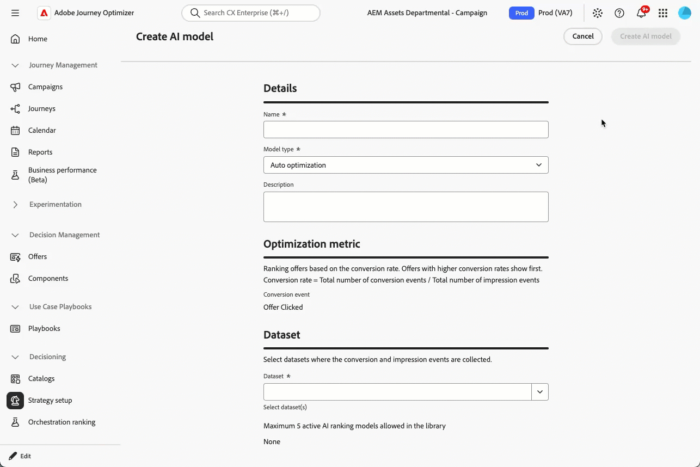

For more information, refer to the <a href="../experience-decisioning/ranking/create-ai-models.md#create-ranking-strategy">detailed documentation</a>.

Availability date: November 3, 2026

+++ Why it matters

**Why it helps:** Help models pick the most relevant offer for each profile by letting them learn from profile attributes and request context, not only from audiences.

**How it works:** When you create a Personalized optimization AI model, click Manage profile features and Manage context features and save your selection, in addition to or instead of audiences. Profile attributes must exist in your profile schema, and context values come from the Web SDK or Mobile SDK and your datastream configuration. Use the model in a selection strategy and decision policy as usual.

**What you can do now:**

* Select up to 50 profile attributes, such as loyalty tier or churn propensity score, as model features.
* Select context attributes sent with the decision request, such as device type, language or country code, with up to 20 added on top of the pre-selected ones.
* Train a model on profile and context features without selecting any audience.
* Pass context values in the decision request so that the model scores decision items in real time.

**Good to know:** Limited Availability: contact your Adobe representative to gain access. During Limited Availability, add the features only when you create a new AI model; do not edit an existing model to add them. Context features are only available for decisioning policies used in inbound channels. Datetime, array and key-value pair attributes are not available as features. If applicable, data governance (DULE) policies are applied automatically to selected profile features.

**Status:** Limited Availability

+++

</td>
</tr>
</tbody>
</table>

* **Decisioning item creation skill in Coworker** - You can now create decision items faster by describing what you need to Adobe CX Enterprise Coworker, which builds the item with you in chat. [Learn more](../experience-decisioning/experience-decisioning-coworker-skills.md#decisioning-offer-item-workflow)

  
Availability date: November 2, 2026

  +++ Why it matters

  **Why it helps:** Create decision items faster by describing what you need in chat, instead of filling in every field of the item creation form.

  **How it works:** Describe the offer or item you want to Adobe CX Enterprise Coworker, and it builds the item with you in chat. Coworker can help you define labels or tags, eligibility based on an audience or an existing rule, schedule, frequency capping, content fragments and custom attributes.

  **What you can do now:**

  * Create a decision item from a description, for example a summer sale offer or a loyalty upgrade.
  * Set eligibility, schedule and frequency capping on an item, using named web or email placements or custom PQL conditions for capping.
  * Update, approve, unapprove, archive or permanently delete decision items.
  * Create or update several items at once from a CSV file or a list.

  **Good to know:** The skill does not author eligibility rules or manage catalogs, collections or selection strategies; use the Decisioning Rule Workflow for rules and ranking formulas. Review the created item before you approve it, and be explicit before deleting because permanent deletion cannot be undone.

  +++

### Integrations {#nov-26-integrations}

* **Dynamic token substitution for Experience Manager fragments** - Use attribute paths such as `{{profile.person.name.firstName}}` directly in Experience Manager Content Fragments, with no token map needed. This works only for fragments added directly to a message, not for fragments served through Experience Decisioning. [Learn more](../integrations/aem-fragments.md#aem-attribute-paths)

  This capability is only available for a set of organizations (Limited Availability). To gain access, contact your Adobe representative. 

  Availability date: November 5, 2026

  +++ Why it matters

  **Why it helps:** Personalize the text inside Experience Manager Content Fragments with profile data without passing a value for each token in the fragment reference.

  **How it works:** Write attribute paths such as `{{profile.person.name.firstName}}` directly in the fields of a Content Fragment. They resolve automatically when the message is sent, with no token map needed, and you can mix them with flat tokens in the same field. To render profile attributes, add an Expression fragment that declares each attribute with the `let` syntax to the same message as an inline fragment.

  **What you can do now:**

  * Use attribute paths from the `profile`, `context` and `item` namespaces inside Content Fragment fields.
  * Mix attribute paths with flat tokens, whose values still come from the token map, in the same field.
  * Reuse one Expression fragment across messages that use the same Content Fragments.

  **Good to know:** Available for organizations where it has been enabled; contact your Adobe representative to request access. It works only for Experience Manager fragments added directly to a message, not for fragments served through Experience Decisioning. Use the full attribute path as it appears in the schema; helpers, expressions, conditional blocks and PQL are not supported inside Content Fragments. Profile attributes that the Expression fragment does not declare render as empty; context and decision item attributes do not need it.

  **Status:** Limited Availability

  +++

## October '26  release notes {#oct-26-release-notes}

>[!BEGINSHADEBOX]

+++**New in Coworker this month**

This release brings several new and improved [Coworker](../start/ai-features.md#cx-coworker) features and skills, listed here for visibility. Each one is also detailed in its relevant section below.

* [Channel Builder skill](#oct-26-channels) - Create, test, and manage custom channels by chatting with Coworker, with guided channel configuration, authentication, throttling, and payload definition.
* [Business Performance Analysis skill](#oct-26-journeys) - Analyze journey performance and get concrete optimization recommendations in Coworker chat.
* [Journey Hygiene Analysis skill](#oct-26-journeys) - Scan journeys for configuration hygiene issues and get suggested fixes in chat.
* [Trace Journey Profile skill](#oct-26-journeys) - Get read-only, profile-level execution data for a published journey, from node and branch counts to a single profile's path.
* [Journey Execution Timeline skill](#oct-26-journeys) - Get the end-to-end timeline of a Read Audience journey batch in Coworker chat, from audience export to delivery.
* [Decisioning rule generation skill](#oct-26-decisioning) - Generate, simulate, and optimize eligibility rules and ranking formulas in natural language, without writing PQL by hand.

+++

>[!ENDSHADEBOX]

### Channels {#oct-26-channels}

<table>
<thead>
<tr>
<th><strong>Override email channel configuration settings</strong> </th>
</tr>
</thead>
<tbody>
<tr>
<td>

Email header fields and delivery settings can now be overridden at the journey or campaign action level, without requiring a separate channel configuration. From name, From email prefix, Reply-To, recipient address, and list-unsubscribe values can each be set using profile attributes or contextual data.

This change allows each individual journey or campaign to carry its own sender identity, useful when the same channel configuration serves multiple programs, regions, or teams that each need a distinct From address or reply routing.

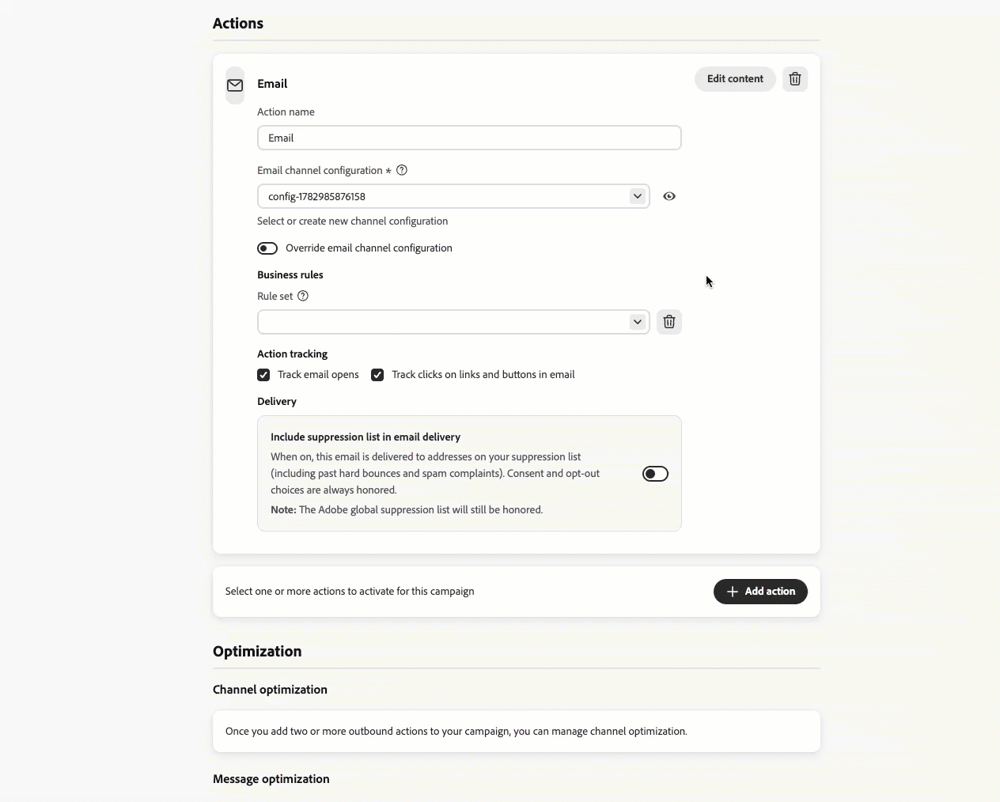

For more information, refer to the <a href="../email/create-email.md#override-email-channel-configuration">detailed documentation</a>.

Availability date: October 26, 2026

+++ Why it matters

**Why it helps:** One channel configuration can serve many programs, regions or teams, while each journey or campaign still shows its own sender identity and reply routing. You do not need to create and maintain an extra channel configuration for every variation.

**How it works:** In the email action of a campaign or journey, after you select the channel configuration, turn on Override email channel configuration. You can then override From name, From email prefix, Reply to name, Reply to email, the Delivery address, and the Mailto (unsubscribe) and One-click unsubscribe URL values. Each field can use profile attributes, helper functions or contextual data, and a field left empty keeps the value from the channel configuration.

**What you can do now:**

* Send a follow-up email that appears to come from the relationship manager the customer met, by overriding the sender name and email address.
* Reflect the relevant advisor, location or branch in sender details instead of routing all sends through a single corporate address.
* Use a different delivery address at the action level when several email addresses are available for a profile.
* Replace the unsubscribe address and one-click unsubscribe URL set in the channel configuration for a specific action.

**Good to know:** For API-triggered campaigns, contextual attributes are not available in the personalization editor when you define the email action. You must enter them manually, and the expression path must match the API payload structure exactly because Journey Optimizer performs no check.

+++

</td>
</tr>
</tbody>
</table>

<table>
<thead>
<tr>
<th><strong>Self-serve setup for High throughput email and push</strong> </th>
</tr>
</thead>
<tbody>
<tr>
<td>

If you have purchased the High throughput transactional messaging add-on, you can now set up High throughput for API-triggered email and push campaigns yourself in the product UI through a dedicated channel configuration. You no longer need to request a manual setup for each resource. 

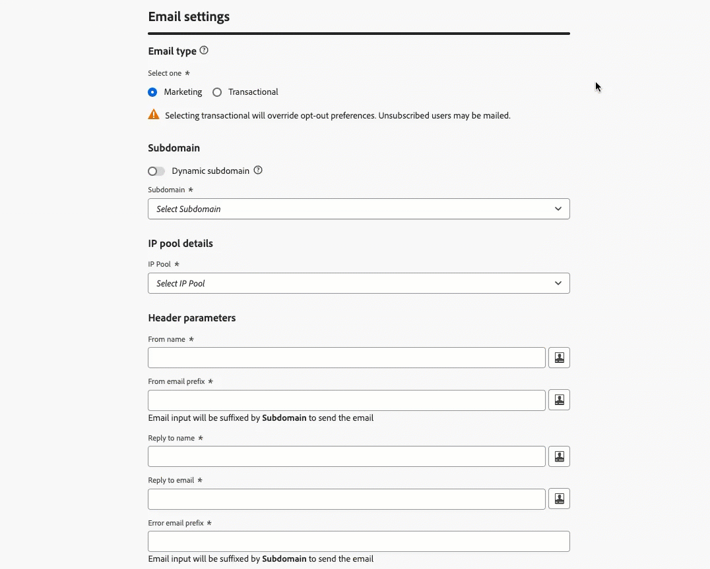

For more information, refer to the <a href="../campaigns/api-triggered-high-throughput.md">detailed documentation</a>.

Availability date: October 26, 2026

+++ Why it matters

**Why it helps:** You can create the High throughput resources yourself in the product, which removes the wait for a manual setup of each resource.

**How it works:** For email, create an IP pool with the Enable high-throughput option, then create a Transactional email channel configuration with the Create as a High throughput configuration toggle and select that IP pool. For push, create a push channel configuration with the same toggle and select the platforms and App ids. These configurations are then the only ones offered when you create a High throughput API-triggered campaign.

**What you can do now:**

* Create a dedicated High throughput IP pool and use it in a High throughput email channel configuration.
* Create a High throughput push channel configuration in the interface.
* Select only High throughput channel configurations when building a High throughput API-triggered email or push campaign.

**Good to know:** Requires the High throughput transactional messaging add-on. After purchase, contact Adobe Customer Care or your Adobe representative once so that the backend activation can be completed. High throughput channel configurations and IP pools can only be used with High throughput API-triggered campaigns, and their type cannot be changed after creation. Push App id personalization is not available when the toggle is on, and High throughput configurations do not support contextual or profile-based personalization.

+++

</td>
</tr>
</tbody>
</table>

<table>
<thead>
<tr>
<th><strong>Custom outbound channel (General Availability)</strong> </th>
</tr>
</thead>
<tbody>
<tr>
<td>

<strong>Custom outbound channels</strong> let administrators bring any outbound HTTP-based messaging channel — such as WeChat, Kakao Talk, Messenger, or a proprietary provider — directly into Journey Optimizer through a no-code Channel Builder. Once configured, custom channels are available across campaigns, journeys, and orchestrated campaigns, with the same full set of capabilities as native channels: personalization with the expression editor, content experimentation, preview and proof, out-of-the-box reporting, and consent and governance enforcement.

With this release, custom outbound channels also gain several new capabilities:

<ul>
<li>Use Journey Optimizer Decisioning in the custom channel payload through the Personalization Editor, the same way as in code-based experiences.</li>
<li>Apply business rules to custom channels, the same way you already can on native channels.</li>
<li>Select custom channels in the channel list for API-triggered campaigns, which was not previously possible.</li>
<!--<li>Define a reporting webhook for a custom channel and attach it to a channel configuration, so you can enrich your Journey Optimizer reports with interaction events.</li>-->
</ul>

Previously available in Limited Availability, this capability is now available to all environments (General Availability), with the enhancements described above.

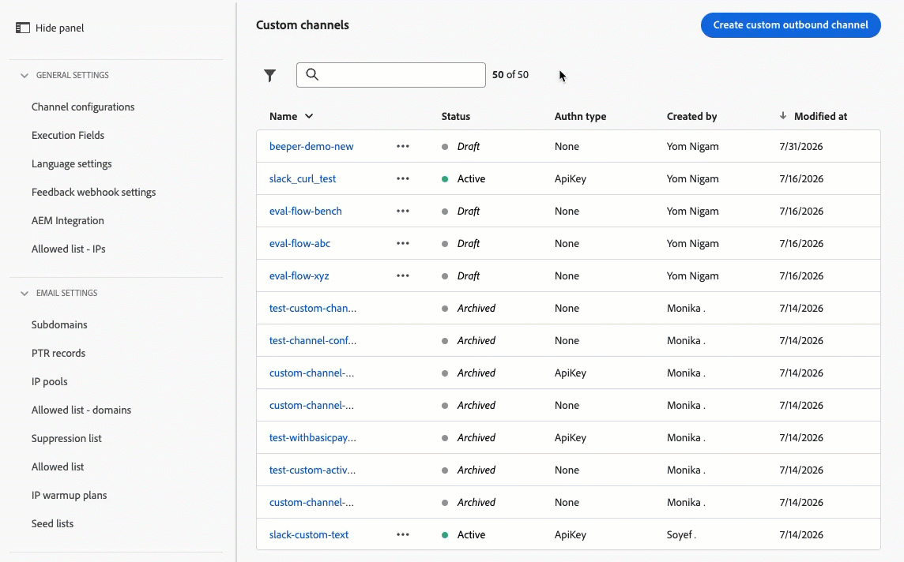

For more information, refer to the <a href="../custom-channel/get-started-custom-channel.md">detailed documentation</a>.

Availability date: October 2, 2026

+++ Why it matters

**Why it helps:** Organizations can keep a delivery provider that Journey Optimizer does not support natively and still orchestrate, personalize and report on it in the same place as native channels. Administrators set the channel up without engineering involvement.

**How it works:** An administrator goes to Administration > Channels and uses the Channel Builder to define the endpoint, authentication, throttling policy and message payload structure, then creates a channel configuration linked to it. Marketers then add the custom channel to a journey or campaign, select the configuration and author the payload in the personalization editor. Custom channels support POST as the only HTTP method.

**What you can do now:**

* Connect a platform such as WeChat, Kakao Talk or Messenger, or a proprietary provider, through any outbound HTTP endpoint.
* Use Journey Optimizer Decisioning in the custom channel payload through the Personalization Editor.
* Apply business rules, such as frequency capping and quiet hours, to custom channels.
* Select a custom channel when creating an API-triggered Marketing campaign.

**Good to know:** Custom channels are available in journeys, orchestrated campaigns and Marketing (action and API-triggered) campaigns, and are not available in transactional campaign types. They are not supported when copying objects between sandboxes. Administrators need the View custom channels and Manage custom channels permissions to use the Channel Builder. The reporting webhook capability is not part of this entry.

+++

</td>
</tr>
</tbody>
</table>

<table>
<thead>
<tr>
<th><strong>Honor tracking consent without blocking email delivery</strong> </th>
</tr>
</thead>
<tbody>
<tr>
<td>

To support compliance with open-tracking consent requirements such as the CNIL guidance in France, you can now honor a recipient's tracking consent without excluding them from an otherwise eligible email send. Tracking consent is stored in the Adobe Experience Platform profile and evaluated for each recipient at send time.

A new <strong>Honor open tracking consent</strong> option in the email settings of the channel configuration removes the Journey Optimizer open-tracking pixel for recipients who have not consented. Email delivery, content, and unsubscribe links are unaffected.

You can turn on the option at any time, without editing your existing journeys and campaigns. Note that some existing messages, such as transactional messages, need to be republished for the setting to apply.

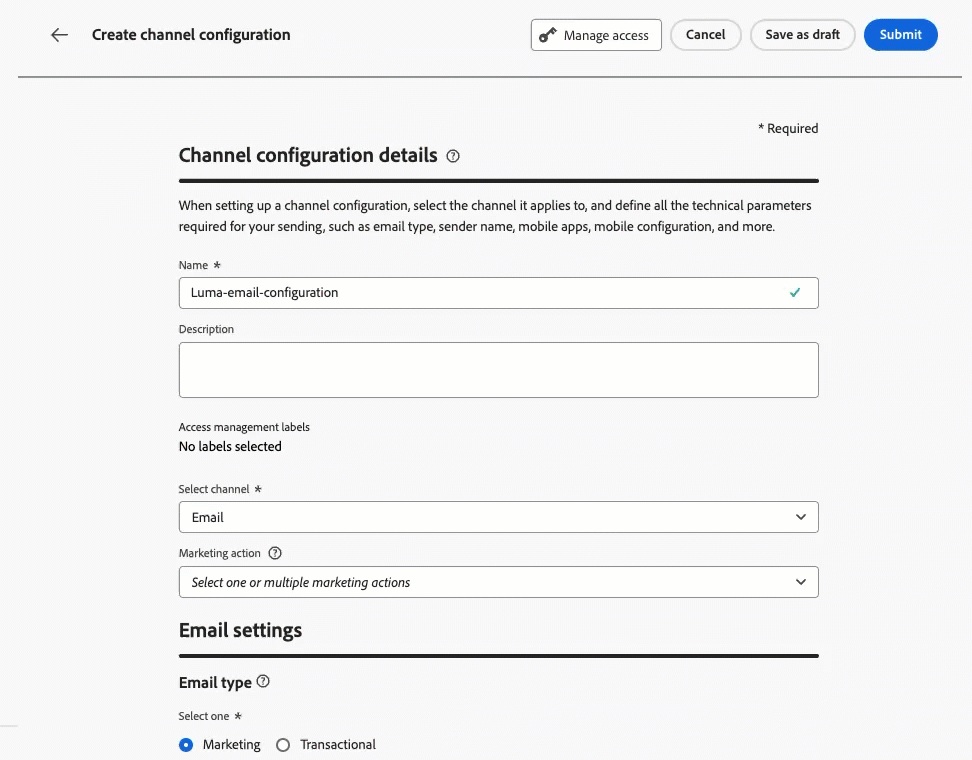

For more information, refer to the <a href="../email/open-tracking-consent.md#existing-messages">detailed documentation</a>.

Availability date: October 29, 2026

+++ Why it matters

**Why it helps:** Recipients who have not consented to open tracking can still receive the email, so compliance with open-tracking consent requirements does not cost you reach.

**How it works:** Record the tracking preference on the customer profile in Adobe Experience Platform (consents.tracking.email.open.val, at channel level or for one email address; an explicit lowercase n means opt-out). Then go to Channels > General settings > Channel configurations, open the email channel configuration and turn on Honor open tracking consent in the Open tracking section. The preference is evaluated for each recipient when the message is prepared.

**What you can do now:**

* Remove the Journey Optimizer open-tracking pixel for recipients who recorded an explicit opt-out, while still sending them the email.
* Apply different tracking preferences per recipient or per email address within the same send.
* Turn the option on for existing journeys and campaigns without editing their email activities.

**Good to know:** The option is off by default, needs the Manage messages presets permission, and is not available for High throughput transactional email configurations. It controls open tracking only, not click tracking or other tracking, and it does not collect consent for you. Only an explicit n disables tracking. Transactional messages must be republished once; in-progress campaign sends and in-progress read-audience journey runs finish with the previous setting.

+++

</td>
</tr>
</tbody>
</table>

* **Channel Builder skill in Coworker to create a new custom channel** - This skill helps administrators create custom channels faster by guiding users through the required setup steps, such as channel configuration, authentication, throttling, and payload definition, making it easier to launch new messaging integrations with less manual effort. <!-- Documentation link: TBD -->

  Availability date: October 2, 2026

  +++ Why it matters

  **Why it helps:** Administrators can set up a custom channel by chatting with Coworker instead of filling each setup step by hand, so a new messaging integration is faster to launch.

  **How it works:** In Coworker chat, describe the messaging service, or provide a curl command or an API document link (OpenAPI/Swagger spec or API reference page). The skill guides you through channel configuration, authentication, throttling and payload definition, and asks which payload scenario to run when you test the connection. You can also list, fetch, update and delete custom channels.

  **What you can do now:**

  * Create a custom channel from a guided setup, a curl command or an API reference link.
  * Test a new custom channel before using it in a campaign or journey.
  * List custom channels, fetch the details of one, update its settings or delete it.

  **Good to know:** Channel Builder is for custom outbound channels only and is designed for administrators. To inspect standard channel configurations such as email, SMS or push, use the read-only Channel Operation skill instead.

  +++

* **Suppression list override at Email action level** - Journey Optimizer now includes a per-action toggle that allows delivery to locally-suppressed addresses for a specific email action in a journey or campaign. This is designed for compliance scenarios where a communication must be demonstrably attempted, such as a required notification to an address that has previously bounced. Sending to suppressed addresses is not a recommended email practice, as it can damage your deliverability. This capability is available in Limited Availability for a set of customers. Contact your Adobe representative to request access.

  For more information, refer to the [detailed documentation](../reports/suppression-list.md#include-suppressed-addresses).

  Availability date: October 28, 2026

  +++ Why it matters

  **Why it helps:** When a communication must be demonstrably attempted, you can reach a locally suppressed address for that one send, without changing the suppression list or any other delivery.

  **How it works:** In the settings of the email action of a campaign or journey, go to the Delivery section and turn on Include suppression list in email delivery, then confirm with I agree in the dialog. The option is off by default and applies to that email action only.

  **What you can do now:**

  * Send a required notification to an address that previously bounced.
  * Include all addresses on your suppression list, whatever the category (hard bounces, spam complaints, soft bounces or manual entries), in one specific email delivery.

  **Good to know:** Sending to suppressed addresses is not a recommended email practice and can damage inbox placement and the sending reputation of the subdomain and IPs; Adobe recommends isolating this traffic on a dedicated subdomain or IP pool. It applies to the local suppression list only: the Adobe global suppression list, consent and opt-out choices are still honored. This differs from the Send to suppressed email addresses option of the channel configuration. Contact your Adobe representative to request access.

  **Status:** Limited Availability

  +++

### Journeys {#oct-26-journeys}

<table>
<thead>
<tr>
<th><strong>New journey alerts (Limited Availability)</strong> </th>
</tr>
</thead>
<tbody>
<tr>
<td>

Five new alerts help you monitor journey message bounce and delivery error rates, receive notifications when journey <strong>Read Audience</strong> exports start and complete, and detect journey event delays due to queueing when the event throughput guardrail has been exceeded. Threshold-based alerts support configurable thresholds, and <strong>Read Audience</strong> export notifications support journey-level subscriptions.

This capability is only available for a set of organizations (Limited Availability). To gain access, contact your Adobe representative.

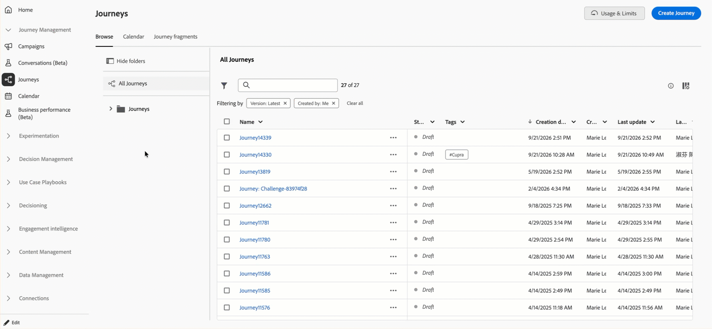

For more information, refer to the <a href="../reports/alerts.md#available-alerts">detailed documentation</a>.

Availability date: October 29, 2026

+++ Why it matters

**Why it helps:** Get told about delivery problems, Read Audience export progress and event queueing as they happen, instead of finding them later in reports.

**How it works:** Go to the Alerts screen in Journey Optimizer and subscribe to the new alerts. The bounce rate, error rate and event throughput alerts have default thresholds that you can override on the Alerts screen (5% bounce rate, 1% message error rate, 600 seconds of queueing time). The two Read Audience export alerts are event notifications with no threshold.

**What you can do now:**

* Monitor the message bounce rate of journeys against a threshold, with a sandbox-level subscription.
* Monitor the message delivery error rate of journeys against a threshold, with a sandbox-level subscription.
* Get notified when a journey starts and completes its Read Audience export, at journey level or sandbox level.
* Detect journey event queueing when the organization-wide event throughput guardrail is exceeded and the queueing time passes your threshold.

**Good to know:** Limited Availability for a set of customers. The bounce and error rate alerts support sandbox-level subscription only (all journeys in the sandbox), not individual journeys. The throughput alert is organization-wide, not tied to one journey: while the guardrail is exceeded, events of all journeys in all sandboxes are queued and processed at 5,000 events per second. Read Audience export completion does not mean that message sending or the journey has completed.

**Status:** Limited Availability

+++

</td>
</tr>
</tbody>
</table>

<table>
<thead>
<tr>
<th><strong>Stop action journey activity</strong> </th>
</tr>
</thead>
<tbody>
<tr>
<td>

A new "Stop action" activity in the journey canvas now allows you to remove a profile from up to five inbound activities or experiences directly from a journey. This decouples inbound disqualification from journey exit.

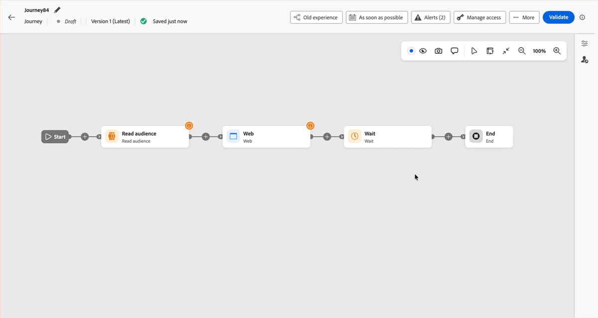

For more information, refer to the <a href="../building-journeys/stop-action.md">detailed documentation</a>.

Availability date: October 12, 2026

+++ Why it matters

**Why it helps:** Stop showing an inbound experience to a profile once it is no longer relevant, while the profile keeps moving through the journey.

**How it works:** In the journey canvas, add the Stop action activity downstream of the inbound activities it targets, on the same journey path, and select up to five in the Action field (use Stop another action to add more). When a profile reaches the step, it stops qualifying for the selected in-app, content card, web or code-based experiences and continues in the journey. Other inbound activities are not affected.

**What you can do now:**

* Stop an in-app reminder after the journey detects that the profile has registered.
* Stop purchase promotions after the journey detects a purchase, while the profile continues through post-purchase steps.
* Replace a code-based experience by stopping experience A before activating experience B.

**Good to know:** The activity must be downstream of the inbound activities on the same path. Selecting no activity, more than five, the same one twice, a non-upstream one or a deleted one generates an error. Placing it right after an inbound activity can prevent the profile from seeing the experience, and placing it right before End is redundant. If the profile re-enters the journey, the experience activates again.

+++

</td>
</tr>
</tbody>
</table>

<table>
<thead>
<tr>
<th><strong>On-demand journey validation</strong> </th>
</tr>
</thead>
<tbody>
<tr>
<td>

A new <strong>Validate</strong> button lets you run configuration checks, including message checks, when you're ready to test or publish, reducing repeated checks during editing and helping keep larger journey canvases responsive.

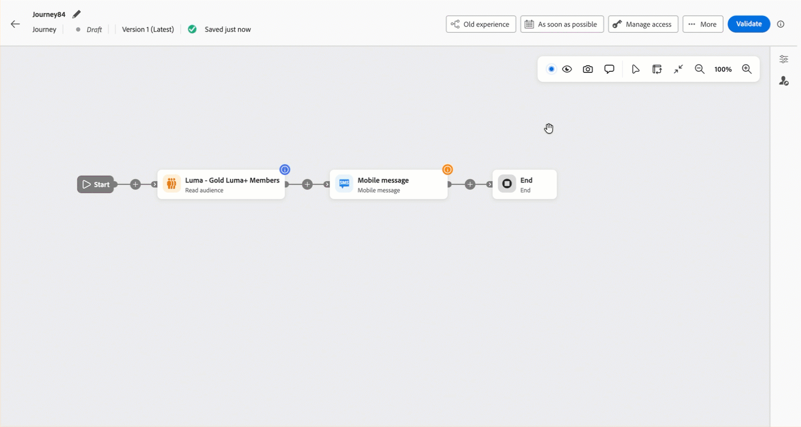

For more information, refer to the <a href="../building-journeys/publish-journey.md#validate">detailed documentation</a>.

Availability date: October 9, 2026

+++ Why it matters

**Why it helps:** Message checks no longer run on every autosave, so the canvas stays responsive while you build, and you choose when to run the full checks.

**How it works:** Click Validate in the journey header when you are ready to test, simulate, run a dry run, request approval or publish. Errors and warnings appear in the Alerts panel, as before. Basic checks on journey activities still run automatically while you build.

**What you can do now:**

* Run configuration checks, including every message, with Validate before testing or publishing.
* Review errors and warnings in the Alerts panel, fix them and validate again.
* Keep larger journeys responsive while you edit, and avoid repeated message checks on smaller journeys.

**Good to know:** The checks themselves have not changed, and validation does not simulate the journey or replace testing. Validate is available for Draft journeys only, not in test, dry-run or simulation mode or while the journey is locked for approval. The journey is temporarily locked during the checks. Until the journey has a current, passed validation, Validate replaces Publish. Edits after validation make the results outdated, and validation does not rerun automatically after you fix an error.

+++

</td>
</tr>
</tbody>
</table>

* **HMAC-signed JWT authentication for custom actions (Limited Availability)** - Certificate-based custom authentication now supports JWT client assertions signed with your OAuth client secret (`HS256`, `HS384`, `HS512`; `client_secret_jwt`), as an alternative to Adobe's RSA certificate. Configurations without `alg` continue to use `RS256`.

  This capability is available in Limited Availability for a set of customers. Contact your Adobe representative to request access. Learn more in [Custom actions](../action/about-custom-action-configuration.md#certificate-based-auth) and [External data sources](../datasource/external-data-sources.md#hmac-credential).

  Availability date: October 13, 2026

  +++ Why it matters

  **Why it helps:** Connect custom actions to identity providers that accept client_secret_jwt, without registering an Adobe certificate.

  **How it works:** In the custom authorization payload of a custom action (Authentication section) or an external data source, keep subType certificateCredential, set the optional alg field to HS256, HS384 or HS512 and add your OAuth client_secret to body.bodyParams. Journey Optimizer uses the secret as the signing key and does not send it to the token endpoint. There is no separate UI control for the algorithm.

  **What you can do now:**

  * Authenticate custom actions with a JWT client assertion signed with your OAuth client secret instead of Adobe's RSA certificate.
  * Keep existing configurations unchanged: without alg, or with RS256, the RSA flow runs as before.

  **Good to know:** Limited Availability for a set of customers. Your identity provider must accept client_secret_jwt with the same secret and algorithm. The payload still needs aud, method POST, bodyType form and client_id in bodyParams. Minimum client_secret length in UTF-8 bytes: 32 for HS256, 48 for HS384, 64 for HS512. Any other alg value, including lowercase, is rejected when the authentication is tested or executed. The HMAC JWT expires 300 seconds after issue, against 600 for RS256.

  **Status:** Limited Availability

  +++

* **Business Performance Analysis skill** - Analyze journey performance and get concrete optimization recommendations in Adobe CX Enterprise Coworker chat. [Learn more](../building-journeys/journeys-coworker-skills.md#journey-analyze)

  Availability date: October 7, 2026

  +++ Why it matters

  **Why it helps:** Understand why a journey underperforms and get concrete changes to try, tied to the journey goal, without building reports yourself.

  **How it works:** Ask in Adobe CX Enterprise Coworker chat, for example how a journey is performing or what to change to improve it. The skill analyzes journey performance, explains areas of lower performance and recommends optimizations such as re-engagement waits, channel escalation, Send Time Optimization, A/B experiments, frequency capping or using the profile time zone.

  **What you can do now:**

  * Analyze the performance of a journey and get optimization recommendations.
  * Find out why a journey underperforms compared with a previous period.
  * Identify which parts of a journey are likely limiting conversion or engagement.

  **Good to know:** Read-only skill in Coworker. To use the Journey Analyze skills fully you need the View Journeys permission (plus View Segments for audience insights); Manage permissions are needed only to create items from Coworker.

  +++
  
* **Journey Hygiene Analysis skill** - Coworker scans journeys for configuration hygiene issues and suggests fixes in chat. The first release has 7 checks: missing or generic names, stale draft journeys, stale live journeys, oversized journeys, long-existing closed journeys, and similar action or event names. [Learn more](../building-journeys/journeys-coworker-skills.md#journey-analyze)

  Availability date: October 20, 2026

  +++ Why it matters

  **Why it helps:** Keep your journey inventory clean by finding configuration problems and decaying journeys without opening each journey.

  **How it works:** Ask in Coworker chat, for example to audit your journeys or run a hygiene check on one journey, custom actions or events. The skill checks metadata and configuration, not performance data, and suggests fixes. Thresholds: stale drafts are older than 30 days and never published, stale live and closed journeys are older than 90 days, oversized journeys have 50 or more nodes.

  **What you can do now:**

  * Find journeys with missing or generic names.
  * Find stale draft journeys, stale live journeys and long-existing closed journeys.
  * Find oversized journeys and similar action or event names, and get cleanup recommendations.

  **Good to know:** Read-only skill in Coworker. To use the Journey Analyze skills fully you need the View Journeys permission (plus View Segments for audience insights); Manage permissions are needed only to create items from Coworker. The skill does not use performance data; use the Business Performance Analysis skill for that.

  +++

* **Trace Journey Profile skill** - CX Coworker can now return read-only, profile-level execution data for a published journey. Check how many profiles entered each node and how they split across branches, find which profiles errored and why, or follow a single profile's node-by-node path through the journey. [Learn more](../building-journeys/journeys-coworker-skills.md#trace-journey-profile)

  Availability date: October 22, 2026

  +++ Why it matters

  **Why it helps:** Answer where profiles went, who errored and why in a published journey, from Coworker chat.

  **How it works:** Ask in Coworker chat to trace profiles through a published journey. The skill returns read-only profile-level data based on journey step events, in three query types: node and branch counts, errored-profile lookup and single-profile trace.

  **What you can do now:**

  * Check how many profiles entered each node and how they split across branches, as counts and percentages.
  * Find which profiles errored over a period, such as the last 7 days, at which node and why.
  * Follow a single profile node by node, with timestamps, the attribute value evaluated at each condition node, and the exit point and reason.

  **Good to know:** Works on published journeys only; draft-only and B2B journeys are not supported. Read-only: it does not export lists or edit journeys. The errored-profile lookup and the single-profile trace return profile-level data. Read-only skill in Coworker. To use the Journey Analyze skills fully you need the View Journeys permission (plus View Segments for audience insights); Manage permissions are needed only to create items from Coworker.

  +++

* **Journey Execution Timeline skill** - Coworker can now return the end-to-end timeline of a Read Audience (batch or scheduled export) journey batch. See how long a batch took, when the audience export, the journey execution, and the delivery started and ended, and the profile-level P95 and P99 for entry, exit, or execution time. [Learn more](../building-journeys/journeys-coworker-skills.md#journey-execution-timeline)

  Availability date: October 26, 2026

  +++ Why it matters

  **Why it helps:** See where time went in a Read Audience journey batch, from audience export to delivery, and which stage caused a delay.

  **How it works:** Ask in Coworker chat about a Read Audience (batch or scheduled export) journey. The skill returns the batch duration, when the audience export, the journey execution and the delivery started and ended, and the profile-level P95 and P99 for entry, exit or execution time. It validates the journey first.

  **What you can do now:**

  * Find out how long a Read Audience journey batch took, end to end.
  * See the audience export, journey execution and delivery timelines for each batch.
  * Identify the slowest batch and the stage that caused the delay.

  **Good to know:** Read Audience journeys only; for any other type the skill stops instead of approximating. Audience export latency runs from creation of the export job to the first profile entry. Recipient or device notification timing is reported as unavailable. The skill is read-only. Read-only skill in Coworker. To use the Journey Analyze skills fully you need the View Journeys permission (plus View Segments for audience insights); Manage permissions are needed only to create items from Coworker.

  +++

<!--
COMING SOON (hidden until next week)
+++ Coming soon — **Information below is subject to change.**

<table>
<thead>
<tr>
<th><strong>AI recommendation cards for journey alerts</strong> </th>
</tr>
</thead>
<tbody>
<tr>
<td>

Spend less time investigating journey issues and get a head start on resolving them. When a <strong>Journey Custom Action failure</strong> or <strong>Journey Anomaly Detected</strong> alert fires, an <strong>AI Recommendations</strong> card on the Journey Optimizer home page highlights the issue. Select the card to review analysis and recommended next steps already prepared in Coworker, without having to request an investigation first. Continue the conversation to explore the findings and decide how to address the issue.

This capability is only available for a set of organizations (Limited Availability). To gain access, contact your Adobe representative.

</td>
</tr>
</tbody>
</table>

+++
-->

<!--
COMING SOON (hidden until next week)
### Campaigns {#oct-26-orchestrated-campaigns}

The following improvements are coming to campaigns in this release.

+++ Coming soon — **Information below is subject to change.**

* **Increased message activity limit for Orchestrated campaigns** - Orchestrated campaigns now support up to 25 message actions on a single canvas, up from the previous limit of 10. This allows complex cross-channel orchestrations, spanning email, push, SMS, and other channels, to be built and managed as a single campaign rather than split across multiple smaller ones.

  For enterprise teams running sophisticated multi-step programs, this reduces operational overhead and simplifies publication and rollback handling when managing large campaign launches. 

+++
-->

<!--
### User interface {#oct-26-user-interface}

* [!BADGE Usability]{type=Positive} **Unified calendar for Campaigns, Journeys, and Orchestrated campaigns (Limited Availability)** - The calendar view for journeys and campaigns now moves out of separate inventories into a unified menu accessible from the left rail that shows all three in one combined view. [Learn more](../start/calendar.md)

  This capability is only available for a set of organizations (Limited Availability). To gain access, contact your Adobe representative.

  Availability date: October 29, 2026
-->

### Landing pages {#oct-26-landing-pages}

<table>
<thead>
<tr>
<th><strong>Public landing pages (Limited Availability)</strong> </th>
</tr>
</thead>
<tbody>
<tr>
<td>

Journey Optimizer now allows you to create public landing pages accessible to anyone, and from there capture data from anonymous visitors into Experience Platform non-profile enabled datasets. You can share the landing page URL anywhere, such as in emails, SMS messages or on your website.

To reuse your existing Journey Optimizer branded subdomains for public landing pages, you need to migrate them to Cloudflare.

This capability is available in Limited Availability. Contact your Adobe representative to request access.

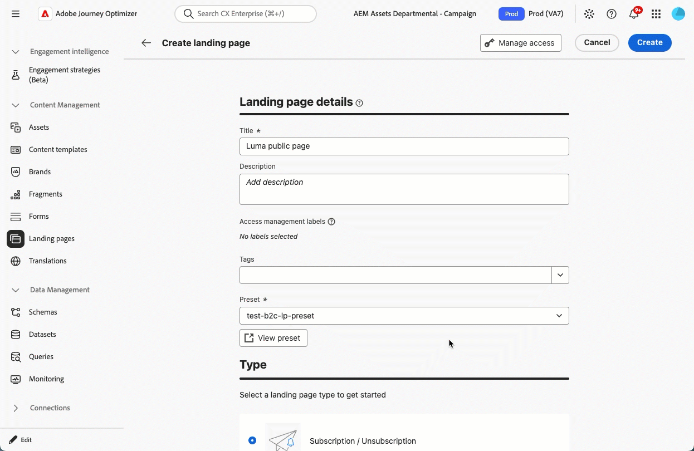

For more information, refer to the <a href="../landing-pages/lp-anonymous.md">detailed documentation</a>.

Availability date: October 28, 2026

+++ Why it matters

**Why it helps:** Public landing pages let you collect data from visitors you do not know yet, from one URL that you can place in any channel. This extends landing pages beyond recipients who arrive from a personalized link.

**How it works:** Go to Content Management > Landing pages > Create landing page, select the Data Capture type, and in Access settings leave Require identified users disabled so anyone with the URL can open the page. Embed a published form linked to a non-profile enabled dataset; the data is sent to that dataset after submission (allow up to 15 minutes). It needs a landing page preset, a form preset linked to a dataset, a published form, and a subdomain migrated to Cloudflare when you reuse an existing one.

**What you can do now:**

* Publish a landing page on a public URL that anyone can open.
* Share the URL in emails, SMS messages, or on your website.
* Capture form data from anonymous visitors into a non-profile enabled dataset in Experience Platform.

**Good to know:** Adobe strongly recommends non-profile enabled datasets, because a profile-enabled dataset can create many unnecessary lead profiles and corrupt existing ones. The form must include all required root-level fields of the dataset schema, or ingestion fails. Reporting, managing allowed IPs and sandbox copy are not supported, and profile-based personalization should not be used on these pages. Reusing an existing branded subdomain requires migrating it to Cloudflare.

**Status:** Limited Availability

+++

</td>
</tr>
</tbody>
</table>

### Administration {#oct-26-administration}

<table>
<thead>
<tr>
<th><strong>Custom metadata for campaigns and journeys (Limited Availability)</strong> </th>
</tr>
</thead>
<tbody>
<tr>
<td>

Define your own business fields, such as line of business, product or cost center, in the schemas provided for Action campaigns, journeys and Orchestrated campaigns. Select up to 10 fields per entity type, then fill them in from the <strong>Metadata fields</strong> section of the properties of each journey or campaign. The values are recorded in dedicated datasets that you can use for reporting, exports and audience creation.

This capability is available in Limited Availability for a set of customers. Contact your Adobe representative to request access.

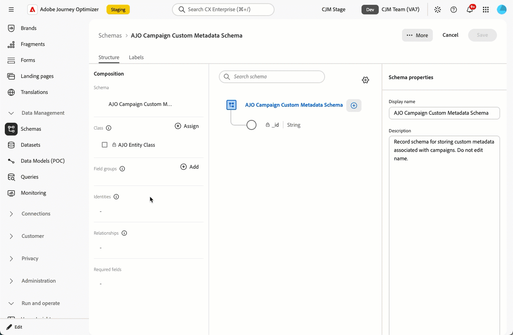

For more information, refer to the <a href="../administration/custom-metadata.md">detailed documentation</a>.

Availability date: October 29, 2026

+++ Why it matters

**Why it helps:** Record your own business context, such as line of business, product or cost center, on journeys and campaigns so you can report on it and build audiences from it.

**How it works:** Define string fields in a custom field group of the custom metadata schemas in Adobe Experience Platform, then go to Administration > Configurations and click Manage in the Metadata card to choose up to 10 fields per entity type, their order and which are required. The fields then appear in the Metadata fields section of each journey, Action campaign or Orchestrated campaign. Values are sent to dedicated datasets when the item is activated.

**What you can do now:**

* Track business fields such as line of business, promotional region or project ID on journeys, Action campaigns and Orchestrated campaigns.
* Export the metadata values from the datasets for downstream reporting.
* Build audiences from the metadata of the journeys and campaigns that profiles received.

**Good to know:** Limited Availability: request access through your Adobe representative or the request form in the documentation. Editing the schemas needs the Manage schemas permission. Only String fields are available, do not mark fields as required in the schema (make them required in the Metadata configuration instead), and field names must be unique in a sandbox. If a required field is empty, the journey or campaign cannot be activated or published. Schema changes can take a few minutes to appear.

**Status:** Limited Availability

+++

</td>
</tr>
</tbody>
</table>

### Decisioning {#oct-26-decisioning}

* **Decisioning rule generation skill in Coworker** - Use natural language in Coworker to generate, simulate, and optimize eligibility rules and ranking formulas for Adobe Journey Optimizer Decisioning. Marketers can create, validate, and test decisioning logic faster, enabling smarter personalization and more time spent optimizing outcomes without requiring PQL syntax expertise. [Learn more](../experience-decisioning/experience-decisioning-coworker-skills.md#rules-ranking)

  Availability date: October 22, 2026

  +++ Why it matters

  **Why it helps:** Marketers can build and test eligibility rules and ranking formulas by describing them in plain language, so they do not need PQL expertise to get decisioning logic ready.

  **How it works:** In Coworker chat, the Decisioning Rule Workflow skill turns a plain-language requirement into PQL for a new rule or an edit to an existing one, explains rules and formulas in plain English, validates and fixes expressions, simulates them against up to three test profiles, and shortens PQL to meet size limits. It is available to customers with access to Coworker and Decisioning.

  **What you can do now:**

  * Create an eligibility rule from a plain-language condition, for example loyalty members in tier 2 or above.
  * Simulate a rule or ranking formula against up to three profiles, including AI-generated edge cases, to see pass or fail results or ranked offers with scores.
  * Optimize a rule or formula that is hitting PQL size limits without changing its logic.
  * Explain in plain English what an existing rule or ranking formula includes, excludes and evaluates.

  **Good to know:** The skill covers eligibility rules, ranking formulas and offer-item frequency capping expressions only; it does not create or edit selection strategies or decision policies. Review a generated or optimized rule and its simulation results before publishing it.

  +++

<!--
COMING SOON (hidden until next week)
+++ Coming soon — **Information below is subject to change.**

* **Decisioning item creation skill in Coworker** - Use natural language in Coworker to create offers (decision items) with AI assistance, so marketers can build and populate items faster without manually filling in each field. 

* **Decisioning audit skill in Coworker** - Ask Coworker questions about your Decisioning objects in natural language. Check your inventory (for example, how many offers you have), explore how objects relate to each other, and run audit queries such as who last edited a given offer. 

* **Decisioning migration assistance in Coworker** - Get AI-enabled assistance in Coworker when migrating from Offer Decisioning to Adobe Journey Optimizer Decisioning. 

+++
-->

### Loyalty {#oct-26-loyalty}

* **Performance settings in Loyalty configurations** - Use the **Performance settings** tab to select your loyalty profile and event datasets and configure your organization's priority **Key performance indicator** for loyalty insights. Choose Revenue, Engagement, Redemptions, or Conversions to determine which insights receive emphasis in your feed. [Learn more](../loyalty-challenges/loyalty-admin.md#performance-settings)

  Availability date: October 1, 2026

  +++ Why it matters

  **Why it helps:** Loyalty insights can follow the metric your organization cares about most, and the datasets behind them are set in one place.

  **How it works:** Open Loyalty configurations from the left navigation, then the Performance settings tab. In the Performance configuration section, select the Loyalty profile dataset and the Loyalty event dataset, then select your priority Key performance indicator.

  **What you can do now:**

  * Select the loyalty profile and event datasets used for loyalty performance insights.
  * Choose Revenue, Engagement, Redemptions, or Conversions as the priority metric for the Loyalty Insights dashboard.
  * Focus the insights feed on the metric that matters most to your business.

  **Good to know:** Loyalty configurations requires administrator access. The profile dataset schema must include the Loyalty details and identityMap field groups, and the event dataset schema must include the Loyalty event details and Commerce details field groups.

  +++

* **Streak challenge configuration update** - The non-consecutive option has been removed when creating Streak challenges. Streak challenges now use the **Task completion requirements** drop-down to require either one task or all tasks together to be completed on consecutive days. [Learn more](../loyalty-challenges/create-challenges.md)

  Availability date: October 1, 2026

  +++ Why it matters

  **Why it helps:** Streak rules are simpler to set up because only consecutive-day streaks are offered.

  **How it works:** When you create a Streak challenge, use the Task completion requirements drop-down on the Structure step to choose between completing one task multiple times or all tasks together multiple times, on consecutive days. Streak length sets the number of consecutive days.

  **What you can do now:**

  * Require members to complete the same task on consecutive days without breaks.
  * Require members to complete all selected tasks together on consecutive days.
  * Set a streak length, for example 7 days for a 7-day purchase streak.

  **Good to know:** The non-consecutive option has been removed from Streak challenges.

  +++

* **Autosave for challenge drafts** - Challenge edits in Loyalty are now saved automatically as you work, so you can publish a challenge or generate a journey without saving first. [Learn more](../loyalty-challenges/create-challenges.md)

  Availability date: October 1, 2026

  +++ Why it matters

  **Why it helps:** You can build a challenge without worrying about losing edits and go straight to publishing.

  **How it works:** In the challenge editor (Settings, Structure, Content and Messaging tabs), changes are saved automatically a couple of seconds after you stop editing, and the manual Save changes button is removed. Publish challenge and Generate journey are no longer gated behind a manual save.

  **What you can do now:**

  * Edit a draft challenge across all tabs without saving manually.
  * Publish a challenge or generate a journey right after editing.
  * Leave start and end dates empty while drafting and add them before publishing.

  **Good to know:** Challenge start and end dates are optional while drafting but required to publish. If a required field is missing when you publish or generate a journey, an inline notification lists what is missing, the affected tabs show a red dot, and the fields are highlighted.

  +++

<!--
COMING SOON (hidden until next week)
### Integrations {#oct-26-integrations}

+++ Coming soon — **Information below is subject to change.**

* **AEM Managed Services content fragments support in Decisioning** - AEM Managed Services content fragments are now supported in Decisioning when managing decision items.

+++
-->

## September '26 release notes {#sep-26-updates}

>[!BEGINSHADEBOX]

+++**New in Coworker this month**

This release brings several new and improved [Coworker](../start/ai-features.md#cx-coworker) features and skills, listed here for visibility. Each one is also detailed in its relevant section below.

* [CE Channel Content plugin](#sep-26-content-management) - A new plugin that brings campaign copy, image, and email HTML skills together in Coworker, from campaign brief to production-ready copy and HTML.
* [Content Management MCP tools](#sep-26-content-management) - Discover and manage content templates, fragments, landing pages, and inline message content through natural language prompts in Coworker.
* [Journey Simulation](#sep-26-journeys) - Automate end-to-end journey validation and interpret the results directly in Coworker.
* [Compare journey versions](#sep-26-journeys) - Get a full-fidelity, structured diff between any two versions of a journey through Coworker Chat.
* [Analyze Journey Anomalies skill](#sep-26-journeys) - Detect unexpected spikes, drops, or flatlines in a journey's entry, exit, or message-send counts, with root-cause diagnostics.
* [Decisioning Explainer skill](#sep-26-decisioning) - Ask Coworker why a specific offer was or wasn't shown to a profile, or to a segment, and get a full trace of eligibility, ranking, and rule exclusions.
* [Rules & Ranking skill](#sep-26-decisioning) - Create, explain, simulate, and optimize Decisioning eligibility rules and ranking formulas in natural language, without writing or validating PQL syntax by hand.

+++

>[!ENDSHADEBOX]

### Content management {#sep-26-content-management}

The following capabilities and improvements are coming to content management in this release.

<table>
<thead>
<tr>
<th><strong>URL validation in Simulate content (Limited Availability)</strong> </th>
</tr>
</thead>
<tbody>
<tr>
<td>

When you preview your content, Journey Optimizer now automatically checks the web links it contains and flags broken, insecure, or unreachable URLs before you send.

This capability is available in Limited Availability for a set of customers. Contact your Adobe representative to request access.

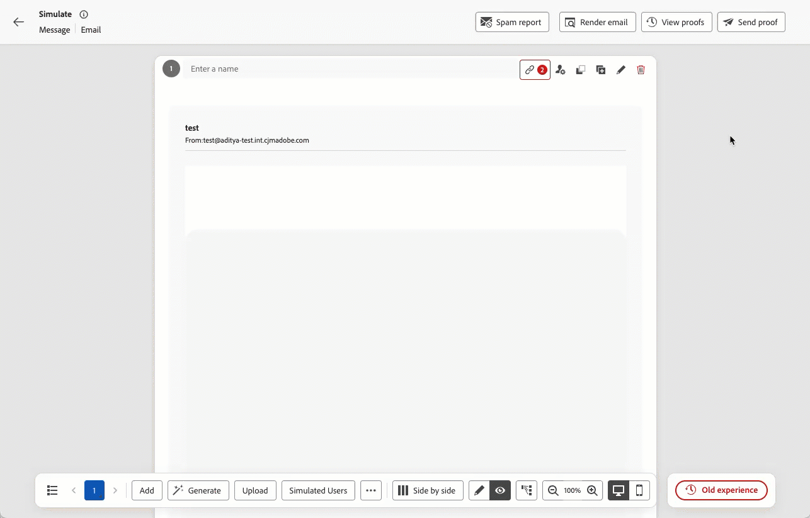

For more information, refer to the <a href="../content-management/url-validation.md">detailed documentation</a>.

Availability date: September 30, 2026

+++ Why it matters

**Why it helps:** Broken or insecure links in a message reach your audience unless you catch them first. Validation in Simulate content flags them while you are still editing.

**How it works:** From the content editor, click Simulate content. The check runs automatically when the Simulate screen opens, and an icon shows a green check mark when all URLs are valid. If any URL is invalid, click the icon to see each URL and the reason, then copy the list. It applies to channel actions in journeys and campaigns across all channels and to content templates. Every http:// and https:// URL is checked, including images and stylesheets.

**What you can do now:**

* Check all web links of your content for broken, insecure (HTTP), or unreachable URLs before you send.
* Copy the list of invalid URLs with the reason for each to share for review.
* Simulate again after fixing the links until the icon shows a green check mark.

**Good to know:** Limited Availability for a set of customers. If the content contains more than 50 URLs, the whole validation request is rejected and no result is returned. Personalized links are validated against the simulated data, so they can be flagged unless you simulate with a real Experience Platform profile. Namespace URLs, CDN resources and URLs in comments can show as false positives. Non-web, relative, anchor and empty links are not checked.

**Status:** Limited Availability

+++

</td>
</tr>
</tbody>
</table>

<table>
<thead>
<tr>
<th><strong>Channel Content plugin in Coworker</strong> </th>
</tr>
</thead>
<tbody>
<tr>
<td>

A new <strong>Channel Content</strong> plugin is now available in Coworker, bringing campaign copy, image, and assembled email HTML skills together under one plugin from strategy to deployment. The following skills are available under the <b>Channel Content</b> plugin:

<ul>
<li><strong>Orchestrate Content Authoring</strong>.</li>
<li><strong>Explore Content Strategy</strong></li>
<li><strong>Content Brief</strong></li>
<li><strong>Generate Content</strong></li>
<li><strong>Check Content Readiness</strong></li>
<li><strong>Revise and Regenerate Content</strong></li>
<li><strong>Generate Image</strong></li>
<li><strong>Assess Content Design</strong></li>
<li><strong>Save Channel Content</strong></li>
<li><strong>Build Email from Figma</strong></li>
<li><strong>Brand Lookup</strong> </li>
</ul>

For more information, refer to the <a href="../content-management/content-management-coworker-skills.md#content-management#ce-channel-content">detailed documentation</a>.

Availability date: September 24, 2026

+++ Why it matters

**Why it helps:** One Coworker plugin covers the path from campaign strategy to production-ready copy, images and email HTML, so you do not switch between separate tools.

**How it works:** Ask Coworker with a brief, journey, campaign or prompt, and the Channel Content plugin plans on-brand copy and images across channels, locales, audiences and variants. Its skills include Explore Content Strategy, Content Brief, Generate Content, Check Content Readiness, Generate Image, Assess Content Design and Save Channel Content, which saves approved content back to Journey Optimizer or another supported solution.

**What you can do now:**

* Turn a campaign brief into writing requirements and drafted copy for a channel.
* Check existing content, including assembled email, for brand voice, accessibility and compliance before sending.
* Generate and adapt images, or build email HTML from a Figma frame with Build Email from Figma.
* Save approved content as a draft in Journey Optimizer.

**Good to know:** Available to customers with access to Coworker. Generating images with a custom, brand-trained model requires production access to Firefly Services. Build Email from Figma needs a FIGMA_ACCESS_TOKEN secret in Coworker settings. Review and edit generated content before saving it.

+++

</td>
</tr>
</tbody>
</table>

<table>
<thead>
<tr>
<th><strong>Content Management MCP tools in Coworker</strong> </th>
</tr>
</thead>
<tbody>
<tr>
<td>

Coworker now has a new set of <strong>Content Management MCP tools</strong>, letting you discover and manage Journey Optimizer content assets through natural language prompts. Ask it to list or retrieve content templates, fragments, landing pages, and journey/campaign inline message content. It can also create content, update templates, and create, update, clone, and publish fragments — plus update inline channel action content directly in journey and campaign.

For more information, refer to the <a href="../content-management/content-management-coworker-skills.md#content-management">detailed documentation</a>.

Availability date: September 3, 2026

+++ Why it matters

**Why it helps:** You can find and update Journey Optimizer content by asking Coworker in plain language, without leaving the conversation to browse the interface.

**How it works:** In Coworker, describe what you need in natural language. The capability is powered by 15 read and write MCP tools for Journey Optimizer content: templates, fragments, landing pages and journey or campaign inline message content.

**What you can do now:**

* List or retrieve content templates, fragments, landing pages and inline message content.
* Create content templates and update existing templates.
* Create, update, clone and publish fragments.
* Update the inline content of a channel action in a journey or campaign.

**Good to know:** Available to all customers with access to Coworker. Update operations replace content in full, so include the complete content in the prompt. Review a fragment before asking Coworker to publish it.

+++

</td>
</tr>
</tbody>
</table>

* **Agentic Translation provider** - Journey Optimizer's Multilingual feature now supports Azure OpenAI and Gemini (Vertex AI) as translation providers, along with locale-specific guidelines in PDF and JSON formats. [Learn more](../content-management/multilingual-provider.md#add-an-agentic-provider)

  Availability date: September 29, 2026

  +++ Why it matters

  **Why it helps:** You can use your own large language model for translation and steer it with locale-specific guidelines, so translations follow your wording rules.

  **How it works:** Go to Content Management > Translation > Providers > Add Provider and choose Agentic Translation. Select Azure OpenAI or Gemini (Vertex AI) under LLM configuration and enter its details, then select the supported locales. On the Guidelines tab, upload a PDF or a JSON guideline per locale (a sample guideline file can be downloaded).

  **What you can do now:**

  * Configure an Azure OpenAI or Gemini (Vertex AI) model as translation provider.
  * Upload a PDF or JSON guideline for each locale.
  * Update or delete an uploaded guideline from its menu.

  **Good to know:** You need access to your own Azure OpenAI or Google Cloud service account credentials to configure the provider.

  +++

* **Mandatory consent checkbox for landing pages** - You can now make a checkbox mandatory in the landing page form component, requiring visitors to select it (for example, to give consent) before they can submit the form. [Learn more](../landing-pages/lp-content.md#use-form-component)

  Availability date: September 4, 2026 

  +++ Why it matters

  **Why it helps:** You can make sure a visitor has agreed before the form is submitted, which is useful when the checkbox records consent.

  **How it works:** In the landing page designer, add a Form component and a checkbox set to opt in or opt out. Select Make form field mandatory so visitors must select the checkbox to submit. Text fields have the same option, and an error message displays if a mandatory field is empty.

  **What you can do now:**

  * Require visitors to select an opt-in or opt-out checkbox before they can submit the form.
  * Require visitors to fill in a text field before they can submit.

  **Good to know:** The option applies to opt-in and opt-out checkboxes and is selected by default. If a visitor does not select the checkbox, the form cannot be submitted.

  +++

* **Additional reserved keywords in personalization syntax** - The list of reserved keywords in Profile Query Language (PQL) has been expanded to include general keywords, time units, and boolean/logical operators. If your XDM schema contains a field name that matches one of these keywords, wrap it in backticks to reference it in a personalization expression. [Learn more](../personalization/personalization-syntax.md#reserved-keywords)

  Availability date: September 1, 2026

  +++ Why it matters

  **Why it helps:** An XDM field whose name matches a reserved keyword can make an expression fail validation. Knowing the longer list helps you check your schema and campaigns.

  **How it works:** Reserved keywords are listed in the personalization syntax documentation, grouped as general keywords, time units, and boolean and logical operators. Wrap a matching field name in backticks, for example ``{{profile.person.`next`.name}}``. Backtick escaping works in both Handlebars paths and PQL expressions.

  **What you can do now:**

  * Wrap an XDM field name in backticks when it matches a reserved keyword.
  * Check your schema field names against the expanded reserved keyword list.

  **Good to know:** Without backticks, the Personalization Editor fails validation with an error. Keywords were released at the end of August, with September 1 as the availability date.

  +++

* [!BADGE Usability]{type=Positive} **Usability improvements in the Content Simulation experience** - The new Content Simulation experience now lets you name and organize your variants for easy comparison, copy or delete variant details directly from each card, view full attribute paths and per-card channel configuration on demand, and upload your own CSV, JSON, or JSONL profiles from a more prominent upload button. [Learn more](../test-approve/simulate-content-variations.md)

  Availability date: September 25, 2026

  +++ Why it matters

  **Why it helps:** Testing several variants is quicker when each one has a name and its controls are on its own card, so you can compare and adjust variants without extra menus.

  **How it works:** From your content, click Simulate content. Each variant card lets you name, copy attributes, duplicate or remove the variant and view its channel configuration (email only). The bottom action bar has Upload for CSV, JSON or JSONL files, an attribute-path toggle for full attribute paths, and a variant list to render only selected variants.

  **What you can do now:**

  * Name variants to tell them apart at a glance, including names in uploaded files.
  * Duplicate a variant and edit its attributes for another test scenario.
  * Show full attribute paths to locate an attribute in the profile data.
  * Upload your own CSV, JSON or JSONL profiles with the Upload button.

  **Good to know:** You can add up to 30 variants manually or by file upload, and up to 40 with AI generation. Edits to simulated user variants are not saved back to the simulated user.

  +++

* [!BADGE Usability]{type=Positive} **Fix syntax with AI** - When validating an expression, if a syntax error is detected, the Personalization Editor provides a "Fix with AI" option to help resolve the issue directly from the editor. [Read more](../personalization/personalization-build-expressions.md#validation-mechanisms).

  Availability date: September 22, 2026

  +++ Why it matters

  **Why it helps:** A syntax error in a personalization expression can be fixed with AI help right where it is detected, so you do not search for the cause by hand.

  **How it works:** In the Personalization Editor, validation runs when you click Add and with the Validate button. When a PQL syntax validation error is detected, the Fix with AI option appears in the bottom pane. Select it to open the expression generation tool in the right rail and get help fixing the error.

  **What you can do now:**

  * Select Fix with AI when validation detects a PQL syntax error.
  * Review the proposed fix in the expression generation tool before applying it.

  **Good to know:** The option appears for PQL syntax validation errors.

  +++

### Loyalty {#sep-26-loyalty}

<table>
<thead>
<tr>
<th><strong>Loyalty event mapping updates</strong> </th>
</tr>
</thead>
<tbody>
<tr>
<td>

Creating or editing an Event Mapping now uses a new **visual mapping builder**: select a schema, pick fields from a searchable field selector, map each field to a loyalty event field with per-row connection status, and preview the auto-generated JSONata expression, with the option to switch to manual JSONata editing at any time.

In addition, "Event Definitions" in Loyalty admin have been renamed to "Event Mappings", with a refreshed list view that shows the human-readable Experience event schema name.

For more information, refer to the <a href="../loyalty-challenges/loyalty-admin.md#event-mappings">detailed documentation</a>.

Availability date: September 22, 2026

+++ Why it matters

**Why it helps:** You can map your schema fields to loyalty event fields without writing a JSONata expression from scratch.

**How it works:** In Loyalty configurations, open the Event mapping tab and select Create event mapping. Enter an Event name, select the Experience event schema, select fields from the searchable field tree, connect each incoming field to a Loyalty event field, and review the generated JSONata and output preview.

**What you can do now:**

* Select a schema and pick the fields to map from a searchable, filterable field selector.
* Map each incoming data field to a loyalty event field with the mapping table.
* Preview the auto-generated JSONata expression and edit it manually when you need a custom expression.
* Identify event mappings in the list by the human-readable Experience event schema name.

**Good to know:** Event Definitions in Loyalty admin are now called Event Mappings. Selecting Reset to generated returns to table-driven mapping. Events that do not match any mapping are ignored. Administrator access is required.

+++

</td>
</tr>
</tbody>
</table>

<table>
<thead>
<tr>
<th><strong>Loyalty Opportunities</strong> </th>
</tr>
</thead>
<tbody>
<tr>
<td>

The Loyalty Performance menu now includes **Opportunities** and **Trend** tabs, which surface AI-detected trends and gaps such as tier progression friction or challenge task drop-off, each with a projected impact and a one-click "Create with AI" action to generate a challenge that addresses it.

In addition, marketers can request **challenge opportunities** directly in Coworker's conversational interface, getting grounded challenge ideas based on real loyalty program trends and turning them into live challenges without leaving the chat.

For more information, refer to the <a href="../loyalty-challenges/loyalty-performance.md#opportunities-view">detailed documentation</a>.

Availability date: September 30, 2026

+++ Why it matters

**Why it helps:** You can see where your loyalty program is losing ground and turn the suggested fix into a challenge without starting from a blank page.

**How it works:** In Loyalty Challenges, select Performance in the left navigation and open the Opportunities or Trends tab. On an opportunity card, View details previews the AI-drafted challenge (summary, tasks, rewards, rationale) and Create with AI opens Coworker to create or edit the challenge. You can also ask Coworker for challenge opportunities directly in chat.

**What you can do now:**

* Review AI-detected opportunities such as underperforming challenges, inactive members, or points expiry, and select Ask AI on a Trends card for a concise summary of the insight.
* Preview the drafted challenge and the rationale with View details.
* Create or edit a challenge from an opportunity with Create with AI, without leaving the reporting page.
* Ask Coworker for opportunities focused on a goal and turn them into live challenges in the chat.

**Good to know:** Opportunities are surfaced only when the analysis identifies a statistically significant trend and a solution that can address it. After Coworker creates the challenge, review its dates, tasks and other fields before publishing.

+++

</td>
</tr>
</tbody>
</table>

* **Per-member Loyalty challenge completion deadlines** - Loyalty challenges now support per-member completion deadlines: choose "Within a number of days after opt-in" under Completion requirements so each member's deadline is calculated from their own opt-in date rather than a fixed program-wide end date. If both a challenge end date and this opt-in window are set, each member's deadline is whichever comes first. [Learn more](../loyalty-challenges/create-challenges.md#schedule)

  Availability date: September 30, 2026

  +++ Why it matters

  **Why it helps:** Each member gets their own completion window from the day they opt in, instead of one program-wide end date for everyone.

  **How it works:** In the challenge Settings tab, under Completion requirements, choose Within a number of days after opt-in and enter Days after opt-in. A member's deadline is their opt-in date plus that number of days.

  **What you can do now:**

  * Give every member the same number of days to finish, counted from their own opt-in date.
  * Set Challenge end to No end date when the deadline is fully driven by the opt-in window.
  * Combine the opt-in window with a challenge end date as a hard cut-off.

  **Good to know:** If both a challenge end date and the opt-in window are set, each member's deadline is whichever comes first. Completion requirements are available under Advanced scheduling.

  +++

* **Challenges domain in the Content Card personalization editor** - The Content Card personalization editor now supports **Challenges** as a domain, letting you access challenge metadata when authoring content card personalization. This makes it easier to create tailored content for each stage of a challenge — Launch, In progress, and End — without custom code. [Learn more](../content-card/design-content-card.md#personalize-challenge-content)

  Availability date: September 30, 2026

  +++ Why it matters

  **Why it helps:** You can reuse challenge data in content cards for each stage of a challenge without custom code.

  **How it works:** In the Content Card personalization editor, open the Personalization icon, select Challenge Data, then select Add loyalty challenge data to make the challenge fields available, and add the fields you need.

  **What you can do now:**

  * Insert challenge metadata into content card personalization.
  * Create tailored content cards for the Launch, In progress and End stages of a challenge.

  **Good to know:** Documented for content cards designed for a loyalty challenge.

  +++

* **"Forever" Loyalty challenges** - Loyalty challenges can now run indefinitely. Set **Challenge end** to **No end date** when configuring the schedule, and the challenge never expires. [Learn more](../loyalty-challenges/create-challenges.md#schedule)
  
  Availability date: September 1, 2026

  +++ Why it matters

  **Why it helps:** You can run a challenge that never expires instead of picking an arbitrary end date.

  **How it works:** In the challenge Settings tab, Schedule section, open the Challenge end field and select No end date. Challenges saved this way never expire, and the Challenges inventory shows a dash in the end-date column.

  **What you can do now:**

  * Run a challenge indefinitely with no end date.
  * Combine No end date with an opt-in based completion deadline.

  **Good to know:** No journey is generated for challenges configured with No end date, because journeys cannot run longer than 90 days. The challenge itself still runs and members can still opt in and complete tasks.

  +++

* **Loyalty available for Healthcare Shield and Privacy and Security Shield customers** - Journey Optimizer Loyalty is now available to Healthcare Shield and Privacy and Security Shield customers. [Learn more](../loyalty-challenges/get-started.md)

  Availability date: September 15, 2026

  +++ Why it matters

  **Why it helps:** Organizations on Healthcare Shield or Privacy and Security Shield no longer have a restriction on adopting Loyalty.

  **How it works:** Journey Optimizer Loyalty can now be used under these Shield offerings, and the earlier availability warning has been removed from the Loyalty documentation.

  **What you can do now:**

  * Use Journey Optimizer Loyalty if you are a Healthcare Shield or Privacy and Security Shield customer.

  **Good to know:** Using Loyalty still requires a Loyalty role; for non-Prod sandboxes an administrator must create a custom role with the required Loyalty permissions.

  +++

* **Loyalty challenge details page** - You can now review a challenge's configuration and performance from a dedicated details page. View its summary, targeted audience, connected journey, tasks, and rewards alongside key metrics for revenue, enrollment, completion rate, and total completions. Open the full report for more detailed performance insights or select **Edit challenge** to modify the challenge. [Learn more](../loyalty-challenges/access-loyalty-challenges.md#challenge-details)

  Availability date: September 30, 2026

  +++ Why it matters

  **Why it helps:** You can check what a challenge is configured to do and how it performs in one place, without opening the editor.

  **How it works:** In the Challenges inventory, select a challenge name to open its details page. It shows the Challenge summary, Tasks and Rewards, plus Key metrics (revenue, enrollment, completion rate, total completions). Select View report for the full report or Edit challenge to modify it.

  **What you can do now:**

  * Review the description, type, dates, targeted audience and connected journey status.
  * Check task completion requirements and each task's details.
  * Read key metrics with trend sparklines and percentage changes.
  * Open the full report or edit the challenge from the same page.

  **Good to know:** The Key metrics and Trends sections are shown only to users with the View Loyalty Insights permission (loyalty-insights.read). Editing a published challenge requires reverting it to Draft first.

  +++

### Journeys {#sep-26-journeys}

<table>
<thead>
<tr>
<th>[!BADGE Usability]{type=Positive} <strong>Content preview in the journey canvas</strong> </th>
</tr>
</thead>
<tbody>
<tr>
<td>

Reviewing channel content required opening each activity individually, one at a time — slow and error-prone on journeys with many channel activities, especially where personalization means checking multiple treatments or variants per activity. <strong>Content preview</strong> removes that friction by surfacing a content thumbnail for every channel activity directly in the canvas, with a fullscreen modal to inspect and switch between treatments and variants.

For more information, see the <a href="../building-journeys/using-the-journey-designer.md#content-preview">journey canvas content preview documentation</a>.

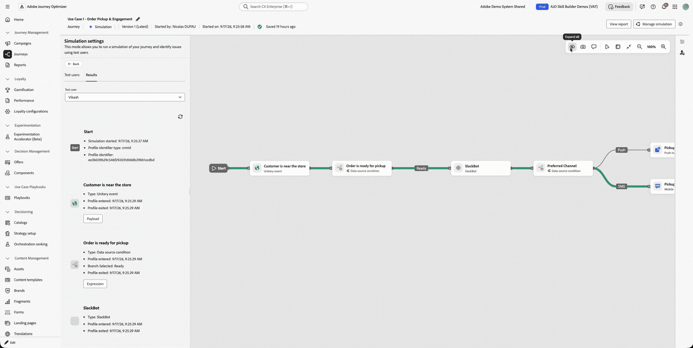

Availability date: September 28, 2026

</td>
</tr>
</tbody>
</table>

<table>
<thead>
<tr>
<th><strong>Compare journey versions with Coworker</strong> </th>
</tr>
</thead>
<tbody>
<tr>
<td>

Today, reviewing what changed between two versions of a journey requires manually comparing them inside Journey Optimizer node by node. There's no structured diff, which makes change-review, audit, and pre-publish checks slow and error-prone, especially as journeys grow more complex. This capability lets a customer or AI agent compare any two versions of a journey through Coworker Chat and get back a full-fidelity, **structured diff** - added/removed/modified/moved nodes with field-level detail, changed connections, journey-level property changes, and roll-up counts, without opening Journey Optimizer. 

For more information, refer to the <a href="../building-journeys/journeys-coworker-skills.md#journey-analyze">detailed documentation</a>.

Availability date: September 24, 2026

+++ Why it matters

**Why it helps:** Reviewing what changed between two journey versions no longer means opening both and comparing them node by node, which makes change review, audit and pre-publish checks faster and less error-prone, especially on complex journeys.

**How it works:** In Coworker Chat, ask Coworker to compare two versions of a journey (for example, version 1.0 and 2.0 of a named journey). It returns a structured diff without opening Journey Optimizer.

**What you can do now:**

* Review added, removed, modified and moved nodes with field-level detail.
* Check changed connections and journey-level property changes, with roll-up counts.
* Run a change review, an audit or a pre-publish check on a journey.
* Ask a targeted question, such as whether a wait duration changed between the last two versions.

+++

</td>
</tr>
</tbody>
</table>

<table>
<thead>
<tr>
<th><strong>Journey Simulation in Coworker</strong> </th>
</tr>
</thead>
<tbody>
<tr>
<td>

The <strong>Journey Simulation skill</strong> in Coworker automates end-to-end journey validation and lets you easily interpret the results. Note that this feature currently supports only the Quick Simulation flow and does not fully replace the Journey Optimizer manual simulation experience.

For more information, refer to the <a href="../building-journeys/journeys-coworker-skills.md#journey-simulation">detailed documentation</a>.

Availability date: September 23, 2026

+++ Why it matters

**Why it helps:** Validate a journey's logic conversationally in Coworker instead of setting up a simulation by hand, and read the results in the same chat.

**How it works:** In Coworker Chat, the Journey Simulation skill runs a Quick Simulation: it generates the minimum simulated users and event data so that each path is tested, then lets you check run status, list simulated users, retrieve logs and review results.

**What you can do now:**

* Run a quick simulation of a journey, for example by asking Coworker to simulate your onboarding journey.
* Review step-by-step path traversal and branch outcomes of a run.
* Check the status of a run, list its simulated users and retrieve its logs.

**Good to know:** Only the Quick Simulation flow is supported. It does not fully replace the manual simulation experience in Journey Optimizer. You cannot choose an existing saved simulated user, edit a simulated user before rerunning, create, browse, update or delete persistent simulated users through chat, or target a specific path or custom test case.

+++

</td>
</tr>
</tbody>
</table>

<table>
<thead>
<tr>
<th><strong>Journey-level holdout (Limited availability)</strong> </th>
</tr>
</thead>
<tbody>
<tr>
<td>

You can now configure a holdout group for your journeys directly from journey properties. A holdout is a configurable percentage of your target audience that is excluded from entering the journey and receives no communication. By comparing holdout profiles against active profiles in Customer Journey Analytics reporting, you can measure the incremental lift - the true impact - that your journey delivers.

This capability is only available for a set of organizations (Limited Availability). To gain access, contact your Adobe representative. For full details about the release cycle and availability phases, see <a href="releases.md">Journey Optimizer release cycle</a>.

For more information, refer to the <a href="../building-journeys/journey-properties.md#performance-management">detailed documentation</a>.

Availability date: September 1, 2026

+++ Why it matters

**Why it helps:** Measure the incremental lift of a journey, meaning its actual impact, by keeping a share of the audience out of it and comparing outcomes.

**How it works:** In the journey properties, open the Performance measurement section, select a Success metric, turn on Measure lift using a holdout, enter the Holdout percentage and save. Excluded profiles are tracked through exclusion events and can be compared with active profiles in Customer Journey Analytics reporting.

**What you can do now:**

* Configure a holdout group from journey properties: a randomly selected percentage of the audience that does not enter the journey and receives no communication.
* Compare holdout profiles with active profiles in Customer Journey Analytics reporting to measure incremental lift.
* Choose the success metric used to calculate the lift, for example Email Opens (AJO).

**Good to know:** This capability is only available to a set of organizations in Limited Availability. Contact your Adobe representative for access.

**Status:** Limited Availability

+++

</td>
</tr>
</tbody>
</table>

<table>
<thead>
<tr>
<th><strong>Generate expressions with AI in journeys</strong> </th>
</tr>
</thead>
<tbody>
<tr>
<td>

The journey advanced expression editor now integrates AI-powered expression generation: describe the expression you want to build in natural language, and the editor generates ready-to-use code you can apply immediately or refine through follow-up prompts.

Previously released in Limited Availability, this capability is now available to all environments (General Availability).

For more information, refer to the <a href="../building-journeys/expression/generate-expression.md">detailed documentation</a>.

Availability date: September 1, 2026

+++ Why it matters

**Why it helps:** Build journey expressions by describing them in plain language instead of writing expression code by hand.

**How it works:** Open the Advanced expression editor in a journey, for example from a condition, an Optimize activity or a Wait activity with a custom date, describe the expression and select Generate. Review the result, then select Apply to insert it in the editor.

**What you can do now:**

* Describe a condition in natural language, such as customers who made a purchase in the last 30 days.
* Generate a dateTimeOnly expression for a Wait activity that uses a custom date.
* Check audience membership, for example whether a profile is in the Gold Loyalty audience.
* Refine the generated expression with follow-up prompts.

**Good to know:** The capability was previously in Limited Availability and is now available to all environments. If the prompt references fields that do not exist in the available data sources, an error message appears and you need to revise the prompt. Read the generative AI guardrails and limitations before using it.

+++

</td>
</tr>
</tbody>
</table>

* **Supplemental ID support in Journey simulation** - **Supplemental ID** is now supported in Journey simulation, allowing you to test complex user scenarios for both read-audience and event-triggered journeys. [Learn more](../building-journeys/simulate-journey-gs.md)

  Availability date: September 28, 2026.

  +++ Why it matters

  **Why it helps:** Test journeys that use a supplemental ID in simulation, so journeys with multiple re-entrance can be validated before going live.

  **How it works:** In Journey simulation, a supplemental ID is now supported for read-audience and event-triggered journeys. The previous restriction that blocked simulation when multiple re-entrance was enabled no longer applies.

  **What you can do now:**

  * Simulate complex user scenarios on a read-audience journey that uses a supplemental ID.
  * Simulate complex user scenarios on an event-triggered journey that uses a supplemental ID.

  **Good to know:** With a supplemental ID on a Read audience journey, the limit of 100 per simulation run counts total journey runs instead of unique users. For example, re-running the same five simulated users 20 times reaches the limit. Stopping and restarting, or resetting, the simulation clears the count.

  +++

* **Support for Jump activities in Audience Qualification journeys** - You can now use Jump activities in journeys that start with an Audience Qualification node to jump to event-based journeys. This capability is being progressively rolled out to organizations. If you don't see this in your environment, it may be because you're still using batch audiences in Audience Qualifications. [Learn more](../building-journeys/jump.md)

  Availability date: September 22, 2026.

  +++ Why it matters

  **Why it helps:** Connect journeys that start with an Audience Qualification to event-based start journeys, which was blocked before.

  **How it works:** In a journey that starts with an Audience Qualification event, add a Jump activity and select an event-based start journey as the target.

  **What you can do now:**

  * Use a Jump activity in a journey that starts with an Audience Qualification node to jump to an event-based start journey.

  **Good to know:** Jumping to a journey that starts with an Audience Qualification or Read Audience is still not supported. The capability is being progressively rolled out and is not enabled for an organization while batch audiences are still used in Audience Qualification nodes.

  +++

* [!BADGE Deprecation]{type=Negative} **Batch audiences no longer supported in Audience Qualification and Exit Criteria** - Starting September 2026, new, draft, and duplicated journeys that use a batch audience in an Audience Qualification node or Exit Criteria cannot be published. Existing live journeys continue to run; if you stop, duplicate, or republish one, publication is blocked until you update its configuration. Use a streaming audience for Audience Qualification or Exit Criteria, or a Read Audience activity for batch-based journey entry. [Learn how to migrate your journeys](../building-journeys/aq-batch-audiences-migration.md)

* **Trigger after batch audience evaluation** - For recurring journeys that target batch audiences, you can configure a wait window of up to 6 hours for a fresh batch evaluation before the journey runs. If an evaluation is in progress, the journey waits for it to complete; if the latest snapshot was used by the previous run, it waits for a newer batch. If no fresh audience is available by the end of the wait window, that occurrence is skipped. [Learn more](../building-journeys/read-audience.md)

  Availability date: September 18, 2026

  +++ Why it matters

  **Why it helps:** Run a recurring batch journey on fresh audience data, and avoid waiting when no wait is needed.

  **How it works:** In the Read audience activity, on a recurring schedule, turn on Trigger after batch audience evaluation and set a wait window of 1 to 6 hours. If a batch segmentation is in progress, the journey waits for it. Otherwise it waits only when the latest snapshot is the same batch used by the previous run.

  **What you can do now:**

  * Configure a wait window of up to 6 hours for a fresh batch evaluation before the journey runs.
  * Let the journey wait for an evaluation in progress, or for a newer batch when the latest snapshot was already used.

  **Good to know:** If no fresher audience is found by the end of the wait window, that occurrence is skipped. The option is available only for daily recurrence and does not control audience evaluation for Action campaigns.

  +++

* **Decisioning in Journey simulation** - Path Experimentation, as part of the **Optimize** activity, is now supported in Simulation. Routing is handled by Decisioning and is random and non-deterministic per simulated user.

  [Learn more](../building-journeys/simulate-journey-gs.md)

  Availability date: September 15, 2026

  +++ Why it matters

  **Why it helps:** Validate the Path Experimentation paths of an Optimize activity in simulation instead of testing them only in a live journey.

  **How it works:** In Simulation, the Experiment method (Path Experimentation) of the Optimize activity is now supported. Routing is handled by Decisioning, for any split, even a 50/50 split or a 10 percent holdout.

  **What you can do now:**

  * Simulate Path Experimentation as part of the Optimize activity.

  **Good to know:** Assignment is random and non-deterministic per simulated user. A small batch, for example 5 users in Quick simulation, is not guaranteed to cover every treatment. This differs from Percentage split, where AI creates one simulated user per branch.

  +++

* **New Journey Anomaly Detected alert** - A new system alert now warns you when a live journey's daily traffic deviates from its own historical baseline, or drops to zero unexpectedly, across Journey Entries, Journey Exits, and Event Sends. This alert is currently available in production sandboxes only.

  [Learn more](../reports/alerts.md)

  Availability date: September 15, 2026

  +++ Why it matters

  **Why it helps:** Be warned when a live journey's traffic drops or deviates unexpectedly, so you can act before customers are affected.

  **How it works:** This is a system alert listed with the journey alerts. Every day it compares each live journey's Journey Entries, Journey Exits and Event Sends with the journey's own historical baseline and raises an alert on a zero value or a deviation of 35 percent or more.

  **What you can do now:**

  * Get warned when a live journey's daily traffic deviates from its own historical baseline.
  * Get warned when Journey Entries, Journey Exits or Event Sends drops to zero unexpectedly.
  * Troubleshoot an alert from the journey live report.

  **Good to know:** Available in production sandboxes only. It applies to live unitary event, read-audience (recurring only) and audience-qualification journeys, and requires the organization or sandbox to be subscribed to alerting. A deviation alert needs 3 to 4 consecutive non-zero days of history and an expected value of at least 100.

  +++

* **Decisioning in Journey simulation** - You can now simulate journeys that rely on Decisioning, with the following newly supported:

  * Content Decision nodes are now supported in Simulation.
  * The Optimize activity's Targeting rule method is now supported in Simulation.
  * Actions with Adobe Journey Optimizer–decisioned content (e.g., email using a decision policy) are now supported in Simulation.
  * Decision policies using Offer eligibility and ranking by rule, audience, priority, or formula are fully supported. Ranking by AI Model - Personalization is also supported, though returned offers may vary between runs.

  [Learn more](../building-journeys/simulate-journey-gs.md)

  Availability date: September 8, 2026

  +++ Why it matters

  **Why it helps:** Validate journeys that rely on Decisioning, including offers and decision policies, in simulation before they go live.

  **How it works:** In Simulation, Content Decision nodes, the Targeting rule method of the Optimize activity and actions with content decisioned by Journey Optimizer are supported. Decision policies are supported for Offer eligibility and for ranking by rule, audience, priority, formula, and AI Model - Personalization.

  **What you can do now:**

  * Simulate Content Decision nodes and the Targeting rule method of the Optimize activity.
  * Simulate actions with decisioned content, for example an email that uses a decision policy.
  * Simulate decision policies that use Offer eligibility and ranking by rule, audience, priority or formula.

  **Good to know:** When ranking by AI Model - Personalization, the returned offers may vary between simulation runs.

  +++

* **Analyze Journey Anomalies skill** - Coworker can now detect unexpected spikes, drops, or flatlines in a journey's entry, exit, or message-send counts against historical baselines using the **Analyze Journey Anomalies** skill. Once a real anomaly is confirmed, the skill runs read-only diagnostics to surface a likely root cause and recommendation. [Learn more](../building-journeys/journeys-coworker-skills.md#journey-analyze)

  Availability date: September 2, 2026

  +++ Why it matters

  **Why it helps:** Find out whether a change in journey traffic is a real anomaly and what likely caused it, without building the analysis yourself.

  **How it works:** In Coworker Chat, ask about entries, exits or sends of a journey, for example why entries dropped yesterday. The skill confirms the anomaly with a deterministic statistical check, then runs bounded, read-only diagnostics and returns a likely root cause and a recommendation. When a Journey Anomaly Detected alert fires, an AI Recommendations card on the Journey Optimizer home page opens Coworker with the analysis prepared.

  **What you can do now:**

  * Detect unexpected spikes, drops or flatlines in a journey's entry, exit or message-send counts against historical baselines.
  * Get a likely root cause and a recommendation once a real anomaly is confirmed.
  * Investigate an anomaly alert that references a specific journey version and timestamp.

  **Good to know:** The diagnostics are read-only. The AI Recommendations card is in Limited Availability for a set of organizations, and the Journey Analyze skills need permissions such as View Journeys and View Segments.

  +++

* **New dateDiff function in journey expression editor** - The journey expression editor now includes the `dateDiff` function, which calculates the difference between two dates in number of days. This function is useful for time-based logic such as creating deadlines, calculating customer lifecycle durations, or building countdown timers in journey conditions.  [Learn more](../building-journeys/functions/date-functions.md#dateDiff)

  Availability date: September 1, 2026

  +++ Why it matters

  **Why it helps:** Compute the gap between two dates directly in a journey expression instead of working it out outside the journey.

  **How it works:** In the journey expression editor, use dateDiff(date1, date2). The parameters can be literal values, functions such as now(), or typed event, profile or custom action response fields.

  **What you can do now:**

  * Create deadlines in journey conditions.
  * Calculate customer lifecycle durations.
  * Build countdown timers in journey conditions.

  **Good to know:** Both parameters must use the same data type. dateOnly parameters return days while dateTimeOnly and dateTime parameters return milliseconds. This function differs from dateDiff in the personalization editor.

  +++

* **Dry run step-event suppression for custom reports** - As part of step-event optimization, Journey Optimizer now stops generating certain non-reportable step events during Journey Dry Runs. This only affects custom reports built on these dry-run step-event types. If you're impacted, re-trigger the dry run to regenerate data.

* **Internal error recovery timeout in Journey Properties** - Journey Properties now includes a **Set internal error recovery timeout** setting: by default, impacted journey events may be retried for up to 72 hours after a service interruption with no action needed. You can turn this setting on to control the replay window (0–72 hours) for time-sensitive journeys. The existing **Timeout or error** field has also been renamed to **Custom Action / Data source timeout** to avoid confusion between the two settings. [Learn more](../building-journeys/journey-properties.md#event-recovery-timeout)

  +++ Why it matters

  **Why it helps:** Control how long a time-sensitive journey retries events after a service interruption, so late replays do not reach customers when they are no longer relevant.

  **How it works:** In Journey Properties, turn on Set internal error recovery timeout and set the replay window from 0 to 72 hours. The default, with the toggle off, is up to 72 hours of retries with no action needed, for new and existing journeys.

  **What you can do now:**

  * Turn on Set internal error recovery timeout in Journey Properties.
  * Set a shorter replay window, from 0 to 72 hours, for time-sensitive journeys.

  **Good to know:** Use a shorter window only when replaying delayed events would no longer be relevant. The Timeout or error field is now named Custom Action / Data Source timeout and is a separate setting: it controls how long a journey waits for a single action response before taking a fallback path.

  +++

* [!BADGE Usability]{type=Positive} **Easier detach and join branches in the new journey canvas** - You can now detach a branch from the rest of your journey without deleting it, and join it back later at a different point, either by selecting an eligible activity directly on the canvas or by picking it from a list of disconnected or already-used branches. [Learn more](../building-journeys/using-the-journey-designer.md#join-and-detach-branches)

  Availability date: September 1, 2026

  +++ Why it matters

  **Why it helps:** Rearrange a journey without deleting work: detach a branch, keep it on the canvas and reconnect it later elsewhere.

  **How it works:** On the new journey canvas, select an edge, or its plus icon, and choose Detach edge. The edge is capped with an End activity and the detached branch stays on the canvas. To rejoin, use the plus icon on an edge, open the Join section and pick a branch from the Disconnected or Branches list, or use Select from canvas.

  **What you can do now:**

  * Detach a branch from the rest of the journey without deleting it.
  * Join a detached branch back at a different point by selecting an eligible activity on the canvas.
  * Join a branch from a list of disconnected or already used branches, with a search field for large journeys.

  **Good to know:** Detach edge only appears where detaching makes sense. For example, it is not available on an edge whose target is an End activity shared by more than one branch.

  +++

### Channels {#sep-26-channels}

The following capabilities and improvements are coming to channels in this release.

<table>
<thead>
<tr>
<th><strong>Live Activities for Android Live Updates</strong> </th>
</tr>
</thead>
<tbody>
<tr>
<td>

Journey Optimizer now expands its real-time mobile personalization capabilities by extending <strong>Live Activity support to Android</strong>. You can deliver real-time progress updates directly to users, such as order tracking, flight statuses, live event updates, and real-time sports scores.

Beyond supporting iOS Live Activities, Journey Optimizer now manages temporary push tokens for Android Live Updates across its platform configurations. It supports both broadcast and transactional update flows using API-triggered campaigns and headless APIs.

For more information, refer to the <a href="../mobile-live/create-mobile-live.md">detailed documentation</a>.

Availability date: September 30, 2026

+++ Why it matters

**Why it helps:** Reach Android users with the same real-time progress updates already available on iOS, so one Live activity channel covers both platforms.

**How it works:** Live activities are sent from an API-triggered campaign (Campaigns menu, then Actions, then Live activity) based on a Live activity channel configuration. For Android, the payload uses the Firebase Cloud Messaging (FCM) object instead of the APNs object, and Journey Optimizer manages the temporary push tokens for Android Live Updates.

**What you can do now:**

* Send real-time progress updates such as order tracking, flight statuses, live event updates, and real-time sports scores to Android users.
* Send broadcast updates to an audience with an API-triggered Marketing campaign.
* Send transactional updates to an individual with an API-triggered Transactional campaign.
* Start, update, and end a Live activity through the cURL request provided after you activate the campaign.

**Good to know:** Android uses the open-source Adobe Experience Platform Messaging extension for the Mobile SDK. Each update must carry a timestamp greater than the previous event for the same notification, otherwise it is ignored. For API-triggered Transactional campaigns, the High Throughput option must not be enabled.

+++

</td>
</tr>
</tbody>
</table>

<table>
<thead>
<tr>
<th><strong>Android push notifications templates improvements</strong> </th>
</tr>
</thead>
<tbody>
<tr>
<td>

Android push notifications previously rendered with a single, fixed layout: images were always center-cropped, and long body text was truncated. This release introduces a template picker at authoring time, allowing marketers to control the layout of Android push notifications.

Following improvements are available:

<ul>
<li><b>Layout selection</b>: New Push Notification Layout picker (Standard / Expanded) when authoring an Android push.</li>
<li><b>Standard layout with "Show entire image"</b>: Choose cropped-to-fill vs. scaled-to-fit.</li>
<li><b>Expanded layout</b>: Multi-line body text with no truncation, plus optional large-icon thumbnail.</li>
<li><b>Collapsed body (Expanded layout)</b>: Set a separate, shorter body text for the collapsed state.</li>
</ul>

For more information, refer to the <a href="../push/design-push.md">detailed documentation</a>.

Availability date: September 1, 2026

+++ Why it matters

**Why it helps:** Show longer Android push messages in full and control how images are displayed, instead of a single fixed layout with truncated text and cropped images.

**How it works:** When you design an Android push notification, use the Push Notification Layout picker to choose Standard (default, single-line body with optional image banner) or Expanded (multi-line body that is never truncated, with an optional large icon). With the Expanded layout, a Collapsed body field sets a shorter text for the collapsed state.

**What you can do now:**

* Choose a Standard or Expanded layout when you author an Android push notification.
* Show the entire image, scaled to fit instead of cropped, in the Standard layout.
* Display multi-line body text without truncation and a large-icon thumbnail in the Expanded layout.
* Set a separate, shorter body text for the collapsed state of the Expanded layout.

**Good to know:** The layout picker is only available for Android push notifications. Standard remains the default, so existing notifications do not change unless you select Expanded. If the Collapsed body is left empty, no body text displays in the collapsed state. Your mobile app must implement the client-side handling for media attachments in the payload for images to render.

+++

</td>
</tr>
</tbody>
</table>

* **Increased subdomain delegation limit** - Depending on your license contract, you can now request up to 3000 subdomains (previously capped at 100) by reaching out to your Adobe representative. This capability is available in Limited Availability for a set of customers. [Learn more](../configuration/delegate-subdomain.md#guardrails)

  Availability date: September 25, 2026

  +++ Why it matters

  **Why it helps:** Delegate far more subdomains when your license contract allows it, instead of stopping at the default cap.

  **How it works:** The Guardrails section of Delegate a subdomain states that Journey Optimizer allows a maximum of 10 subdomains by default, and up to 3000 depending on your license contract. To raise your limit, reach out to your Adobe representative.

  **What you can do now:**

  * Request up to 3000 subdomains, up from 100, through your Adobe representative.

  **Good to know:** The limit depends on your license contract and is shared by the email, landing page, and web channels. SMS and custom channels do not support CDN provisioning and are not subject to this limit.

  **Status:** Limited Availability

  +++

* **Direct mail - Split large files automatically** - Direct Mail files can now be split into multiple parts automatically when they exceed roughly 20 GB, or manually by choosing a target file size in the file routing configuration. [Learn more](../direct-mail/direct-mail-configuration.md)

  Availability date: September 30, 2026

  +++ Why it matters

  **Why it helps:** Keep very large Direct Mail exports manageable without splitting files yourself.

  **How it works:** In the file routing configuration of your Direct Mail setup, the Split file into multiple parts option lets you set a target file size from 500 MB to 10 GB. If you do not select it, Journey Optimizer still splits the file automatically once it exceeds approximately 20 GB.

  **What you can do now:**

  * Rely on automatic splitting of a Direct Mail file once it exceeds roughly 20 GB.
  * Choose a target file size in the file routing configuration to split files manually into several parts.

  **Good to know:** By default, files are split only when they exceed about 20 GB. The optional JSON manifest file that described the parts is no longer available.

  +++

* **Direct mail - Increased audience limit** - The Direct Mail channel audience limit has been increased from 3 million to 100 million profiles, letting you target much larger audiences without hitting file-creation errors. [Learn more](../direct-mail/get-started-direct-mail.md)

  Availability date: September 30, 2026

  +++ Why it matters

  **Why it helps:** Run Direct Mail campaigns on much larger audiences without the earlier error that prevented the file from being created.

  **How it works:** When you create a Direct Mail message, you select your audience from the available Adobe Experience Platform audiences. Audience selection now supports up to 100 million profiles, up from 3 million.

  **What you can do now:**

  * Target an audience of up to 100 million profiles in a Direct Mail message.
  * Avoid the file-creation failure that occurred above 3 million profiles.

  **Good to know:** Large files are handled through the file split capability, which splits files above a certain size.

  +++

### Email Designer {#sep-26-email-designer}

The following capabilities and improvements are coming to the Email Designer in this release.

<table>
<thead>
<tr>
<th><strong>Dynamic Media Template component in the Email Designer (Limited Availability)</strong> </th>
</tr>
</thead>
<tbody>
<tr>
<td>

The Email Designer now includes a dedicated <strong>Dynamic Media Template</strong> component for inserting Dynamic Media Templates from Adobe Experience Manager into your email content. In addition to browsing existing templates, you can now import a Photoshop (PSD) file directly — drag and drop it into the component, or select it from your computer, then choose a destination to store it.

Once your file is imported, select <strong>Edit in Dynamic Media Template Editor</strong> to open the Dynamic Media Template Editor directly within Journey Optimizer, where you can enable the parameters you want to expose, without leaving the Email Designer. The enabled parameters then become available in the component's <strong>Settings</strong> tab.

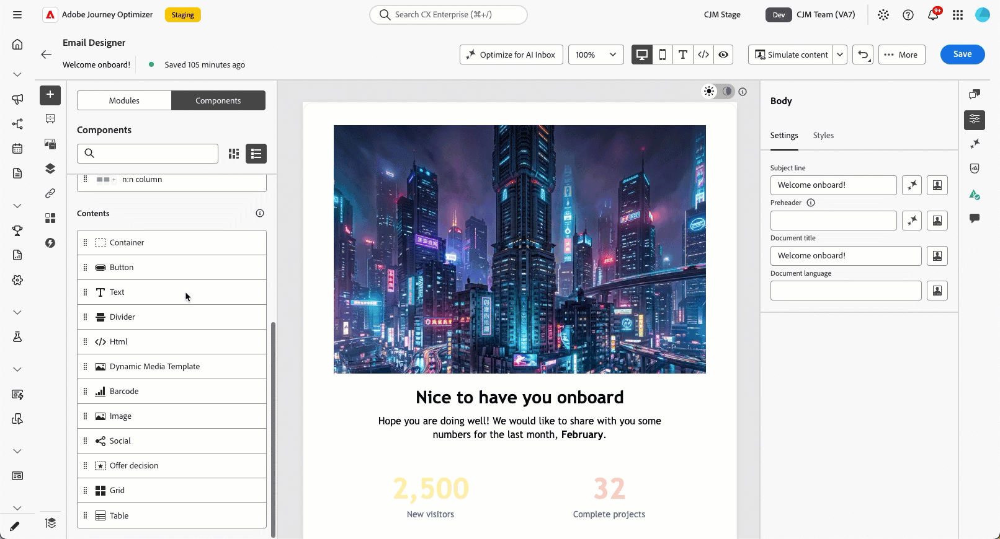

This capability is only available for a set of organizations (Limited Availability). To gain access, contact your Adobe representative.

For more information, refer to the <a href="../email/content-components.md#dynamic-media-template">detailed documentation</a>.

Availability date: September 30, 2026.

+++ Why it matters

**Why it helps:** Build personalized Dynamic Media content from a Photoshop file or an existing template without leaving the Email Designer.

**How it works:** Drag the Dynamic Media Template component into your layout, then choose Browse to pick an AEM template or Import PSD to drop a Photoshop file and select a destination. Select Edit in Dynamic Media Template Editor to open the editor within Journey Optimizer and use Include Param to enable the parameters you want to expose.

**What you can do now:**

* Insert a Dynamic Media Template from Adobe Experience Manager or import a Photoshop (PSD) file by drag and drop.
* Edit the template in the Dynamic Media Template Editor and enable the parameters you want to expose.
* Fill in the enabled parameters in the Settings tab, with personalization and conditional content.

**Good to know:** Requires a Journey Optimizer license together with a Dynamic Media license. If your organization does not have access, you can still add a dynamic media template with the Image component.

**Status:** Limited Availability

+++

</td>
</tr>
</tbody>
</table>

<table>
<thead>
<tr>
<th><strong>Collaborate on email content</strong> </th>
</tr>
</thead>
<tbody>
<tr>
<td>

The Email Designer now includes built-in <strong>collaboration tools</strong> for commenting and resolution, so marketing teams can review, discuss, and finalize email content directly within Journey Optimizer instead of sharing drafts over external tools like chat, email threads, or spreadsheets. Invite collaborators and reviewers, add general or component-specific comments, and reply to, resolve, and manage comment threads — all without leaving the Email Designer.

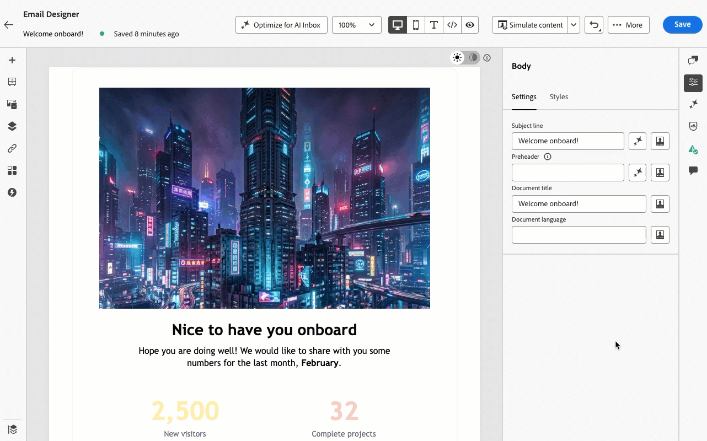

For more information, refer to the <a href="../email/email-collaboration.md">detailed documentation</a>.

Availability date: September 25, 2026.

+++ Why it matters

**Why it helps:** Keep reviews and feedback on an email in one place, in the tool where it is built, instead of scattered across chat, email threads, or spreadsheets.

**How it works:** In the Email Designer, click the Collaboration icon in the right navigation to open the Collaboration panel. Enter a general comment, or select a component and use the Collaboration tool in its toolbar, and tag people with @ to notify them.

**What you can do now:**

* Invite collaborators and reviewers and tag them with @ so they get email and in-product Pulse notifications.
* Add general comments or comments on a specific component.
* Reply to, resolve, and manage comment threads, including showing resolved comments through the filter.

**Good to know:** No specific permission is required to use the collaboration tools. Resolved comments are hidden by default.

+++

</td>
</tr>
</tbody>
</table>

<table>
<thead>
<tr>
<th><strong>New Table component</strong> </th>
</tr>
</thead>
<tbody>
<tr>
<td>

The Email Designer now includes a built-in <strong>Table component</strong>, allowing you to structure content in rows and columns directly within your email. Drag and drop the component onto your canvas, customize the number of rows and columns, and style each cell independently to create clear, organized layouts without relying on custom HTML.

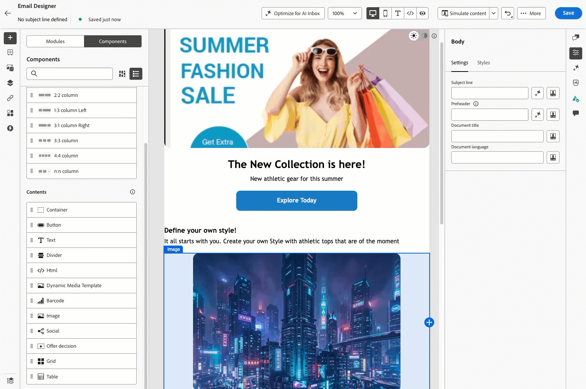

For more information, refer to the <a href="../email/content-components.md#table">detailed documentation</a>.

Availability date: September 24, 2026.

+++ Why it matters

**Why it helps:** Lay out content in rows and columns with a ready-made component instead of writing custom HTML.

**How it works:** Drag the Table component from the Components list in the left rail of the Email Designer onto your canvas. In the Settings tab, set rows and columns, Include header row, and Stripe rows; use the Styles tab for cell color, font size, text alignment, and font color.

**What you can do now:**

* Drag and drop the Table component onto your canvas.
* Adjust the number of rows and columns, or add and delete them from the contextual menu on the table.
* Style cells independently, and add a header row or alternating row colors.

+++

</td>
</tr>
</tbody>
</table>

<table>
<thead>
<tr>
<th><strong>Dark mode support for email theme variants</strong> </th>
</tr>
</thead>
<tbody>
<tr>
<td>

Email themes now support dark mode, so each color variant can render with a look tailored to recipients viewing your email in a dark mode-enabled client.

When enabled, a default dark palette is generated automatically for every variant, and you can further customize it with a different palette or your own custom colors — independently from the light mode design, so changes made in one mode do not affect the other.

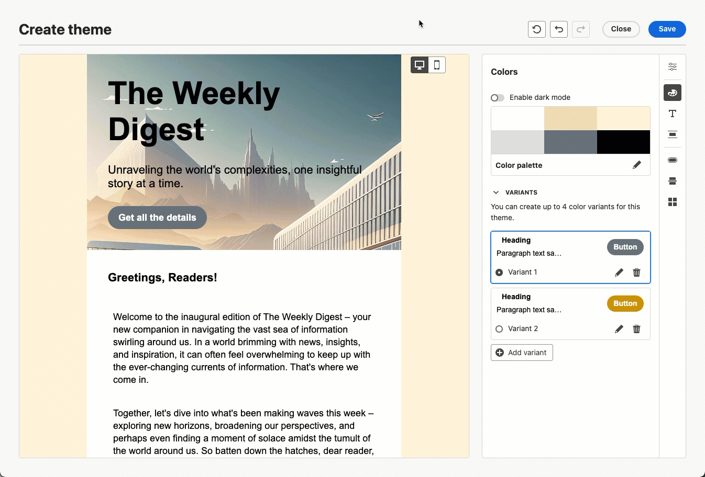

For more information, refer to the <a href="../email/apply-email-themes.md">detailed documentation</a>.

Availability date: September 24, 2026.

+++ Why it matters

**Why it helps:** Make themed emails look right for recipients who read in dark mode, with one theme covering both light and dark.

**How it works:** When you create or edit a theme, turn on Enable dark mode in the theme settings. A toggle appears at the top right of the central canvas to switch between light and dark views, and a default dark palette is generated for each color variant.

**What you can do now:**

* Enable dark mode so a default dark palette is generated for every theme variant.
* Customize a dark variant with a different color palette or your own custom colors.
* Switch between Light mode and Dark mode when you apply a theme to an email, to review the dark version.

**Good to know:** The dark mode preview is a simulation based on a CSS filter and may not match the final result, so send a proof to check rendering in email clients that support custom dark mode. Color edits in dark mode apply only to dark mode, but non-color settings such as spacing, padding, and font size are shared with light mode. To delete a color variant, you must be in light mode.

+++

</td>
</tr>
</tbody>
</table>

* [!BADGE Usability]{type=Positive} **Auto save in the Email Designer** - Your changes are now automatically saved in the Email Designer after about 10 seconds of inactivity, so you no longer risk losing your changes while designing your email. This capability is only available for a set of organizations (Limited Availability). To gain access, contact your Adobe representative.

  Availability date: September 25, 2026

  +++ Why it matters

  **Why it helps:** Avoid losing work while you design an email, since changes are saved without you clicking Save.

  **How it works:** In the Email Designer, your changes are saved automatically after about 10 seconds of inactivity. No setting is documented; access is granted by your Adobe representative.

  **What you can do now:**

  * Design an email without saving manually, relying on automatic saving after about 10 seconds of inactivity.

  **Good to know:** Only available for a set of organizations; contact your Adobe representative to gain access. You can still click Save when your content is ready.

  **Status:** Limited Availability

  +++

### Orchestrated campaigns {#sep-26-orchestrated-campaigns}

<table>
<thead>
<tr>
<th><strong>New Orchestrated Campaigns monitoring APIs</strong> </th>
</tr>
</thead>
<tbody>
<tr>
<td>

New <strong>APIs</strong> are now available for orchestrated campaigns, allowing you to programmatically retrieve orchestrated campaigns and monitor their executions, enabling deeper integration with external systems and automation pipelines.

For more information, refer to the <a href="https://developer.adobe.com/journey-optimizer-apis/references/orchestrated-campaigns" target="_blank">API reference on Adobe Developer</a>.

Availability date: September 28, 2026

+++ Why it matters

**Why it helps:** Orchestrated campaign data can be read by your own tools, so external systems and automation pipelines do not depend on the user interface to follow executions.

**How it works:** The new public APIs let you retrieve orchestrated campaigns and monitor their executions programmatically. They are described in the orchestrated campaigns API reference on Adobe Developer.

**What you can do now:**

* Retrieve orchestrated campaigns programmatically.
* Monitor orchestrated campaign executions from external systems and automation pipelines.

+++

</td>
</tr>
</tbody>
</table>

<table>
<thead>
<tr>
<th><strong>Alerting for orchestrated campaigns</strong> </th>
</tr>
</thead>
<tbody>
<tr>
<td>

Orchestrated campaigns now support <strong>automated alerting</strong> through the same alerting framework used across journeys and campaigns. Alerts are triggered when a campaign execution fails, times out, and each alert includes what happened, when, where, and a direct link to the Canvas to check further details in the logs.

For more information, refer to the <a href="../orchestrated/start-monitor-campaigns.md#alerting">detailed documentation</a>.

Availability date: September 22, 2026

+++ Why it matters

**Why it helps:** Orchestrated campaign problems reach you as notifications, so you do not have to keep checking the monitoring view to find out that something went wrong.

**How it works:** Orchestrated campaign alerts use the same alerting framework as journeys and campaigns. View and manage the available alerts from Administration > Alerts, and subscribe to them there.

**What you can do now:**

* Get notified when an orchestrated campaign execution encounters an error.
* Subscribe to orchestrated campaign lifecycle alerts such as delivery started, delivery failed, delivery completed, campaign start, stopped, publish and completed.
* Follow the link in an alert to the Canvas to check details in the logs.

**Good to know:** Only the alerts listed in the documentation are available.

+++

</td>
</tr>
</tbody>
</table>

<table>
<thead>
<tr>
<th><strong>Alert activity in orchestrated campaigns</strong> </th>
</tr>
</thead>
<tbody>
<tr>
<td>

You can now create your own alerts directly on the orchestrated campaign canvas with the new <strong>Alert</strong> activity. Configure a static, plain-text title and message to notify subscribers when execution reaches the activity. Combine it with a Test activity to trigger alerts based on conditions, such as a query returning fewer profiles than expected.

For more information, refer to the <a href="../orchestrated/activities/alert.md">detailed documentation</a>.

Availability date: September 30, 2026

+++ Why it matters

**Why it helps:** You decide which situations are worth an alert by placing the activity exactly where they occur in the flow, instead of relying only on the predefined system alerts.

**How it works:** Add the Alert activity (a Flow control activity) to the orchestrated campaign canvas and connect it to the transition where the alert should fire. Set a Label, a required Title and a required Message; subscribers then receive the notification when execution reaches the activity.

**What you can do now:**

* Notify subscribers when execution reaches a specific point of the campaign.
* Place the Alert activity on a branch of a Test activity to alert only when a condition is met, for example when a query returns fewer profiles than expected.
* Subscribe to the Orchestrated Campaign Activity Alert from the Alerts page.

**Good to know:** The activity has no trigger or condition of its own. The title and message are static plain text and dynamic tokens are not supported. The 10,000 profile threshold shown in examples is set in the Test activity. It is not a product limit.

+++

</td>
</tr>
</tbody>
</table>

* **LINE channel for orchestrated campaigns** - LINE is now available as a native outbound channel in orchestrated campaigns, alongside email, SMS, and push. You can build and deliver LINE messages directly from the campaign canvas, including text, stickers, images, videos, location data, and Flex Messages, supporting promotional, transactional, and ongoing engagement use cases in LINE-dominant markets such as Japan and APAC. Previously released in Limited Availability, this capability is now generally available. [Learn more](../orchestrated/activities/channels.md)

  Availability date: October 2, 2026

  +++ Why it matters

  **Why it helps:** Campaigns that reach customers on LINE can be built and run in the same orchestrated campaign as the other channels, rather than in a separate tool.

  **How it works:** Add a Line channel activity on the orchestrated campaign canvas, next to the Email, Mobile message, Push and Direct mail activities, and build the LINE content in it. LINE message creation is documented in the LINE section of the channel documentation.

  **What you can do now:**

  * Build and deliver LINE messages from the orchestrated campaign canvas: text, stickers, images, videos, location data and Flex Messages.
  * Combine the LINE activity with other channel activities in a cross-channel orchestrated campaign.

  **Good to know:** Channel activities count toward the limit of 10 channel activities per orchestrated campaign.

  +++

* **Campaign Orchestration monitoring** — A new user interface is now available for tracking the ingestion status and freshness of relational store data used by Orchestrated Campaign Segmentation. It gives you direct visibility into the health of the data feeding your batch audiences. A new Campaign Orchestration tab in the Adobe Experience Platform's Monitoring dashboard surfaces the health of relational store dataflows (records ingested/updated/deleted/failed/skipped), with drill-down graphs and a per-dataflow/dataset breakdown including lineage. [Learn more](../data/monitor-data-ingestion.md#co)

  Availability date: September 28, 2026

  +++ Why it matters

  **Why it helps:** When a batch audience is not what you expect, you can check whether the data behind it arrived, instead of guessing.

  **How it works:** Open the Campaign Orchestration tab in the Monitoring dashboard. It shows summary cards for the Data Lake and Campaign Orchestration stages, ingestion metrics and trends, and dataflow- and dataset-level details of the data moving into the Relational Store used by orchestrated campaigns.

  **What you can do now:**

  * Track the ingestion status and freshness of relational store data used by Orchestrated Campaign Segmentation.
  * Review records received, ingested, updated, deleted, skipped and failed per dataflow and dataset.
  * Compare the volume received with the volume processed at each stage, and open the details of a failing dataflow to find the affected source or dataset.

  **Good to know:** A difference between the Data Lake and Campaign Orchestration stages does not necessarily indicate a failure: review the updated, deleted, skipped and failed counts.

  +++

* **Conditional content with relational data in orchestrated campaigns** - When building conditional content in the Email Designer for orchestrated campaigns, you can now build conditions directly on relational data — such as related records associated with a profile — not just standard profile attributes. [Learn more](../orchestrated/activities/channels.md#add-personalization)

  Availability date: September 22, 2026

  +++ Why it matters

  **Why it helps:** One email can show different content depending on a customer's related records, such as their purchases, not only on profile fields.

  **How it works:** In the Email Designer of an orchestrated campaign channel activity, build conditional content on Target attributes from the campaign worktable. These include incoming audience or enrichment data from relational schemas.

  **What you can do now:**

  * Build conditions in the Email Designer directly on relational data, such as related records associated with a profile.
  * Show different content depending on the target record.

  **Good to know:** Conditions are specific to the current delivery and cannot be saved as reusable conditions.

  +++

* **Direct joins on collections in Orchestrated Campaigns** - When adding an attribute from a related collection, you can now choose between three join modes — a new default that warns you about potential performance impact from cartesian products, plus the existing Aggregate and Advanced modes — making it easier to understand the tradeoffs of your query before you build it. [Learn more](../orchestrated/build-query.md#links)

  Availability date: September 22, 2026

  +++ Why it matters

  **Why it helps:** You see the trade-offs of a collection condition before you build the query, which helps avoid queries that create high volumes or slow performance.

  **How it works:** In the rule builder, when you select an attribute from a collection (1-N link) such as Price in Purchases, you choose between three options. Default creates an exists such as condition on the collection, Aggregate applies an aggregate function such as Count, and Advanced uses a direct join to the collection element.

  **What you can do now:**

  * Use Default, the recommended option for most cases, to create an exists such as condition.
  * Use Aggregate when you need to count or aggregate collection records.
  * Use Advanced when you need a direct join to one collection attribute, for a single condition on the collection element.
  * Get a message about possible cartesian products and performance impact when a query can imply them.

  **Good to know:** Advanced is the existing direct join behavior and is no longer the default.

  +++

### Campaigns {#sep-26-campaigns}

The following improvement is coming to campaigns in this release.

* **Folders for Action Campaigns** - You can now organize your Action Campaigns into folders to improve navigation and management in the interface. [Learn more](../campaigns/manage-campaigns.md#folders)

  Availability date: September 30, 2026

  +++ Why it matters

  **Why it helps:** Large campaign lists become easier to navigate because related campaigns can be grouped.

  **How it works:** In the Campaigns inventory, select the Show folders icon to open the folder view. Create a folder with Create folder, rename, delete or move it from the More actions button, and move a campaign with Move to folder.

  **What you can do now:**

  * Organize Action Campaigns into folders.
  * Filter the inventory to one folder, or return to the full list with All campaigns.
  * Move a campaign into an existing or new folder from the inventory.

  **Good to know:** Folders for campaigns are available for Action and API-triggered campaigns only, not for Orchestrated campaigns.

  +++

### Decisioning {#sep-26-decisioning}

The following capabilities and improvements are coming to decisioning in this release.

<table>
<thead>
<tr>
<th><strong>Decisioning support in Web channel</strong> </th>
</tr>
</thead>
<tbody>
<tr>
<td>Decisioning is now available for the Web channel. You can use decision policies directly in the web visual editor to deliver the most relevant offers to each visitor.

For more information, refer to the <a href="../experience-decisioning/use-decision-policy.md">detailed documentation</a>.

Availability date: September 22, 2026

+++ Why it matters

**Why it helps:** Web campaigns and journeys can now pick the most relevant offer for each visitor through decision policies, in the same editor used to build the web content.

**How it works:** Open a web campaign or journey, go to the web visual editor, select the component to personalize, and click the personalization icon. In the Personalization Editor, go to Decision policies and select Insert syntax to add the decision policy code.

**What you can do now:**

* Add a decision policy to a component in the web visual editor to deliver offers to each visitor.
* Personalize web content with the attributes of the returned decision items.
* Repeat the insert sequence once per decision item you want the policy to return.

**Good to know:** The total payload size of a web channel response must not exceed 64 KB, otherwise the request results in an error, so keep decision items and attributes within that threshold.

+++

</td>
</tr>
</tbody>
</table>

<table>
<thead>
<tr>
<th><strong>Decisioning Explainer in Coworker</strong> </th>
</tr>
</thead>
<tbody>
<tr>
<td>

A new <strong>Decisioning Explainer</strong> skill in Coworker lets you ask, in natural language, why a specific offer was or wasn't shown to a profile or segment, tracing eligibility, capping, ranking, and the candidate pool involved in the decision.

For more information, refer to the <a href="../experience-decisioning/experience-decisioning-coworker-skills.md#decisioning-explainer">detailed documentation</a>.

Availability date: September 16, 2026

+++ Why it matters

**Why it helps:** Marketers can get an answer to why an offer was or was not shown without reading rules or formulas, which builds confidence when configuring offer logic.

**How it works:** Ask Coworker in chat. For a profile or a segment and a time window, it walks through which offers were eligible, which eligibility rule included or excluded each one, whether frequency or fatigue capping suppressed an offer, the final ranking scores with the strategy or AI model behind them, and the candidate pool evaluated. It is available to customers with access to Coworker and Decisioning.

**What you can do now:**

* Ask why a specific profile saw, or did not see, an offer on a given date.
* Investigate why an offer stopped showing to a group of customers over a recent period.
* Review the ranking scores and factors that made one offer rank above another.
* Find the most common reason a segment is excluded from an offer.

**Good to know:** The skill is read-only: it explains decisions but does not modify rules, ranking formulas or selection strategies. Naming the profile, offer or segment and a time window gives a more precise answer.

+++

</td>
</tr>
</tbody>
</table>

<table>
<thead>
<tr>
<th><strong>Rules &amp; Ranking in Coworker</strong> </th>
</tr>
</thead>
<tbody>
<tr>
<td>

A new <strong>Rules &amp; Ranking</strong> skill in Coworker lets you create, explain, simulate, and optimize eligibility rules and ranking formulas using natural language, without writing or validating PQL syntax by hand.

For more information, refer to the <a href="../experience-decisioning/experience-decisioning-coworker-skills.md#rules-ranking">detailed documentation</a>.

Availability date: September 16, 2026

+++ Why it matters

**Why it helps:** Marketers can create, understand and test eligibility rules and ranking formulas before they go live, without reading or writing PQL.

**How it works:** Ask Coworker in chat to turn a plain-language description into a new eligibility rule or an edit to an existing one, explain a rule or formula, simulate it against test profiles, or rewrite it more concisely. It is available to customers with access to Coworker and Decisioning.

**What you can do now:**

* Create an eligibility rule from a plain-language description.
* Ask for a plain-English explanation of an existing rule or ranking formula.
* Simulate a rule or formula against test profiles, for example to check whether a rule passes for a profile with a given attribute value.
* Shorten a rule or formula that hits PQL size limits without changing its logic.

**Good to know:** Simulation covers up to three profiles. The skill is scoped to eligibility rules, ranking formulas and offer-item frequency capping expressions and does not create or edit selection strategies or decision policies.

+++

</td>
</tr>
</tbody>
</table>

* **AEM Content Fragments in Decisioning available for Managed Services customers** - Previously, AEM Content Fragments in Decisioning were available only to customers using **Adobe Experience Manager as a Cloud Service** integration. This capability is now also available to customers using **Adobe Experience Manager Managed Services**. [Learn more](../experience-decisioning/items.md#attributes)

  Availability date: September 23, 2026

  +++ Why it matters

  **Why it helps:** Customers who run Adobe Experience Manager Managed Services can now map their Content Fragments to decision items, so they get the same fragment-driven decisioning as Cloud Service customers.

  **How it works:** When you define the attributes of a decision item, you can map Adobe Experience Manager Content Fragment fields to the item attributes. Decisioning models, formulas and ranking criteria can then optimize which fragment is served to each profile. The feature is available for channels with Decisioning support.

  **What you can do now:**

  * Map AEM Content Fragment fields to decision item attributes when you use Adobe Experience Manager Managed Services.
  * Use Journey Optimizer decisioning models, formulas and ranking criteria to optimize which fragment is served to each profile.

  **Good to know:** Attribute paths written directly inside Experience Manager fragments, such as `{{profile.person.name.firstName}}`, are not supported for fragments served through Experience Decisioning.

  +++

* **Support for Adobe Experience Platform profiles in Rule and Ranking formula simulation** - When simulating a Rule or Ranking Formula, you can now select an Adobe Experience Platform profile to automatically fill the attributes of a test-data variant, instead of entering them manually. [Learn more](../experience-decisioning/ranking/ranking-formulas.md#simulate-ranking-formula)

  Availability date: September 22, 2026

  +++ Why it matters

  **Why it helps:** Simulations run on real test-profile data instead of hand-typed values, which is faster and closer to what the decision will see.

  **How it works:** Open a rule or ranking formula, click Simulate, and add or generate a test variant. Select Edit on the variant, click Select AEP profile, choose an identity namespace, enter the identity value and click Select profile. The profile and audience attributes of the test profile fill the variant.

  **What you can do now:**

  * Fill the attributes of a test-data variant from an Experience Platform test profile instead of entering them manually.
  * Reuse recently applied profiles from the Recents list without searching again.

  **Good to know:** Only test profiles can be selected. Only the Profile and Audience attribute groups of the variant are filled; other test data such as offer items is unchanged. The Recents list keeps the 10 most recent profiles, is stored in the browser per organization and sandbox, and is not shared across browsers or devices.

  +++

### Onboarding {#sep-26-onboarding}

The following improvement is coming to onboarding in this release.

<table>
<thead>
<tr>
<th><strong>Guided capabilities for onboarding emails and journeys</strong> </th>
</tr>
</thead>
<tbody>
<tr>
<td>

Guided capabilities for onboarding emails and journeys now include the following improvements:

<ul>
<li>When you migrate an email, [!DNL Journey Optimizer] identifies the content blocks referenced by that email and surfaces them as action items, so you can migrate the content blocks alongside the email.</li>
<li>The interface has been improved to make guided onboarding more intuitive.</li></ul>

For more information, refer to the <a href="../start/onboarding-hub.md">detailed documentation</a>.

Availability date: September 23, 2026

+++ Why it matters

**Why it helps:** An email that depends on content blocks no longer arrives without them, because the blocks it uses are listed for you to migrate with it.

**How it works:** Open the migration workspace from the Journey Optimizer homepage. When you migrate an email, Journey Optimizer scans it, identifies the content blocks it references and surfaces them as fragment action items on the email, which you resolve without leaving the email migration flow.

**What you can do now:**

* Migrate the content blocks referenced by an email alongside the email.
* Resolve fragment action items on the email, such as assets or corresponding profile attributes.
* Use the improved guided onboarding interface.

**Good to know:** Migration needs the permissions Manage Campaigns, Manage Journeys, Manage Message, Manage Segments, Manage Library items, View and Manage sandboxes and Manage AJO integration configuration.

+++

</td>
</tr>
</tbody>
</table>

+++ Coming soon — **Information below is subject to change.**

<table>
<thead>
<tr>
<th><strong>Guided capabilities for onboarding emails and journeys (General Availability)</strong> </th>
</tr>
</thead>
<tbody>
<tr>
<td>

Transitioning to Adobe Journey Optimizer from another marketing platform is easier with guided capabilities that help you move existing email content and journeys into Journey Optimizer. A <strong>dedicated workspace</strong> lets you reuse what you have instead of rebuilding from scratch.

Previously released in Limited Availability, this capability is now available to all environments (General Availability).

</td>
</tr>
</tbody>
</table>

+++

### Reporting {#sep-26-reporting}

The following capability is coming to reporting in this release.

<table>
<thead>
<tr>
<th><strong>New inbound monitoring graphs in Data Management</strong> </th>
</tr>
</thead>
<tbody>
<tr>
<td>

You can now monitor inbound data health directly from <strong>Data Management &gt; Monitoring &gt; Edge</strong>, with six new graphs covering throughput, latency, and proposition events:

<ul>
<li><strong>AJO Inbound Throughput</strong> — overall inbound throughput (records per second) over time.</li>
<li><strong>AJO Inbound Throughput Breakdown</strong> — inbound throughput broken down by location.</li>
<li><strong>AJO Inbound Latency</strong> — inbound request latency (in milliseconds), broken down by distribution of values (P50, P90, and more).</li>
<li><strong>AJO Inbound Proposition Events Throughput</strong> — throughput of proposition events (tracking signals generated when a user interacts with, views, or triggers personalized offers) over time.</li>
<li><strong>AJO Inbound Proposition Events Throughput by Channel</strong> — proposition events throughput broken down by inbound channel (CBE, in-app, content cards).</li>
<li><strong>AJO Inbound Proposition Events Throughput by Event Type</strong> — proposition events throughput broken down by event type (dismissed, suppressed, displayed, triggered, interacted, sent).</li>
</ul>

For more information, refer to the <a href="../data/monitoring.md">detailed documentation</a>.

Availability date: September 24, 2026

+++ Why it matters

**Why it helps:** Inbound traffic, latency and proposition events can be checked in the product, so a change in volume or speed is visible without a separate tool.

**How it works:** Go to Data Management > Monitoring > Edge, then select AJO throughput in the drop-down menu. Six graphs are available for inbound throughput, latency and proposition events.

**What you can do now:**

* Review overall inbound throughput in records per second, and compare traffic across locations to spot an unusual increase or decrease.
* Check inbound request latency in milliseconds as a distribution (P50, P90 and more) to identify higher-latency requests.
* Follow proposition events over time, by inbound channel (CBE, in-app, content cards) and by event type (dismissed, suppressed, displayed, triggered, interacted, sent).

+++

</td>
</tr>
</tbody>
</table>

### Integrations {#sep-26-integrations}

The following capabilities are coming to integrations in this release.

<table>
<thead>
<tr>
<th><strong>Browsing integrations</strong> </th>
</tr>
</thead>
<tbody>
<tr>
<td>

A new Browsing integration configuration type is now available in Adobe Journey Optimizer. This setup lets your define a selector experience, using tables, lists, or cards, so marketers can browse, search, and select items from external APIs directly in Journey Optimizer authoring workflows.

For more information, refer to the <a href="../integrations/integrations-browsing.md">detailed documentation</a>.

Availability date: September 30, 2026

+++ Why it matters

**Why it helps:** Marketers pick an item from a list returned by an external API instead of typing its identifier, which avoids manual entry of parameter values.

**How it works:** An administrator creates a Browsing integration from the Browsing tab of the Integrations configuration: items path, search, pagination (Offset, Page or Cursor) and how items are rendered (Table, List or Avatar), then tests it with Test browsing and activates it. The Browsing integration is then linked to a parameter of a Standard integration.

**What you can do now:**

* Define a selector experience with tables, lists or cards for items from an external API.
* Let marketers search, browse and paginate items and select one from Add personalization > Integrations in the content editor.
* Insert the item Reference path value automatically in the integration parameter.

**Good to know:** A Browsing integration must be linked to a parameter on a Standard integration, and both must be published; the Browsing integration also needs to be activated.

+++

</td>
</tr>
</tbody>
</table>

### Audiences {#sep-26-audiences}

The following capability and reminder apply to audiences in this release.

<table>
<thead>
<tr>
<th><strong>Use audience enrichment attributes in Decisioning rules (Limited Availability)</strong> </th>
</tr>
</thead>
<tbody>
<tr>
<td>

You can now reference an audience's enrichment attributes as a data source in Decisioning eligibility rules. Enrichment attributes are additional, audience-specific data - such as the product or item IDs that qualified a profile for inclusion - defined through an Enrich activity in an audience composition. This lets your eligibility logic take into account exactly what triggered a customer's audience membership, without building and maintaining separate audiences for each product or item variation. Enrichment attributes were already available in journey conditions, custom actions, and message personalization; this release extends them to Decisioning.

This capability is only available for a set of organizations (Limited Availability) and supports batch audience deliveries only. To gain access, contact your Adobe representative. 

Availability date: September 23, 2026

+++ Why it matters

**Why it helps:** Eligibility can depend on exactly what put a customer in an audience, such as the product or item that qualified them, without one audience per product or item variation.

**How it works:** Enrichment attributes are defined through an Enrich activity in an audience composition. In the Decisioning rule builder, open the Fields panel, the Attributes tab, then the Browse enrichment schemas section, where each audience is listed as Schema for audienceId followed by the audience ID.

**What you can do now:**

* Reference an audience's enrichment attributes as a data source in Decisioning eligibility rules.
* Take into account the product or item IDs that qualified a profile for inclusion in an audience.

**Good to know:** Available only for a set of organizations and supports batch audience deliveries only; contact your Adobe representative for access. Enrichment attributes must first be added to a Field Group in the ExperiencePlatform data source. They are not available in ranking formulas.

**Status:** Limited Availability

+++

</td>
</tr>
</tbody>
</table>

<!--For more information, refer to the <a href="../audience/enrichment-attributes.md#enrichment">detailed documentation</a>.-->

* **Upcoming change to Audience Composition enrichment audiences** - During the October release (end of October), Journey Optimizer will stop journeys and campaigns that use or reference an Audience Composition audience whose source dataset does not have a **primary identity descriptor**. From that point forward, only Audience Composition audiences built with a primary identity descriptor are supported in journeys and campaigns. If you need these journeys or campaigns to remain active, contact your Adobe representative — our product team can help you migrate. <!-- Documentation link: TBD -->

### Administration {#sep-26-administration}

The following reminder applies to administration in this release.

* **Dataset Time-to-live (TTL) guardrail — existing sandboxes** - The time-to-live (TTL) guardrail for Journey Optimizer system-generated datasets (90 days in the profile store, 13 months in the data lake) will be enforced on existing customer sandboxes and organizations starting October 1, 2026. 
