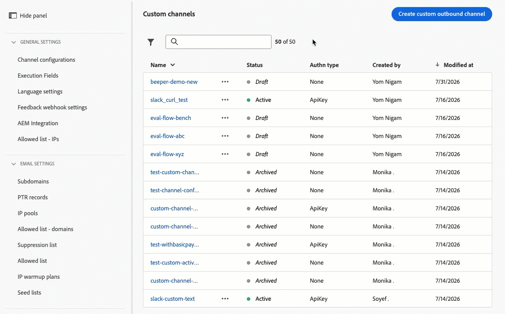
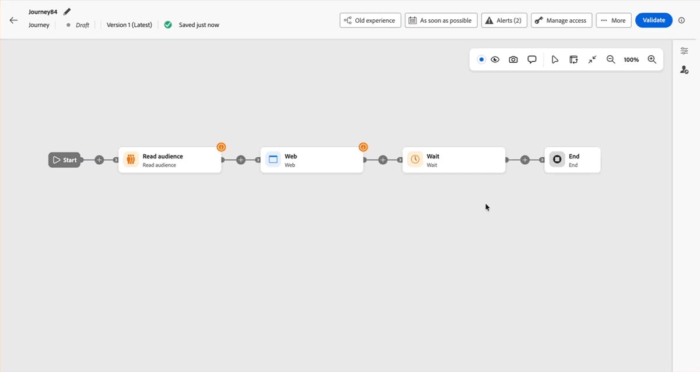
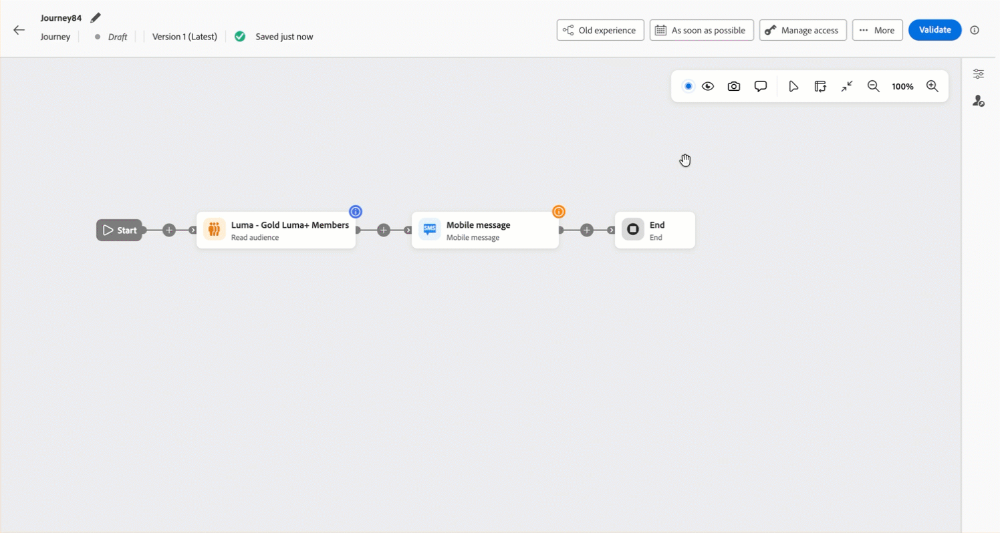
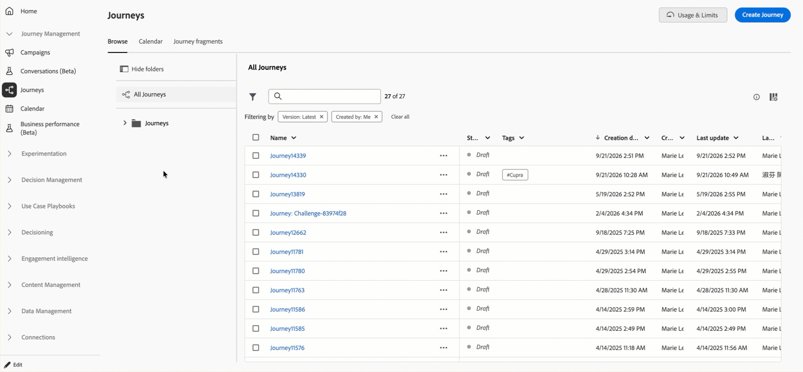

# Release notes {#release-notes}

>[!CONTEXTUALHELP]
>id="ajo_homepage_card1"
>title="What's new?"
>abstract="**Adobe Journey Optimizer** continuously delivers new capabilities, enhancements to existing capabilities, and bug fixes. All changes are consolidated on the last week of each month in these release notes."
 
[!DNL Adobe Journey Optimizer] follows a continuous delivery model, allowing Adobe to deliver new capabilities, enhancements, and fixes on an ongoing basis. This approach enables a scalable, phased rollout of capabilities to ensure performance and stability across all environments. Because of this model, release notes are updated between monthly releases. For full details about the release cycle and availability phases, see [Journey Optimizer release cycle](releases.md).

[!DNL Adobe Journey Optimizer] is built natively on [!DNL Adobe Experience Platform] and inherits from its latest innovations and improvements. Learn more about these changes in [Adobe Experience Platform Release Notes](https://experienceleague.adobe.com/docs/experience-platform/release-notes/latest.html){target="_blank"}.

>[!NOTE]
>
>Capabilities listed in these release notes include an **Availability date** indicating when each change becomes accessible in your environment. Entries in the **Coming soon** accordions are expected in the upcoming days or weeks. Information in these sections is subject to change. 

>[!BEGINSHADEBOX]

**Usability improvements**

Each month, [!DNL Adobe Journey Optimizer] delivers usability improvements to make everyday work easier. Look for the [!BADGE Usability]{type=Positive} badge within each product area to spot these improvements at a glance.

>[!ENDSHADEBOX]

## October '26  release notes {#oct-26-release-notes}

>[!BEGINSHADEBOX]

+++**New in Coworker this month**

This release brings several new and improved [Coworker](../start/ai-features.md#cx-coworker) features and skills, listed here for visibility. Each one is also detailed in its relevant section below.

* [Channel Builder skill](#oct-26-channels) - Create, test, and manage custom channels by chatting with Coworker, with guided channel configuration, authentication, throttling, and payload definition.
* [Business Performance Analysis skill](#oct-26-journeys) - Analyze journey performance and get concrete optimization recommendations in Coworker chat.
* [Journey Hygiene Analysis skill](#oct-26-journeys) - Scan journeys for configuration hygiene issues and get suggested fixes in chat.
* [Trace Journey Profile skill](#oct-26-journeys) - Get read-only, profile-level execution data for a published journey, from node and branch counts to a single profile's path.
* [Journey Execution Timeline skill](#oct-26-journeys) - Get the end-to-end timeline of a Read Audience journey batch in Coworker chat, from audience export to delivery.
* [Decisioning rule generation skill](#oct-26-decisioning) - Generate, simulate, and optimize eligibility rules and ranking formulas in natural language, without writing PQL by hand.

+++

>[!ENDSHADEBOX]

### Channels {#oct-26-channels}

<table>
<thead>
<tr>
<th><strong>Override email channel configuration settings</strong> </th>
</tr>
</thead>
<tbody>
<tr>
<td>

Email header fields and delivery settings can now be overridden at the journey or campaign action level, without requiring a separate channel configuration. From name, From email prefix, Reply-To, recipient address, and list-unsubscribe values can each be set using profile attributes or contextual data.

This change allows each individual journey or campaign to carry its own sender identity, useful when the same channel configuration serves multiple programs, regions, or teams that each need a distinct From address or reply routing.

For more information, refer to the <a href="../email/create-email.md#override-email-channel-configuration">detailed documentation</a>.

Availability date: October 28, 2026

</td>
</tr>
</tbody>
</table>

<table>
<thead>
<tr>
<th><strong>Self-serve setup for High throughput email</strong> </th>
</tr>
</thead>
<tbody>
<tr>
<td>

If you have purchased the High throughput transactional messaging add-on, you can now set up High throughput for API-triggered email campaigns yourself in the product UI. Create a dedicated High throughput IP pool, then create a High throughput email channel configuration that uses it, without requesting a manual setup for each resource. 

For more information, refer to the <a href="../campaigns/api-triggered-high-throughput.md">detailed documentation</a>.

Availability date: October 28, 2026

</td>
</tr>
</tbody>
</table>

<table>
<thead>
<tr>
<th><strong>Custom outbound channel (General Availability)</strong> </th>
</tr>
</thead>
<tbody>
<tr>
<td>

<strong>Custom outbound channels</strong> let administrators bring any outbound HTTP-based messaging channel — such as WeChat, Kakao Talk, Messenger, or a proprietary provider — directly into Journey Optimizer through a no-code Channel Builder. Once configured, custom channels are available across campaigns, journeys, and orchestrated campaigns, with the same full set of capabilities as native channels: personalization with the expression editor, content experimentation, preview and proof, out-of-the-box reporting, and consent and governance enforcement.

With this release, custom outbound channels also gain several new capabilities:

<ul>
<li>Use Journey Optimizer Decisioning in the custom channel payload through the Personalization Editor, the same way as in code-based experiences.</li>
<li>Apply business rules to custom channels, the same way you already can on native channels.</li>
<li>Select custom channels in the channel list for API-triggered campaigns, which was not previously possible.</li>
<!--<li>Define a reporting webhook for a custom channel and attach it to a channel configuration, so you can enrich your Journey Optimizer reports with interaction events.</li>-->
</ul>

Previously available in Limited Availability, this capability is now available to all environments (General Availability), with the enhancements described above.

For more information, refer to the <a href="../custom-channel/get-started-custom-channel.md">detailed documentation</a>.

Availability date: October 2, 2026

</td>
</tr>
</tbody>
</table>

* **Channel Builder skill in Coworker to create a new custom channel** - This skill helps administrators create custom channels faster by guiding users through the required setup steps, such as channel configuration, authentication, throttling, and payload definition, making it easier to launch new messaging integrations with less manual effort. <!-- Documentation link: TBD -->

  Availability date: October 2, 2026

* **Suppression list override at Email action level** - Journey Optimizer now includes a per-action toggle that allows delivery to locally-suppressed addresses for a specific email action in a journey or campaign. This is designed for compliance scenarios where a communication must be demonstrably attempted, such as a required notification to an address that has previously bounced. This capability is available in Limited Availability for a set of customers. Contact your Adobe representative to request access.

  Availability date: October 28, 2026

+++ Coming soon — **Information below is subject to change.**

<table>
<thead>
<tr>
<th><strong>Honor tracking consent without blocking email delivery</strong> </th>
</tr>
</thead>
<tbody>
<tr>
<td>

To support compliance with open-tracking consent requirements such as the CNIL guidance in France, you can now honor a recipient's tracking consent without excluding them from an otherwise eligible email send. Tracking consent is stored in the Adobe Experience Platform profile and evaluated for each recipient at send time. A new <strong>Disable open tracking</strong> option in the email settings removes the Journey Optimizer open-tracking pixel for recipients who have not consented. Email delivery, content, and unsubscribe links are unaffected.

<!-- Documentation link: TBD -->
</td>
</tr>
</tbody>
</table>

* **Reporting webhooks available for custom channels** - You can now define a reporting webhook for a custom outbound channel and attach it to a channel configuration. Use it to enrich your Journey Optimizer reports with interaction events. <!-- Documentation link: TBD -->

+++ 

### Journeys {#oct-26-journeys}

<table>
<thead>
<tr>
<th><strong>Stop action journey activity</strong> </th>
</tr>
</thead>
<tbody>
<tr>
<td>

A new "Stop action" activity in the journey canvas now allows you to remove a profile from up to five inbound activities or experiences directly from a journey. This decouples inbound disqualification from journey exit.

For more information, refer to the <a href="../building-journeys/stop-action.md">detailed documentation</a>.

Availability date: October 12, 2026

</td>
</tr>
</tbody>
</table>

<table>
<thead>
<tr>
<th><strong>On-demand journey validation</strong> </th>
</tr>
</thead>
<tbody>
<tr>
<td>

A new <strong>Validate</strong> button lets you run configuration checks, including message checks, when you're ready to test or publish, reducing repeated checks during editing and helping keep larger journey canvases responsive.

For more information, refer to the <a href="../building-journeys/publish-journey.md#validate">detailed documentation</a>.

Availability date: October 9, 2026

</td>
</tr>
</tbody>
</table>

* **HMAC-signed JWT authentication for custom actions (Limited Availability)** - Certificate-based custom authentication now supports JWT client assertions signed with your OAuth client secret (`HS256`, `HS384`, `HS512`; `client_secret_jwt`), as an alternative to Adobe's RSA certificate. Configurations without `alg` continue to use `RS256`.

  This capability is available in Limited Availability for a set of customers. Contact your Adobe representative to request access. Learn more in [Custom actions](../action/about-custom-action-configuration.md#certificate-based-auth) and [External data sources](../datasource/external-data-sources.md#hmac-credential).

  Availability date: October 13, 2026

* **Business Performance Analysis skill** - Analyze journey performance and get concrete optimization recommendations in Adobe CX Enterprise Coworker chat. [Learn more](../building-journeys/journeys-coworker-skills.md#journey-analyze)

  Availability date: October 7, 2026
  
* **Journey Hygiene Analysis skill** - Coworker scans journeys for configuration hygiene issues and suggests fixes in chat. The first release has 7 checks: missing or generic names, stale draft journeys, stale live journeys, oversized journeys, long-existing closed journeys, and similar action or event names. [Learn more](../building-journeys/journeys-coworker-skills.md#journey-analyze)

  Availability date: October 20, 2026

* **Trace Journey Profile skill** - CX Coworker can now return read-only, profile-level execution data for a published journey. Check how many profiles entered each node and how they split across branches, find which profiles errored and why, or follow a single profile's node-by-node path through the journey. [Learn more](../building-journeys/journeys-coworker-skills.md#trace-journey-profile)

  Availability date: October 22, 2026

* **Journey Execution Timeline skill** - Coworker can now return the end-to-end timeline of a Read Audience (batch or scheduled export) journey batch. See how long a batch took, when the audience export, the journey execution, and the delivery started and ended, and the profile-level P95 and P99 for entry, exit, or execution time. [Learn more](../building-journeys/journeys-coworker-skills.md#journey-execution-timeline)

  Availability date: October 26, 2026

+++ Coming soon — **Information below is subject to change.**

<table>
<thead>
<tr>
<th><strong>New journey alerts (Limited Availability)</strong> </th>
</tr>
</thead>
<tbody>
<tr>
<td>

Five new alerts help you monitor journey message bounce and delivery error rates, receive notifications when journey <strong>Read Audience</strong> exports start and complete, and detect journey event delays due to queueing when the event throughput guardrail has been exceeded. Threshold-based alerts support configurable thresholds, and <strong>Read Audience</strong> export notifications support journey-level subscriptions.

This capability is available in Limited Availability for a set of customers. Contact your Adobe representative to request access.

<!--

For more information, refer to the <a href="../reports/alerts.md#available-alerts">detailed documentation</a>.

Availability date: October 29, 2026

-->
</td>
</tr>
</tbody>
</table>

<table>
<thead>
<tr>
<th><strong>AI recommendation cards for journey alerts</strong> </th>
</tr>
</thead>
<tbody>
<tr>
<td>

The Journey Optimizer home page now surfaces an <strong>AI recommendation card</strong> when a journey alert fires, covering <strong>Journey Custom Action failure</strong> and <strong>Journey Anomaly Detected</strong> alerts. Selecting the card opens the journey with the right rail pre-populated with the analysis already performed.

<!-- GIF placeholder: to be added -->
<!-- Documentation link: TBD -->
</td>
</tr>
</tbody>
</table>

<table>
<thead>
<tr>
<th><strong>Journey creation from Coworker rail</strong> </th>
</tr>
</thead>
<tbody>
<tr>
<td>

<strong>Journey creation with AI</strong> is now available directly from the Coworker right rail, replacing the previous AI Assistant experience with a re-branded, integrated entry point for generating journeys.

</td>
</tr>
</tbody>
</table>

* **Reduced step events for wait and event activities** - Step events are no longer generated for **wait** activities and **event** activities when the profile was not actually processed at that activity.

* [!BADGE Usability]{type=Positive} **Unified calendar for Campaigns, Journeys, and Orchestrated campaigns** - The calendar view for journeys and campaigns now moves out of separate inventories into a unified menu accessible from the left rail that shows all three in one combined view.

+++

### Orchestrated campaigns {#oct-26-orchestrated-campaigns}

The following improvements are coming to orchestrated campaigns in this release.

+++ Coming soon — **Information below is subject to change.**

* **Increased message activity limit for orchestrated campaigns** - Orchestrated campaigns now support up to 25 message actions on a single canvas, up from the previous limit of 10. This allows complex cross-channel orchestrations, spanning email, push, SMS, and other channels, to be built and managed as a single campaign rather than split across multiple smaller ones.

  For enterprise teams running sophisticated multi-step programs, this reduces operational overhead and simplifies publication and rollback handling when managing large campaign launches. <!-- Documentation link: TBD -->

* **Orchestrated campaigns skills in Coworker** - You can now find and inspect orchestrated campaigns conversationally from the Coworker chat interface. This release covers four read-only capabilities: listing and filtering campaigns by status, channel, tags, or name; pulling a specific campaign's details including its channel configuration and activity structure; visualizing a campaign's canvas as a graph of its activities and connections; and retrieving execution logs to surface errors for troubleshooting. This provides teams with live visibility into campaign data without requiring API access or navigation through the Journey Optimizer user interface. Creating, editing, or publishing campaigns via Coworker is not yet supported.

+++

### Decisioning {#oct-26-decisioning}

* **Decisioning rule generation skill in Coworker** - Use natural language in Coworker to generate, simulate, and optimize eligibility rules and ranking formulas for Adobe Journey Optimizer Decisioning. Marketers can create, validate, and test decisioning logic faster, enabling smarter personalization and more time spent optimizing outcomes without requiring PQL syntax expertise. [Learn more](../experience-decisioning/experience-decisioning-coworker-skills.md#rules-ranking)

  Availability date: October 22, 2026

+++ Coming soon — **Information below is subject to change.**

* **Decisioning item creation skill in Coworker** - Use natural language in Coworker to create offers (decision items) with AI assistance, so marketers can build and populate items faster without manually filling in each field. <!-- Documentation link: TBD -->

* **Decisioning audit skill in Coworker** - Ask Coworker questions about your Decisioning objects in natural language. Check your inventory (for example, how many offers you have), explore how objects relate to each other, and run audit queries such as who last edited a given offer. <!-- Documentation link: TBD -->

* **Decisioning migration assistance in Coworker** - Get AI-enabled assistance in Coworker when migrating from Offer Decisioning to Adobe Journey Optimizer Decisioning. <!-- Documentation link: TBD -->

+++

### Loyalty {#oct-26-loyalty}

* **Performance settings in Loyalty configurations** - Use the **Performance settings** tab to select your loyalty profile and event datasets and configure your organization's priority **Key performance indicator** for loyalty insights. Choose Revenue, Engagement, Redemptions, or Conversions to determine which insights receive emphasis in your feed. [Learn more](../loyalty-challenges/loyalty-admin.md#performance-settings)

  Availability date: October 1, 2026

* **Streak challenge configuration update** - The non-consecutive option has been removed when creating Streak challenges. Streak challenges now use the **Task completion requirements** drop-down to require either one task or all tasks together to be completed on consecutive days. [Learn more](../loyalty-challenges/create-challenges.md)

  Availability date: October 1, 2026

* **Autosave for challenge drafts** - Challenge edits in Loyalty are now saved automatically as you work, so you can publish a challenge or generate a journey without saving first. [Learn more](../loyalty-challenges/create-challenges.md)

  Availability date: October 1, 2026

### Integrations {#oct-26-integrations}

+++ Coming soon — **Information below is subject to change.**

* **Dynamic token substitution for Experience Manager fragments** - Experience Manager Content Fragment references now support a **tokenSubstitution** attribute. When set to `false`, personalization inside the fragment's fields resolves directly, without a token map in the reference. It defaults to `true`, which keeps the existing behavior.

  This capability is only available for a set of organizations (Limited Availability). To gain access, contact your Adobe representative. 

* **AEM Managed Services content fragments support in Decisioning** - AEM Managed Services content fragments are now supported in Decisioning when managing decision items.

+++

### Landing pages {#oct-26-landing-pages}

+++ Coming soon — **Information below is subject to change.**

<table>
<thead>
<tr>
<th><strong>Anonymous landing pages (Limited Availability)</strong> </th>
</tr>
</thead>
<tbody>
<tr>
<td>

Journey Optimizer now allows you to create public landing pages accessible to anyone, and from there capture data from anonymous visitors into Experience Platform non-profile enabled datasets. You can share the landing page URL anywhere, such as in emails, SMS messages or on your website.

To reuse your existing Journey Optimizer branded subdomains for public landing pages, you need to migrate them to Cloudflare.

This capability is available in Limited Availability. Contact your Adobe representative to request access.

<!-- GIF placeholder: TBD -->
<!-- Documentation link: TBD -->
</td>
</tr>
</tbody>
</table>

+++

### Administration {#oct-26-administration}

+++ Coming soon — **Information below is subject to change.**

<table>
<thead>
<tr>
<th><strong>Custom metadata for campaigns and journeys (Limited Availability)</strong> </th>
</tr>
</thead>
<tbody>
<tr>
<td>

Define your own business fields, such as line of business, product or cost center, in the schemas provided for Action campaigns, journeys and Orchestrated campaigns. Select up to 10 fields per entity type, then fill them in from the <strong>Metadata fields</strong> section of the properties of each journey or campaign. The values are recorded in dedicated datasets that you can use for reporting, exports and audience creation.

This capability is available in Limited Availability for a set of customers. Contact your Adobe representative to request access.

<!--

For more information, refer to the <a href="../administration/custom-metadata.md">detailed documentation</a>.

Availability date: October 29, 2026

-->
</td>
</tr>
</tbody>
</table>

+++
