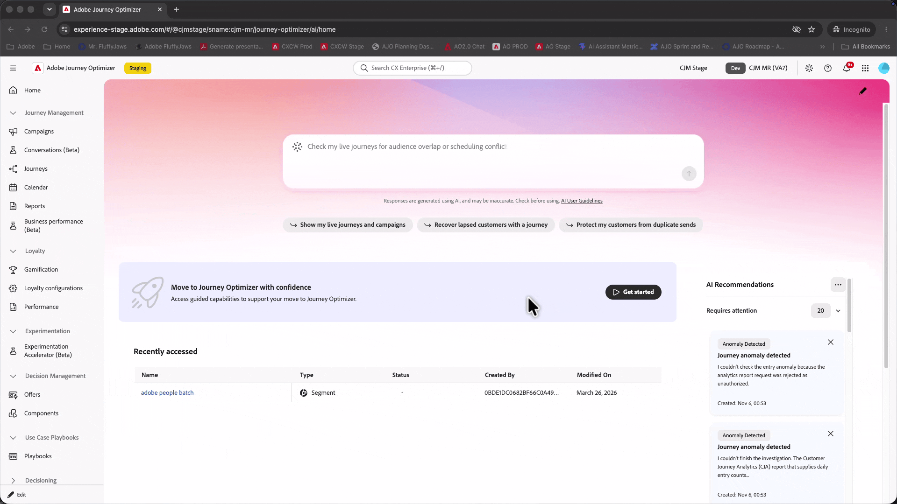
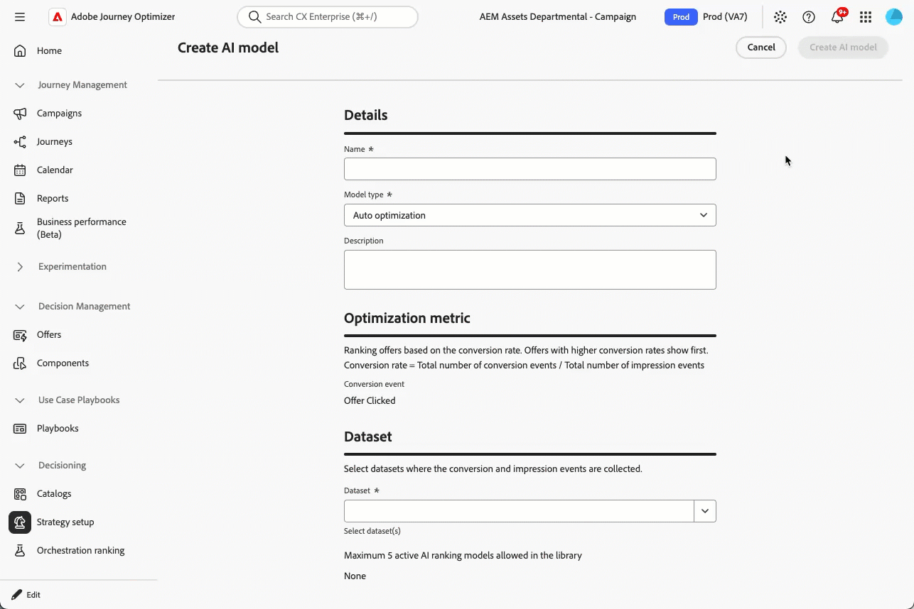

# Release notes {#release-notes}

>[!CONTEXTUALHELP]
>id="ajo_homepage_card1"
>title="What's new?"
>abstract="**Adobe Journey Optimizer** continuously delivers new capabilities, enhancements to existing capabilities, and bug fixes. All changes are consolidated on the last week of each month in these release notes."
 
[!DNL Adobe Journey Optimizer] follows a continuous delivery model, allowing Adobe to deliver new capabilities, enhancements, and fixes on an ongoing basis. This approach enables a scalable, phased rollout of capabilities to ensure performance and stability across all environments. Because of this model, release notes are updated between monthly releases. For full details about the release cycle and availability phases, see [Journey Optimizer release cycle](releases.md).

[!DNL Adobe Journey Optimizer] is built natively on [!DNL Adobe Experience Platform] and inherits from its latest innovations and improvements. Learn more about these changes in [Adobe Experience Platform Release Notes](https://experienceleague.adobe.com/docs/experience-platform/release-notes/latest.html){target="_blank"}.

>[!NOTE]
>
>Capabilities listed in these release notes include an **Availability date** indicating when each change becomes accessible in your environment. <!-- Entries in the **Coming soon** accordions are expected in the upcoming days or weeks. Information in these sections is subject to change. -->

>[!BEGINSHADEBOX]

**Usability improvements**

Each month, [!DNL Adobe Journey Optimizer] delivers usability improvements to make everyday work easier. Look for the [!BADGE Usability]{type=Positive} badge within each product area to spot these improvements at a glance.

>[!ENDSHADEBOX]

## November '26 release notes {#nov-26-release-notes}

### Journeys {#nov-26-journeys}

<table>
<thead>
<tr>
<th><strong>AI recommendation cards for journey alerts</strong> </th>
</tr>
</thead>
<tbody>
<tr>
<td>

Spend less time investigating journey issues and get a head start on resolving them. When a <strong>Journey Custom Action failure</strong> or <strong>Journey Anomaly Detected</strong> alert fires, an <strong>AI Recommendations</strong> card on the Journey Optimizer home page highlights the issue. Select the card to review analysis and recommended next steps already prepared in Coworker, without having to request an investigation first. Continue the conversation to explore the findings and decide how to address the issue.

This capability is only available for a set of organizations (Limited Availability). To gain access, contact your Adobe representative.

For more information, refer to the <a href="../start/user-interface.md#cx-enterprise-coworker">detailed documentation</a>.

Availability date: November 16, 2026

</td>
</tr>
</tbody>
</table>

### Campaigns {#nov-26-orchestrated-campaigns}

<table>
<thead>
<tr>
<th><strong>Orchestrated campaigns skills in Coworker</strong> </th>
</tr>
</thead>
<tbody>
<tr>
<td>

You can now find and inspect orchestrated campaigns conversationally from the Coworker chat interface. This release covers three read-only skills:

<ul>
<li>
<strong>Orchestrated Campaign List</strong>: list, filter, and count campaigns, for example by status or channel.
</li>
<li>
<strong>Orchestrated Campaign Get</strong>: retrieve a specific campaign's details, lifecycle history, and execution history, and visualize its activity graph.
</li>
<li>
<strong>Orchestrated Campaign Workflow Renderer</strong>: render a workflow graph as a visual diagram.
</li>
</ul>

This provides teams with live visibility into campaign data without requiring API access or navigation through the Journey Optimizer user interface. Creating, editing, or publishing campaigns via Coworker is not yet supported.

For more information, refer to the <a href="../orchestrated/orchestrated-campaigns-coworker-skills.md">detailed documentation</a>.

Availability date: November 3, 2026

</td>
</tr>
</tbody>
</table>

* **Retarget recipients using execution metadata** - In orchestrated campaigns, you can now retarget recipients based on the execution metadata of a previous message. New map functions are also available to retrieve metadata values in your expressions. [Learn more](../orchestrated/retarget.md#feedback-metadata)

  This capability is only available for a set of organizations (Limited Availability). To gain access, contact your Adobe representative.

  Availability date: November 24, 2026

+++ Coming soon — **Information below is subject to change.**

* **Increased message activity limit** - Orchestrated campaigns now support up to **25 message actions** on a single canvas, up from the previous limit of 10. This allows complex cross-channel orchestrations, spanning email, push, SMS, and other channels, to be built and managed as a single campaign rather than split across multiple smaller ones.

  For enterprise teams running sophisticated multi-step programs, this reduces operational overhead and simplifies publication and rollback handling when managing large campaign launches.

+++

### Onboarding {#nov-26-onboarding}

* **Migrate transactional email campaigns to Journey Optimizer** - The migration workspace now supports **Campaigns**. You can bring the transactional emails you built in your existing marketing platform into [!DNL Journey Optimizer] and convert them into API-triggered campaigns. [Learn more](../start/migrate-content-and-journeys.md#import-campaign-content)

  Note that the migrating capability is only available for a set of organizations (Limited Availability). To gain access, contact your Adobe representative. 

  Availability date: November 17, 2026

### Decisioning {#nov-26-decisioning}

<table>
<thead>
<tr>
<th><strong>Profile and context features for Personalized optimization models (Limited Availability)</strong> </th>
</tr>
</thead>
<tbody>
<tr>
<td>

You can now enrich Personalized optimization AI models with profile and context features, in addition to or instead of audiences. When creating an AI model, select up to 50 profile attributes from your profile schema, such as loyalty tier or churn propensity score, and up to 20 context attributes sent with the decision request, such as device type, language or page URL. Models use these signals to score decision items in real time and deliver more relevant offers. Context features are only available for decisioning policies used in inbound channels.

This capability is only available for a set of organizations (Limited Availability). To gain access, contact your Adobe representative.

For more information, refer to the <a href="../experience-decisioning/ranking/create-ai-models.md#create-ranking-strategy">detailed documentation</a>.

Availability date: November 3, 2026

</td>
</tr>
</tbody>
</table>

* **Decisioning item creation skill in Coworker** - You can now create decision items faster by describing what you need to Adobe CX Enterprise Coworker, which builds the item with you in chat. [Learn more](../experience-decisioning/experience-decisioning-coworker-skills.md#decisioning-offer-item-workflow)

  
Availability date: November 2, 2026

### Integrations {#nov-26-integrations}

* **Dynamic token substitution for Experience Manager fragments** - Use attribute paths such as `{{profile.person.name.firstName}}` directly in Experience Manager Content Fragments, with no token map needed. This works only for fragments added directly to a message, not for fragments served through Experience Decisioning. [Learn more](../integrations/aem-fragments.md#aem-attribute-paths)

  This capability is only available for a set of organizations (Limited Availability). To gain access, contact your Adobe representative. 

  Availability date: November 5, 2026

