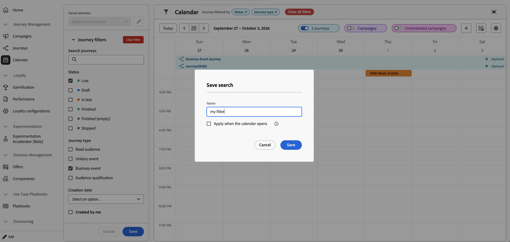
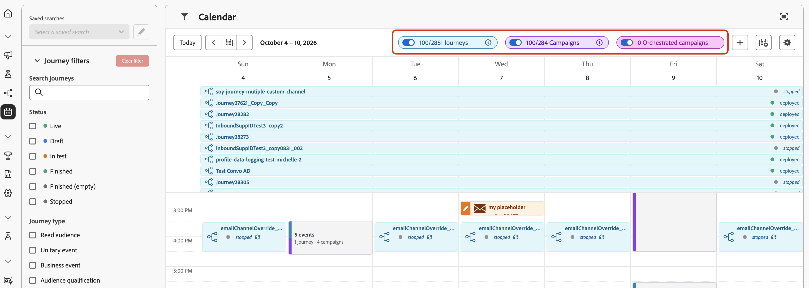
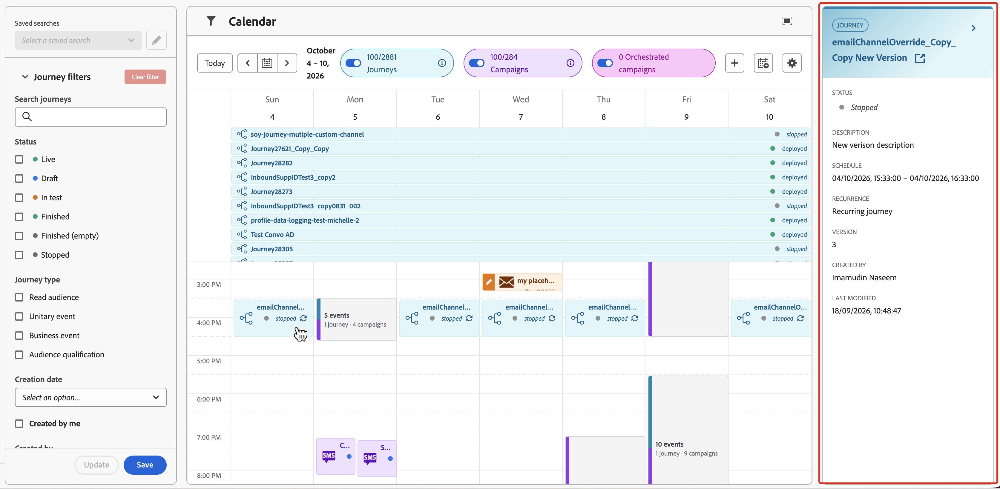
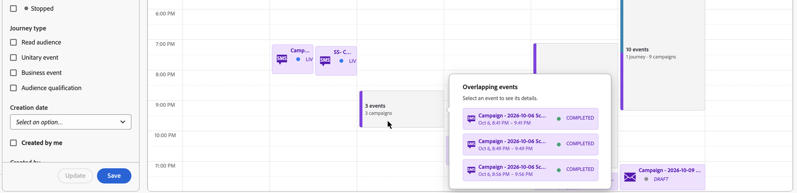
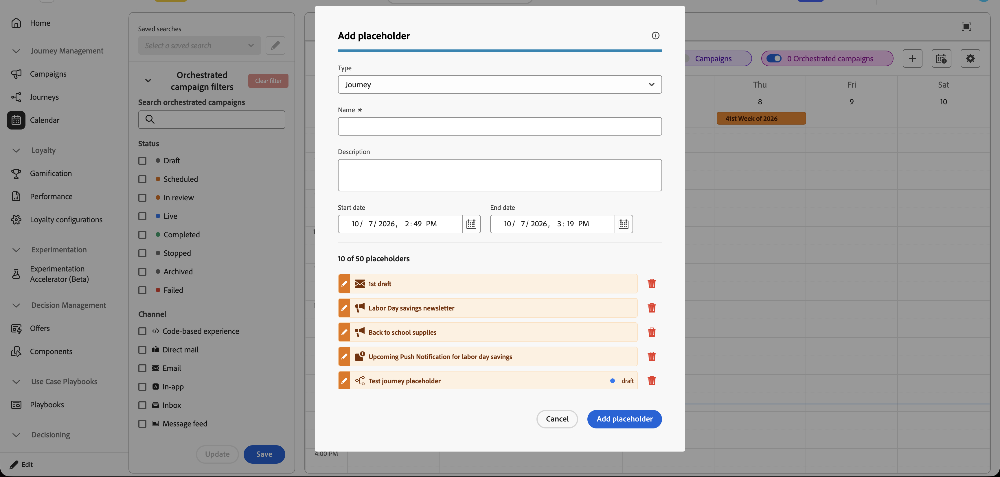
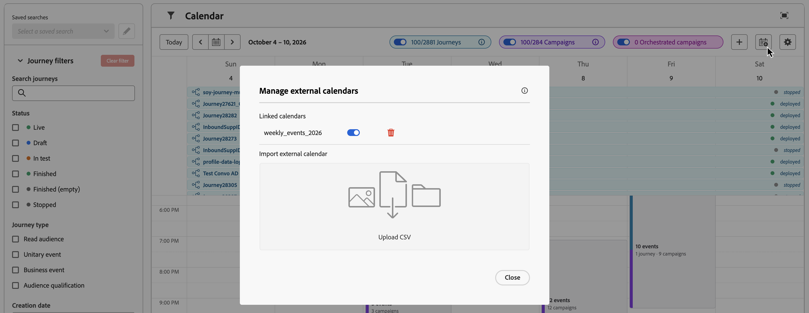
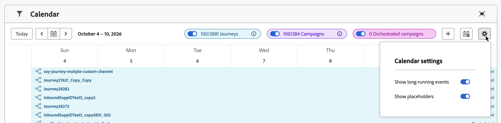

# Use the Calendar {#calendar}

>[!BEGINSHADEBOX]
>
>**On this page:** Learn how to use the unified Calendar to view schedules and manage calendar items across journeys and campaigns.
>
>[!ENDSHADEBOX]

The **[!UICONTROL Calendar]** menu provides one view for scheduled activity across [!DNL Adobe Journey Optimizer]. It brings journeys and campaigns into the same calendar workspace.

>[!AVAILABILITY]
>
>The unified Calendar is available in Limited Availability for a set of organizations. To gain access, contact your Adobe representative.

## Navigate the Calendar

From the left navigation, open **[!UICONTROL Journey Management]** > **[!UICONTROL Calendar]**.

* **Filter calendar items**: Use the filters in the left panel to narrow the items shown in the calendar. A summary of the applied filters appears at the top of the window.

    To save filters you use frequently, select **[!UICONTROL Save]** at the bottom of the filters panel and name your search. You can save up to 10 searches and select them from the **[!UICONTROL Saved searches]** dropdown at the top of the panel.

    

* **Show or hide journeys and campaigns**: Use the **[!UICONTROL Journeys]** and **[!UICONTROL Campaigns]** toggles to show or hide each type of item. The counters show the number of items currently displayed and the total available items. Orchestrated campaigns appear only if they are available to you.

    

* **Move between dates**: Use **[!UICONTROL Today]**, the previous and next date buttons, or the date picker to move through the calendar. The calendar displays a week at a time.

* **Expand the Calendar**: Select the **[!UICONTROL Open in full screen]** icon in the upper-right corner to expand the calendar workspace.

## View and manage calendar items

Calendar items appear as scheduled blocks in the weekly grid. Select an item to open its details in the right rail. Depending on the item type and your permissions, the rail can include its status, description, schedule, audience, channels, version, and available actions to open the item and edit it.

Campaign details include the channel breakdown, channel configuration, audience used, and tags. You can view orchestrated campaign details only if orchestrated campaigns are available to you.



When multiple items overlap, select the overlapping block to display a scrolling detail list of events. Select an event in the list to view its details.



### How campaigns display {#campaign-representation}

* By default, the calendar grid shows all live and scheduled campaigns for the selected week. Use additional filters to show completed, stopped, and finished activations, or activations of a specific type or channel.
* Draft campaigns are not displayed. Draft placeholders that you add directly to the Calendar can still appear.
* Campaigns spanning multiple days appear at the top of the calendar grid.
* If no start time is specified, the closest manual activation time is used to position the campaign in the calendar.
* Campaigns are displayed as 1-hour timespans. These timespans do not reflect actual send or completion times.

### How journeys display {#journey-representation}

* By default, the calendar grid shows all live and scheduled journeys for the selected week. Use additional filters to show completed, stopped, and finished activations.
* Draft journeys and journeys in test mode are not displayed.
* Journeys spanning multiple days appear at the top of the calendar grid.
* If no start time is specified, the closest manual activation time is used to position the journey in the calendar.
* Journeys are displayed as 1-hour timespans. These timespans do not reflect actual send or completion times.

## Add placeholders

You can add your own placeholders directly from the Calendar while planning work. Placeholders are shared with everyone in your organization, and you can add up to 50 placeholders.

To add a placeholder, follow these steps:

1. Select the **[!UICONTROL +]** icon.

1. In the **[!UICONTROL Add placeholder]** dialog, select a type, enter a name, and optionally add a description.

    

1. Set the start and end dates and times, then select **[!UICONTROL Add placeholder]**.

Placeholders appear in the calendar with a draft status and use the same color as external calendar events.

To manage existing placeholders, open the **[!UICONTROL Add placeholder]** dialog. In the placeholder list, select the pencil icon next to a placeholder to edit it, or the trash icon to remove it.

## Add external calendars

You can link up to three external calendars by importing CSV files. Imported calendar events are shared with everyone in your organization.

The CSV file must contain event title, start date, and end date columns. For example:

```text
title,start,end
Holiday,1/1/2025,1/1/2025
Christmas,12/25/2025,12/25/2025
```

To add an external calendar, follow these steps:

1. Select the **[!UICONTROL Manage external calendars]** icon.

    

1. Select **[!UICONTROL Upload CSV]** and choose your file.

## Configure Calendar settings

Select the **[!UICONTROL Calendar settings]** icon to configure the display of:

* Long-running events
* Draft events

These settings control what appears in your Calendar view and do not change the underlying journey or campaign configuration.


